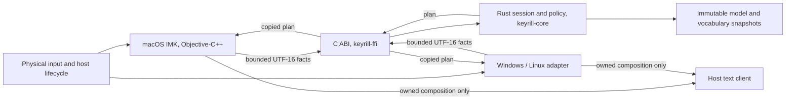

# Architecture

Keyrill is a portable Rust engine behind a narrow C ABI, with one native adapter per platform.
The adapter owns everything native: focus, permissions, objects, API calls, event disposition
and verification of what the host document actually contains. Rust owns conversion,
segmentation, lexical protection, scoring, abstention, bounded language context, manual intent
and reversal data. A Rust plan is a proposal, never editing authority.

| Path | Contents |
|---|---|
| `crates/keyrill-core` | Mapping, model loader, inference, Vim vocabulary, word session; std only, `forbid(unsafe_code)` |
| `crates/keyrill-ffi` | C ABI over the core, panic containment, macOS dictionary-file acquisition |
| `include/keyrill.h` | The ABI contract: layouts, ownership, versioning, every status code |
| `native/macos` | InputMethodKit server, controller, settings window, compatibility backend, tests |
| `assets/model.bin` | Frozen EN/RU model, generated from `model/` by `tools/pack-model.py` |
| `model/` | Hash-pinned model source, generator, evaluator and evaluation corpora |
| `tools/inference-probe` | Stdin probe the evaluator drives; not part of any build product |

There is no shared document-editing abstraction across platforms, by design
([ADR 001](docs/adr/001-rust-core-native-adapters.md)): IMK, TSF and Linux input frameworks
differ in locks, callbacks, focus and composition identity, and a common facade would hide
authority rather than prove it.

## Word session

Each input context has one engine handle and one word session. Its states are `Idle`,
`Composing`, `BoundaryRetained` and `Invalidated`; the native generation is tracked separately.

| State and event | Effect |
|---|---|
| Idle, eligible letter | Acquire context facts; start a new composition only if nothing is selected or foreign-marked |
| Composing, letter | Update the owned mark, preserving case and the previous verified text |
| Composing, Space | Infer or abstain, then mark the exact word plus one Space; keep the original only if converted |
| BoundaryRetained, reversal | Restore the exact original and Space while the same mark is still owned |
| BoundaryRetained, next input | Finish the mark once, expire the receipt, then process or pass the new input in order |
| Composing, manual command | Deterministic conversion with explicit intent; inference never undoes it |
| Composing, Backspace | Remove only owned text; empty composition is its own native operation |
| Escape | With a receipt, restore the original, finish and consume the key; otherwise finish the word as typed and pass Escape |
| Focus, source or client change | Invalidate stale plans; finish only a still-valid old mark; never carry a word to a new field. The echo of a mode switch Keyrill requested keeps the boundary mark and its receipt |
| Foreign mark, mismatch, exception, unknown outcome | Stop correction for that word; no speculative repair. After a failed readback check, commit the client's own marked text once so the next key can't replace it. A second unknown outcome in an activation, or one before any verified write, stops the session until reactivation |

`propose` copies a latest-only token, expected text, desired text, operation and key disposition
without changing confirmed state. `acknowledge` advances state only on a verified result.
A refused or unknown outcome invalidates the session; reset expires tokens and receipts; a
panic poisons the handle permanently. A plan permits at most one native write.

When a write was attempted and its result is unknown, the key that carried it is consumed and
not replayed, because it may already be in the document. An unknown finish passes the next
ordinary key once, since the finish did not include it. Reserved commands stay consumed. This
contains ambiguity; it does not prove the host preserved input, and a client that produces
unknown outcomes cannot be admitted for automatic correction.

Callbacks are not a document lock. Every native client call can reenter or invalidate state:
snapshot the generation before a query, recheck it after each call and before any effect.
Never hold a Rust borrow or dictionary lock across a native callback. Retained native objects
keep memory alive, not focus or document identity.

## Safety invariants

| ID | Requirement | Falsifying test |
|---|---|---|
| S1 | Preserve unrelated document content and input order | Whole-document, prefix, suffix and selection oracle with input and focus changes injected at each native boundary |
| S2 | Never treat a stale or foreign composition as owned | Match client, generation, mark, exact UTF-16 text and caret (an unchanged commit by range skips the caret, and on focus loss the text readback); reject foreign-range and reused-proxy schedules |
| S3 | No write under uncertain target authority | Verify before the effect and after reentrant queries; zero writes after an ownership loss |
| S4 | Do not lose, duplicate, redirect or reorder keys | Separate refused-before-write from attempted-unknown; assert key disposition and documents, not return codes |
| S5 | Report evidence, not accepted API calls | Separate requested, attempted, readback-matched and document-verified outcomes |
| S6 | No committed-text rewrite on the composition path | No temporary selection, whole-value set, counted deletion, clipboard or stale absolute range |
| S7 | Reversal authority expires | A receipt belongs to one owned mark and generation; a late reversal makes zero writes |
| S8 | No private text persisted or transmitted | Content-free logs and status, bounded memory, no network, no clipboard |
| S9 | Native/FFI lifetime is explicit | One owner per mutable session, callbacks drained before free, ABI bounds and exception containment tested |
| S10 | Refusal is visible and safe | Unsupported status with unchanged documents; never switch transport silently |

These are acceptance requirements, not a proof that arbitrary clients obey a transaction
protocol. An already dispatched request to a misbehaving client cannot be withdrawn, so admit a
client only under a tested contract and exclude the ones that cannot preserve the invariants.

The macOS compatibility backend is the one explicit exception: it does counted deletion and
retyping, outside S1, S4 and S6, under the terms in
[ADR 006](docs/adr/006-compatibility-backend.md). It is chosen before any edit and never used to
repair a failed composition write.

Mechanisms rejected as generic fallbacks, each with a reproduced or source-level failure:

| Mechanism | Failure |
|---|---|
| Accessibility temporary selection, then replace | Input typed after selecting overwrites the exposed selection before revalidation |
| Whole-field accessibility set from a snapshot | Concurrent input disappears when the old value is written back |
| Counted Backspaces, then insert | Continued input changes what gets deleted; tags and pacing don't serialize the host |
| Absolute range over committed text | The host can change text after validation; a generation check detects but can't retract |
| Clipboard paste and restore | Exposes text to clipboard history; a late restore overwrites a newer clipboard |
| Input suppression and replay | Focus can move while queued; replay can duplicate, redirect or drop input |

[`docs/regressions.json`](docs/regressions.json) holds the negative and state-machine schedules
for these. A test passes by detecting the prohibited transport's damage or by refusing the
schedule; it must not make Keyrill reproduce the unsafe edit.

## Eligibility and key disposition

Automatic correction requires an enabled policy, an admitted control, no Secure Input, a known
input mode, a complete whitespace-delimited token and no foreign composition. Exclusion is
checked before any text is read or composition starts. Secure, read-only and uncertain controls
get neither.

A key is consumed only under a reviewed handling contract. A plan rejected before any write
passes the key unchanged. Punctuation, Tab and Enter are not correction triggers: a still-owned
word is finished under the native lifecycle and the key goes through. Never delay or replay
Enter, Tab, navigation or shortcuts to gain inference context.

## Configuration and snapshots

Disk reads stay out of keyboard callbacks. The model is embedded and validated once per process,
before the input server starts. Personal vocabulary is parsed off the input thread into
immutable snapshots and published whole; an invalid candidate keeps the last good snapshot.
Each decision uses one snapshot. Invalid configuration keeps the last valid configuration and
reports a content-free error; safety settings are never partially applied.

## Privacy and trust boundary

An input method sees everything typed in a client that selects it. Safe Rust doesn't change that:
native code, dependencies, the model, installation and updates are all inside the trust boundary.
Keyrill keeps at most one word, one reversal receipt and 256 UTF-16 units of its own finished
words in memory, clears them on invalidation, and writes none of it anywhere. Diagnostics are
content-free counters and status. Private text can still exist in a crash dump; Keyrill doesn't
claim secure erasure. Personal dictionaries stay user-owned, read-only and out of release assets.
No telemetry, remote configuration, automatic update or privileged helper.

## Lifetime

Quit stops new operations, finishes only a valid owned mark, detaches native sinks and releases
handles after callbacks drain. An engine is never freed while a callback can still reach it.
Rust panics are contained at the ABI and poison the handle; native exceptions are contained on
the native side; neither unwinds through the other. A caught panic does not recover allocation
aborts or a partially mutated host.
