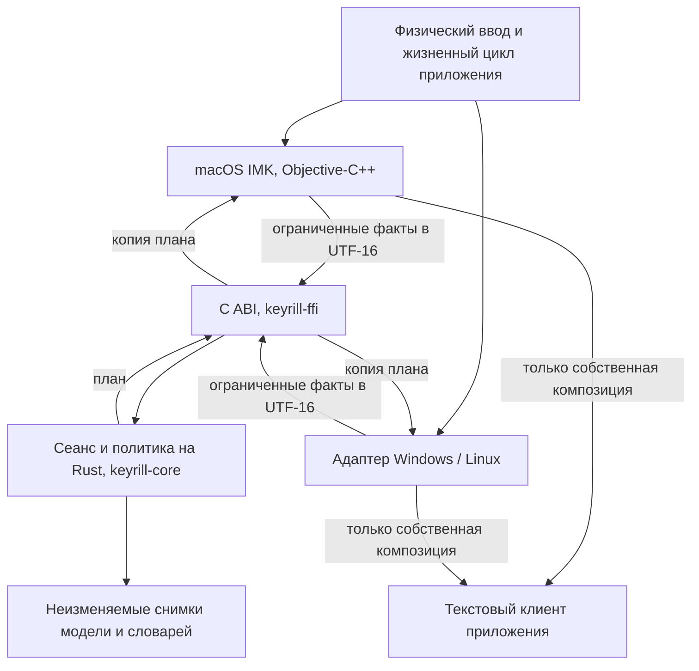
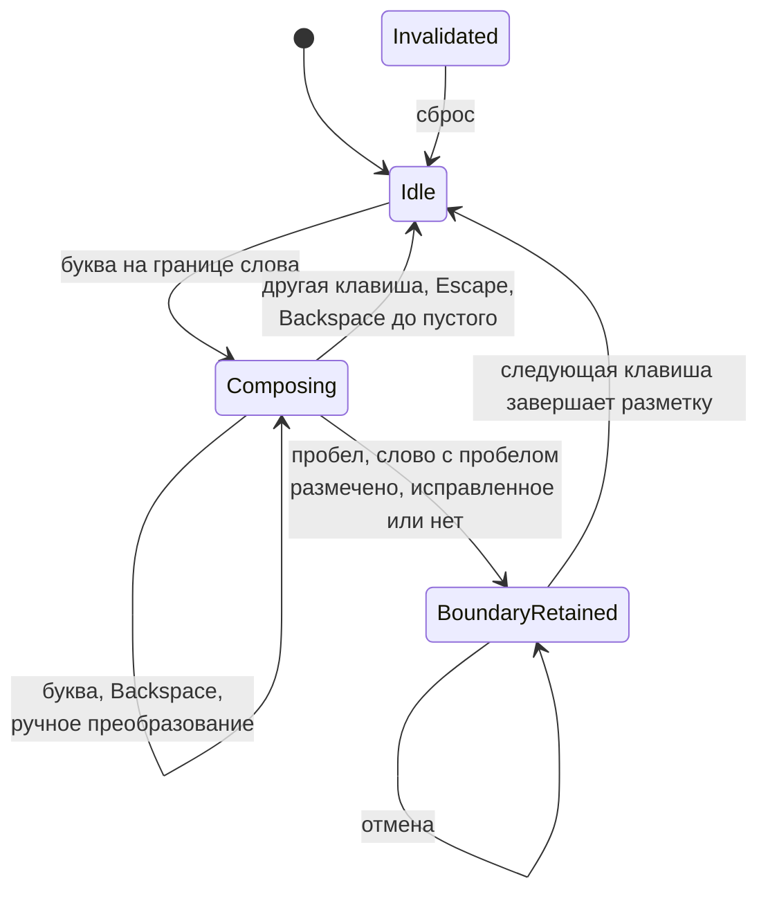
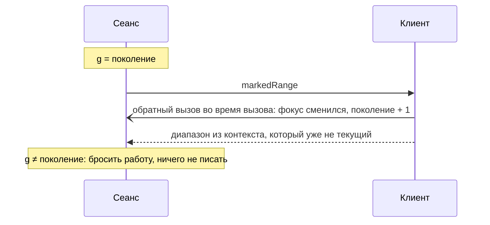

<!-- translation of ARCHITECTURE.md at 3fd694d456415fad3cc411b37613dfcda40d3e12 -->

# Архитектура

Keyrill состоит из двух частей: переносимого движка, написанного на языке Rust, и нативного
адаптера, который разрабатывается отдельно для каждой платформы. Движок и адаптер связаны узким
двоичным интерфейсом на уровне C ABI.

Адаптер отвечает за всё, что зависит от платформы. Он следит за фокусом ввода, получает необходимые
разрешения, работает с объектами и функциями операционной системы, решает, пропустить нажатую
клавишу или поглотить её, и проверяет, что в действительности записано в документе приложения. На
долю движка остаются преобразование раскладки, разбиение текста на слова, лексическая защита,
оценка, отказ от исправления, учёт ограниченного языкового контекста, ручные команды и данные для
отмены. Движок лишь составляет план правки; права выполнять правку этот план не даёт.

Путь одного слова через всю систему прослежен в разделе
[«Как работает Keyrill»](docs/how-it-works.ru.md); в настоящем разделе собраны справочные сведения.

| Каталог или файл | Назначение |
| -- | -- |
| `crates/keyrill-core` | Отображение раскладок, загрузка модели, вывод, словари Vim, сеанс слова; используется только стандартная библиотека, `forbid(unsafe_code)` |
| `crates/keyrill-ffi` | Интерфейс C ABI к ядру, перехват паники, чтение файлов словарей |
| `include/keyrill.h` | Контракт ABI: расположение структур в памяти, правила владения, версии, все коды состояния |
| `native/macos` | Сервер InputMethodKit, контроллер, окно настроек, режим совместимости, тесты |
| `assets/model.bin` | Замороженная модель EN/RU, получаемая из `model/` с помощью `tools/pack-model.py` |
| `model/` | Исходные данные модели, закреплённые хешами, генератор, программа оценки и корпуса для оценки |
| `tools/inference-probe` | Вспомогательная программа, которой программа оценки управляет через stdin; в продукты сборки не входит |

Общей для всех платформ абстракции правки документа в Keyrill нет, и это сделано сознательно
([ADR 001](docs/adr/001-rust-core-native-adapters.ru.md)). Платформенные средства ввода — IMK, TSF и
среды ввода Linux — существенно различаются по блокировкам, обратным вызовам, работе с фокусом и
способу опознания композиции. Общий фасад скрыл бы вопрос о том, имеет ли программа право на правку,
вместо того чтобы дать на него ответ.

## Сеанс слова

Каждому контексту ввода соответствуют один дескриптор движка и один сеанс слова. Сеанс может
находиться в одном из четырёх состояний: `Idle`, `Composing`, `BoundaryRetained` и `Invalidated`. В
файле `session.rs` два средних состояния представлены одним значением `State::Owned` и различаются
флагом `boundary`. Нативное поколение отслеживается отдельно, адаптером.

Каждая стрелка на диаграмме обозначает план, который вступает в силу лишь после того, как адаптер
подтвердит его выполнение и проверку. При любом другом исходе сеанс из любого состояния переходит в
`Invalidated`; к тому же результату приводит клавиша, запланированная в режиме, отличном от режима
собственного слова. В состоянии `Invalidated` сеанс отклоняет все планы до тех пор, пока адаптер его
не сбросит.

| Состояние и событие | Действие |
| -- | -- |
| Idle, допустимая буква | Получить сведения о контексте; новую композицию начинать, только если ничего не выделено и нет чужой разметки |
| Composing, буква | Обновить собственную разметку, сохранив регистр и предыдущий проверенный текст |
| Composing, пробел | Выполнить вывод или отказаться от исправления, затем разметить точное слово и один пробел; оригинал сохранять, только если слово было преобразовано |
| BoundaryRetained, отмена | Восстановить точный оригинал и пробел, пока та же разметка принадлежит Keyrill |
| BoundaryRetained, следующий ввод | Один раз завершить разметку, погасить квитанцию, затем по порядку обработать или пропустить новый ввод |
| Composing, ручная команда | Выполнить детерминированное преобразование по явной команде; вывод такое преобразование не отменяет |
| Composing, Backspace | Удалять только собственный текст; опустошение композиции выполняется отдельной нативной операцией |
| Escape | При наличии квитанции восстановить оригинал, завершить слово и поглотить клавишу; в противном случае завершить слово в набранном виде и пропустить Escape |
| Смена фокуса, источника или клиента | Погасить устаревшие планы; старую разметку завершать, только если она ещё действительна; слово в новое поле не переносить. Если смену режима запросил сам Keyrill, ответное уведомление о ней сохраняет разметку на границе и её квитанцию |
| Чужая разметка, расхождение, исключение, неизвестный исход | Прекратить исправление данного слова, не пытаясь исправить положение наугад; что ещё можно записать и когда исправление возобновляется, определяет раздел «Контракт правки» ниже |

Метод `propose` копирует токен, действительный только для последнего плана, ожидаемый текст,
требуемый текст, операцию и решение о клавише; подтверждённое состояние при этом не изменяется.
Метод `acknowledge` продвигает состояние только при проверенном результате. Отказ или неизвестный
исход делают сеанс недействительным; сброс гасит токены и квитанции; паника отравляет дескриптор
навсегда. Каждый план допускает не более одной нативной записи.

Следует помнить, что обратный вызов не является блокировкой документа. Любое нативное обращение к
клиенту может привести к повторному входу или сделать состояние недействительным. Поэтому поколение
необходимо запоминать перед каждым запросом и сверять после каждого вызова и перед любым действием.

Во время нативного обратного вызова нельзя удерживать заимствование Rust или блокировку словаря.
Удержание нативного объекта сохраняет его в памяти, но не гарантирует ни фокуса, ни связи с тем же
документом.

## Контракт правки

Каждый план допускает не более одной нативной записи; в этом разделе перечислено, что адаптер обязан
проверить до неё и после неё. Разметка считается *собственной*, если клиент, начальное смещение и
точный текст совпадают с локальными полномочиями адаптера, то есть с последней проверенной им
разметкой. *Точным текстом* называется результат обратного чтения по ожидаемому диапазону, который
содержит ожидаемые единицы UTF-16 и сообщает тот же диапазон. Поколение и режим Secure Input
проверяются заново после каждого обращения к клиенту: изменение до записи означает отказ от плана, а
изменение после записи делает исход неизвестным.

| Запись | Проверяется до записи | Проверяется после записи, для проверенного исхода | Клавиша |
| -- | -- | -- | -- |
| Начало слова: первая буква создаёт разметку | Keyrill ничем не владеет, ничего не размечено и не выделено; курсор там, где был прочитан контекст | Разметка с этого смещения, курсор в её конце, точный текст | Поглощается |
| Обновление слова: буква, пробел, Backspace, ручное преобразование, отмена | Собственная разметка, курсор в её конце, точный текст | Разметка с того же смещения, курсор в её конце, точный текст | Поглощается |
| Опустошение слова: Backspace на последней букве | Собственная разметка, курсор в её конце, точный текст | Разметки нет, курсор в начале бывшей разметки | Поглощается |
| Завершение с новым текстом: Escape восстанавливает оригинал | Собственная разметка, курсор в её конце, точный текст | Разметки нет, курсор после текста, точный текст | Поглощается |
| Неизменное завершение перед набранной клавишей | Собственная разметка и точный текст; курсор не проверяется | Разметки нет, точный текст в том же диапазоне | Передаётся приложению либо, если начинает следующее слово, планируется заново |
| Неизменное завершение по запросу жизненного цикла: фиксация, деактивация, смена режима, щелчок | Собственный диапазон разметки; текст не читается | Разметки нет; текст не читается | Нет |

Каждая запись заканчивается одним из трёх подтверждений, и состояние Rust продвигает только первое:

- **Проверено.** Все проверки строки пройдены. Состояние Rust продвигается, а после записи разметки
  адаптер получает локальные полномочия на новую разметку. Если Rust такое подтверждение отвергает,
  контракт нарушен, и исправление прекращается до повторной активации.
- **Отказ до записи.** Не прошла одна из проверок до записи. Ничего не записывается, клавиша
  передаётся приложению в набранном виде, Rust забывает слово, и следующее слово начинается с
  чистого листа.
- **Неизвестный исход.** Запись могла состояться, но подтвердить её результат нечем. Rust забывает
  слово, исправление прекращается, и ничего не повторяется. Клавиша, которую несла запись,
  поглощается и не воспроизводится; завершение несло только прежнюю разметку, поэтому следующая за
  ним клавиша один раз пропускается. Зарезервированные команды по-прежнему поглощаются.

После неизвестного исхода адаптер выполняет не более одной записи, и только если не прошла проверка
после записи, по собственному ответу клиента, при неизменном поколении и выключенном Secure Input:
он читает размеченный текст обратно и, если прочитанное точно занимает диапазон разметки, фиксирует
его без изменений, чтобы следующая клавиша не могла его заменить. Эта запись сохраняет то, что видит
пользователь, и ничего не исправляет. Исправление возобновляется на следующей текстовой клавише,
только если за эту активацию уже была проверена хотя бы одна запись и неизвестный исход случился
впервые; в противном случае оно остаётся выключенным до повторной активации источника ввода. Такие
правила ограничивают неопределённость, но не доказывают, что приложение сохранило ввод; поэтому
клиент, у которого возникают неизвестные исходы, к автоматическому исправлению не допускается.

Как строки таблицы отображаются на вызовы IMK и почему два неизменных завершения ослабляют проверки,
описано в разделе
[«Адаптер для macOS»](docs/macos.ru.md#%D0%BA%D0%BE%D0%BC%D0%BF%D0%BE%D0%B7%D0%B8%D1%86%D0%B8%D1%8F).
Режим совместимости в этот контракт не входит: он отправляет ограниченный пакет синтетических
событий, исход которого считается отправленным, но не проверенным, и никогда не запускается для
исправления неизвестного исхода композиции ([ADR 006](docs/adr/006-compatibility-backend.ru.md)).

## Инварианты безопасности

| Обозначение | Требование | Опровергающий тест |
| -- | -- | -- |
| S1 | Сохранять посторонний текст документа и порядок ввода | Сверка всего документа, префикса, суффикса и выделения при вводе и смене фокуса, внедряемых на каждой нативной границе |
| S2 | Не принимать устаревшую или чужую композицию за собственную | Сверка клиента, поколения, разметки, точного текста в UTF-16 и курсора (при фиксации без изменений по диапазону курсор не сверяется, а при потере фокуса не выполняется и обратное чтение текста); отклонение сценариев с чужим диапазоном и повторно используемым прокси |
| S3 | Не выполнять запись, если право на правку цели не установлено | Проверка перед действием и после запросов с повторным входом; после потери владения не выполняется ни одной записи |
| S4 | Не терять, не удваивать, не перенаправлять и не переставлять клавиши | Отказ до записи отличается от попытки с неизвестным исходом; проверяется судьба клавиши и состояние документа, а не коды возврата |
| S5 | Отделять результат проверки документа от успешного вызова API | Различаются результаты запрошенные, предпринятые, совпавшие при обратном чтении и подтверждённые по документу |
| S6 | На пути композиции не переписывать зафиксированный текст | Не допускаются временное выделение, запись всего значения, удаление заданного числа символов, буфер обмена и устаревший абсолютный диапазон |
| S7 | Право на отмену ограничено во времени | Квитанция относится к одной собственной разметке и одному поколению; запоздалая отмена не выполняет ни одной записи |
| S8 | Личный текст не сохраняется и не передаётся | Журналы и состояние без содержимого, ограниченный объём памяти, отсутствие сети и буфера обмена |
| S9 | Время жизни нативных объектов и FFI задано явно | У каждого изменяемого сеанса один владелец, обратные вызовы завершаются до освобождения, границы ABI и перехват исключений проверены тестами |
| S10 | Отказ заметен и безопасен | Состояние «не поддерживается» при неизменённых документах; способ доставки никогда не меняется незаметно |

Перечисленные требования являются условиями приёмки, а не доказательством того, что произвольный
клиент соблюдает протокол транзакций. Запрос, уже отправленный неправильно работающему клиенту,
отозвать невозможно. Поэтому клиент допускается только на основании проверенного контракта, а
клиенты, не способные соблюдать инварианты, исключаются.

> [!WARNING]
> Единственным явным исключением является режим совместимости в macOS. Он удаляет заданное число
> символов и набирает слово заново, то есть выходит за рамки S1, S4 и S6, на условиях, изложенных в
> [ADR 006](docs/adr/006-compatibility-backend.ru.md). Этот режим выбирается до начала любой правки
> и никогда не применяется для исправления неудачной записи композиции.

Ниже перечислены механизмы, отвергнутые в качестве универсального запасного пути. Сбой каждого из
них либо воспроизведён, либо следует из исходного кода:

| Механизм | Сбой |
| -- | -- |
| Временное выделение через Accessibility с последующей заменой | Ввод, сделанный после выделения, затирает открытое выделение раньше, чем выполняется повторная проверка |
| Запись всего поля через Accessibility по снимку | Ввод, сделанный за это время, теряется при записи старого значения |
| Заданное число нажатий Backspace с последующей вставкой | Продолжающийся ввод изменяет удаляемый текст; метки событий и паузы не упорядочивают работу приложения |
| Абсолютный диапазон в зафиксированном тексте | Приложение может изменить текст после проверки; проверка поколения обнаруживает это, но отменить изменение не может |
| Вставка через буфер обмена с восстановлением | Текст попадает в историю буфера обмена; запоздалое восстановление затирает более новое содержимое |
| Задержка ввода с последующим повтором | Пока ввод находится в очереди, фокус может смениться; повтор может удвоить, перенаправить или потерять ввод |

Отрицательные сценарии и сценарии конечного автомата для этих механизмов собраны в файле
[`docs/regressions.json`](docs/regressions.json). Тест считается пройденным, если он обнаруживает
ущерб от запрещённого способа доставки или отказывается выполнять сценарий; вынуждать Keyrill
воспроизводить небезопасную правку тест не должен.

## Допустимость исправления и судьба клавиши

Автоматическое исправление выполняется лишь при выполнении следующих условий: политика включена,
элемент управления допущен, режим Secure Input выключен, режим ввода известен, токен закончен и
ограничен пробельными символами, чужой композиции нет. Исключения проверяются прежде, чем прочитан
какой-либо текст и начата композиция. Защищённые элементы, элементы только для чтения, а также
элементы, тип которых нельзя установить достоверно, не должны допускаться ни к тому, ни к другому.
Однако адаптер для macOS не различает их внутри одного приложения: допуск выдаётся всему приложению
по идентификатору пакета, а Secure Input является единым глобальным флагом, поэтому ни поля паролей,
ни поля только для чтения или с конфиденциальными данными по отдельности он не распознаёт (см.
раздел [«Адаптер для macOS»](docs/macos.ru.md)).

Клавиша поглощается только в соответствии с проверенным контрактом обработки. Если план отклонён до
записи, клавиша пропускается без изменений. Знаки препинания, Tab и Enter исправления не вызывают:
слово, ещё принадлежащее Keyrill, завершается обычным нативным путём, а клавиша проходит дальше.
Задерживать или повторять Enter, Tab, клавиши навигации и сочетания клавиш ради получения контекста
для вывода запрещается.

## Конфигурация и снимки

В обратных вызовах клавиатуры диск не читается. Модель встроена в программу и проверяется один раз
за время работы процесса, до запуска сервера ввода. Личный словарь разбирается вне потока ввода;
результатом разбора являются неизменяемые снимки, которые публикуются целиком. Если очередной
вариант не прошёл проверку, сохраняется последний удачный снимок. Каждое решение принимается на
основе одного снимка. Если конфигурация не прошла проверку, сохраняется последняя прошедшая её, а
сообщение об ошибке выдаётся без содержимого; настройки безопасности никогда не применяются
частично.

## Приватность и граница доверия

Метод ввода видит всё, что набирается в клиенте, где он выбран, и применение безопасного Rust этого
не меняет: нативный код, зависимости, модель, установка и обновления находятся внутри границы
доверия. Keyrill хранит в памяти не более одного слова, одной квитанции отмены и 256 единиц UTF-16
из собственных завершённых слов, стирает их, когда сеанс становится недействительным или
сбрасывается, и нигде не записывает. Диагностика ограничивается счётчиками и состоянием без
содержимого. Тем не менее личный текст может оказаться в дампе памяти при аварийном завершении;
гарантированного стирания Keyrill не обещает. Личные словари принадлежат пользователю, открываются
только для чтения и в файлы выпуска не попадают. Телеметрия, удалённая настройка, автоматическое
обновление и привилегированные вспомогательные программы отсутствуют.

## Время жизни

При завершении работы Keyrill прекращает приём новых операций, завершает собственную разметку, если
она ещё действительна, отключает нативные приёмники событий и освобождает дескрипторы после
завершения обратных вызовов. Движок не освобождается до тех пор, пока к нему может обратиться
обратный вызов. Паника Rust перехватывается на границе ABI и отравляет дескриптор; нативные
исключения перехватываются на нативной стороне; ни паника, ни исключение не раскручивают стек через
кадры другого языка. Следует учитывать, что перехват паники не спасает от аварийного завершения при
нехватке памяти и не восстанавливает приложение, изменённое частично.
