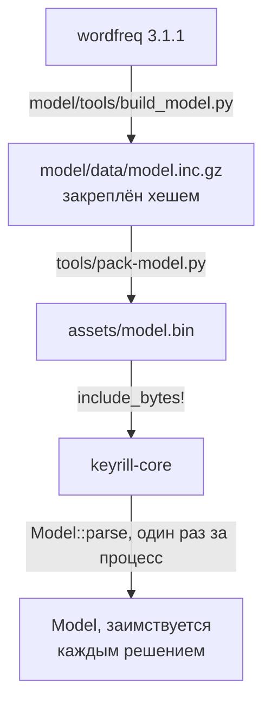

<!-- translation of docs/engine.md at 3d3100f108ea4a48744a033b3ab2efe183fdd592 -->

# Движок

Крейт `keyrill-core` выполняет преобразование текста из одной раскладки в другую, определяет, не
набрано ли слово в неверной раскладке, разбирает личные словари и ведёт сеанс слова. Движок только
составляет предложения: нативный документ он не читает и не изменяет. Интерфейс C ABI, построенный
поверх движка, описан в разделе о [переносе на другие платформы](porting.ru.md) и в файле
`include/keyrill.h`; в разделе [«Как работает Keyrill»](how-it-works.ru.md) одно решение разобрано
на настоящих числах.

## Отображение раскладок

Поддерживаются две раскладки: американская QWERTY и русская ЙЦУКЕН. Русские раскладки Apple и PC
различаются положением буквы ё и поэтому представлены разными значениями `Keyboard`; адаптер для
macOS использует раскладку Apple. Проверенную таблицу раскладки для Windows или Linux должен
предоставить адаптер соответствующей платформы; выводить её из раскладки Apple «Русская — ПК» не
следует.

Преобразования `Mapping::EnToRu` и `RuToEn` действуют на физические позиции клавиш. Преобразование
`Mapping::Manual` заменяет каждую поддерживаемую букву, а знаки препинания и неподдерживаемые
единицы UTF-16, в том числе непарные суррогаты, оставляет без изменений. Это преобразование не
является инволюцией, и проверять его как инволюцию нельзя.

Словом называется непрерывная последовательность букв EN/RU (`mapping::is_letter`). В английском
режиме клавиши, которым в русской раскладке соответствуют буквы х, ъ, ж, э, б, ю и ё (`[ ] ; ' , .`,
клавиша буквы ё для клавиатуры сеанса, то есть `\` у Apple и `` ` `` у PC, а также те же клавиши с
Shift), рассматриваются как условные буквы. Единицы, для которых `inference::is_provisional`
возвращает истину, могут как начинать слово, так и продолжать его; поэтому `[jhjij` преобразуется в
`хорошо`, а `;bpym` — в `жизнь`. Слово, которое не было исправлено, фиксируется точно в набранном
виде: `hello,` остаётся `hello,`, а одиночные `...` или `;` остаются знаками препинания. Такая
клавиша входит в композицию и приложению не передаётся, поэтому действия, которые приложение
связывает с самой клавишей (например, «умные» кавычки или автоматическая вставка парной скобки), к
ней не применяются. В русском режиме эти клавиши являются обычными буквами, и никаких других
изменений не происходит.

| Клавиша США | `[` | `]` | `;` | `'` | `,` | `.` | `\` (Apple), `` ` `` (PC) |
| -- | -- | -- | -- | -- | -- | -- | -- |
| Русская буква | х | ъ | ж | э | б | ю | ё |

## Вывод

При нажатии пробела метод `Session::propose_with_inference` оценивает законченное собственное слово
по заимствованным снимкам модели и словарей; в ожидающем плане заимствованные данные не сохраняются.
Пусть набранное слово *w* прошло проверки допустимости, личного словаря и известных слов (они
описаны ниже), а его прочтение в другой раскладке *c* содержится в лексиконе целевого языка с
частотностью Zipf не менее 3. Тогда слово исправляется при выполнении условия

```math
\log_{10} f_{\text{target}}(c) - \log_{10} P_{\text{source}}(w) + \log_{10}\frac{p}{1-p} + \log_{10} k
\;\ge\; \log_{10} C + \pi(|w|)
```

где *f* — частота слова-кандидата; *P* — правдоподобие набранных букв по символьной модели второго
порядка; *p* = 0,001 — априорная вероятность ошибки; *k* — множитель контекста, равный 19, если
недавние слова сеанса написаны на целевом языке, 1/19, если на исходном, и 1 в остальных случаях;
*C* = 100 — цена ложного исправления; π — штраф за длину, равный 4, 2 и 1 для слов из одной, двух и
трёх единиц UTF-16. Значения *p*, *C*, минимальный Zipf и параметры порога для известных слов
хранятся в структуре `Policy`.

> [!NOTE]
> Эти параметры служат для ранжирования, не откалиброваны и вероятностями не являются; допустимые
> значения Zipf и пороговых разностей ограничены диапазоном 0..=9. Минимальный Zipf кандидата и
> параметры порога подобраны на выборке dev (см. раздел «Оценка» ниже).

Рассмотрим теперь набранную строку, которая сама является словом лексикона своей раскладки (Known,
причина 3). Защита такой строки снимается в пользу другого прочтения лишь в том случае, если она
сама редкая, а другое прочтение значительно частотнее: её Zipf должен быть ниже 3, а Zipf кандидата
должен превышать его не менее чем на 2,5, или на 3,5 для слова из двух единиц UTF-16 при отсутствии
контекста на целевом языке. После снятия защиты слово исправляется только на основании частот, а его
оценкой служит разность двух значений Zipf, то есть десятичный логарифм отношения частот: для
строки, уже имеющейся в лексиконе, символьная модель ничего не добавляет. Поэтому `yf` (Zipf 2,37)
преобразуется в `на` (7,25), а `ghb` — в `при`, тогда как `lf` (3,40) остаётся без изменений. Со
слова из одной единицы защита не снимается никогда; при этом правило учитывает слово целиком, так
что `e.` состоит из двух единиц.

Для слова с условными буквами кандидатом служит вся последовательность клавиш, прочитанная
по-русски; регистр оценивается по этому прочтению. Английское прочтение состоит только из букв: их
оценивает символьная модель, а каждая условная единица, стоящая перед буквами, между ними или после
них, добавляет десятичный логарифм частоты, с которой такой знак препинания встречается на этом
месте в английских словах (−2,3, −1,6 и −1,0 соответственно; измерено на выборке dev корпуса EWT).
Английское ядро слова сохраняется, только если знаки препинания стоят в конце, и тогда оно защищено
как известное слово; поэтому `it.` не преобразуется в `шею`, а `he,` — в `руб`. Слово, не содержащее
букв, недопустимо.

Движок отказывается от исправления при неизвестном режиме, неподдерживаемом токене или токене, в
котором смешаны письменности, при смешанном регистре, при слове из нескольких букв, набранном
целиком заглавными, а также при недопустимых значениях политики. Одна заглавная буква в начале слова
допустима (`Ghbdtn` преобразуется в `Привет`). Для ссылок из эталонных векторов причины решений
пронумерованы:

| Причина | Значение |
| -- | -- |
| 0 | Исправление |
| 1 | Недопустимый токен |
| 2 | Защищено личным словарём |
| 3 | Известное слово исходного языка |
| 4 | Кандидат запрещён личным словарём |
| 5 | Доводов недостаточно |
| 6 | Настроенный словарь отсутствует |
| 7 | Явная ручная команда преобразования или отмены |

Признанные и редкие слова личного словаря защищены от исправления. Запрещающая запись снимает как
личную, так и общую защиту, а запрещённый кандидат отвергается. Наличие кандидата в словаре не даёт
ему частоты и само по себе исправления не оправдывает. Отображённые знаки препинания, не входящие в
целевой алфавит, недопустимы.

Автоматическое исправление начинает работать только после того, как готовы оба личных источника.
Пустой источник, прошедший проверку, считается готовым, отсутствующий — нет; впрочем, приложение
может опубликовать отсутствующий файл по пути по умолчанию как пустой (так поступает macOS,
используя `KR_SOURCE_MISSING_IS_EMPTY`). Ручное преобразование работает в любом случае. Ручная
команда преобразования или отмены прекращает повторный вывод для данного слова; простое исправление
опечатки такого действия не оказывает.

### Контекст

Языковой контекст образуется только из собственных проверенных завершённых слов сеанса общим объёмом
не более 256 единиц UTF-16 и никогда не извлекается из документа. Завершённое слово вместе с
пробелом добавляется в контекст после подтверждения завершения; разметка с пробелом, которую ещё
можно отменить, в контекст не входит. Отказ, неизвестный исход, сброс, смена режима и действия
приложения вне собственной композиции очищают контекст. Тот же результат даёт печатаемый знак
препинания, так как действие приложения над ним не подтверждается. При разборе контекста берутся две
последние последовательности букв одного языка в текущей строке; символы, не являющиеся буквами,
пропускаются, а на символах LF и CR разбор прекращается. Отбрасывание контекста со знаками
препинания может лишить слово защитного множителя 19, поэтому изменять этот разбор допустимо только
вместе с проведением новой оценки.

## Личный словарь

Движок читает списки слов Vim в формате `.add`
([`:help spell`](https://github.com/vim/vim/blob/master/runtime/doc/spell.txt)) в кодировке UTF-8
размером не более 1 МиБ, построчно и по тем же правилам, что и сам Vim. Поддерживаются метка порядка
байтов (BOM) в начале файла, окончания строк LF и CRLF, пустые строки и комментарии, директивы
`/encoding=utf-8` и `/regions=`, а также флаги `=`, `?`, `!` и с `1` по `9`. Строка, первый байт
которой равен `#`, считается комментарием независимо от дальнейшего содержимого: команды Vim `zw`,
`zug` и `zuw` закомментируют запись, перезаписывая именно этот байт. Строки не в UTF-8, строки с
неизвестной директивой или флагом, слова с управляющими символами и прочие ошибочные строки
пропускаются, а их число подсчитывается (`Vocabulary::skipped`). Если в файле встречается символ
NUL, размер файла превышает допустимый или в начале стоит директива `/encoding=` с кодировкой,
отличной от `utf-8`, файл отвергается целиком. Пробельные символы Unicode по краям строк, включая
неразрывный пробел, удаляются.

Запись, состоящая из строчных букв, защищает формы, набранные строчными, с заглавной буквы и целиком
заглавными; запись, содержащая заглавные буквы, защищает свою точную форму и форму, набранную
целиком заглавными; флаг `/=` требует точного совпадения регистра. Если подходят несколько записей,
предпочтение отдаётся запрещающей (`!`), затем признанной и, наконец, редкой (`?`).

| Запись | Подходящие формы | Действие |
| -- | -- | -- |
| `hello` | `hello`, `Hello`, `HELLO` | Признано: не исправляется никогда |
| `iPhone` | `iPhone`, `IPHONE` | Признано |
| `iPhone/=` | только `iPhone` | Признано |
| `colour/?` | те же, что у `hello` | Редкое: тем не менее защищено |
| `ghbdtn/!` | те же, что у `hello` | Запрещено: снимает любую защиту и никогда не становится результатом исправления |

Строка `/regions=` и флаги регионов с 1 по 9 проверяются, после чего отбрасываются, так что поиск не
зависит от локали; флаги принимаются даже в том случае, если имя региона не объявлено. Ошибочная
строка `/regions=` пропускается так же, как любая другая ошибочная строка.

Метод `vocabulary::Snapshot::replace` полностью разбирает новый вариант словаря и только после этого
публикует его. Код, который уже получил прежний неизменяемый `Arc`, продолжает им пользоваться, и
неудачный вариант никогда не заменяет его частично. Файлы для адаптера читает крейт `keyrill-ffi`
(см. раздел о [macOS](macos.ru.md#%D1%81%D0%BB%D0%BE%D0%B2%D0%B0%D1%80%D0%B8)).

Вторым видом источников являются слова, которым пользователь обучил проверку орфографии операционной
системы (Learn Spelling в macOS, Add to dictionary в Windows). Метод `Vocabulary::parse_words`
читает такой список по одному слову в строке, в кодировке UTF-8 с необязательной меткой BOM или в
UTF-16 LE с меткой BOM; каждая строка рассматривается как слово целиком, поэтому `#` и `/` являются
здесь обычными символами. К каждому слову применяется то же правило регистра, что и к записи Vim без
флагов; слово считается признанным, а если список содержит исключённые слова, — запрещённым. Такие
списки помещаются в `Dictionaries::learned` и защищают и запрещают слова наравне с источниками Vim,
однако готовность определяется только двумя источниками Vim: отсутствие или нечитаемость списка
выученных слов никогда не задерживает исправление.

## Модель



Файл `assets/model.bin` содержит 89 656 английских и 241 624 русских слова с десятичными логарифмами
частот, а также по одной символьной модели второго порядка для каждого языка. Эти данные получены из
больших списков wordfreq 3.1.1. Загрузчик проверяет сигнатуру, версию, поле хеша источника,
алфавиты, счётчики, смещения, индексы слов, порядок, границы разделов и отсутствие лишних байтов в
конце; проверка выполняется один раз, вне обратных вызовов ввода. Проверки заголовка обеспечивают
согласованность, но не подлинность данных; воспроизводимость файла проверяет команда
`tools/pack-model.py --check`, которая заново собирает каждый файл из закреплённого источника
`model/data/model.inc.gz` и сравнивает байты. Формат файла описан в строке документации этого
скрипта.

Упаковщик хранит каждое значение в виде знакового целого числа в микроединицах и восстанавливает все
396 107 исходных значений типа f64 бит в бит. Никакого переобучения, перекалибровки или
перенормировки он не выполняет. Порядок получения самих исходных данных изложен в файле
[`model/README.md`](../model/README.ru.md).

## Оценка

Команда `./tools/verify evaluate` запускает без обращения к сети `model/tools/evaluate.py`, который
проверяет ответы `tools/inference-probe`, на закреплённых выборках dev и test из Universal
Dependencies (английский корпус EWT и русский корпус Taiga) и завершается с ошибкой, если не
выполнен хотя бы один из приведённых ниже порогов. Отчёты, в том числе перечень всех ложных
исправлений, записываются в каталог `target/evaluation/docs/results/`. Личные словари при оценке не
читаются. Параметры подбираются на выборке dev; выборка test используется только для отчёта и
проверки порогов.

При оценке текст набирается через настоящий `Session` так же, как это делает адаптер для macOS.
Слово начинается только после пробельного символа или в начале документа; запись применяется, только
если моделируемая композиция содержит в точности тот текст, который ожидает план, и подтверждается
после применения; смена режима завершает слово и сбрасывает сеанс. Расхождение, а также пропущенная
клавиша, которая должна была войти в композицию, прерывают оценку с ошибкой. Каждое предложение
рассматривается как отдельный документ, набираемый за один раз, с пробелом в конце.

- **Повтор в неверной раскладке.** Каждое предложение (`# text`) набирается на клавишах своей
  раскладки Apple при включённом противоположном режиме, так что русская `,` поступает как `^` в
  английском режиме, а английская `,` — как `б` в русском. Для каждого языка вычисляются: *полнота
  по токенам* — доля разделённых пробелами токенов, которые изменились в неверной раскладке и в
  результате совпали с задуманными; *полнота по словам* — та же величина для токенов, состоящих
  только из букв; *полнота по первой ошибке* — доля предложений, в которых исправлен первый
  ошибочный токен (именно он важен в случае, когда исправление переключает источник ввода). Токен,
  изменённый во что-либо иное, называется *неверным исправлением*.
- **Повтор в верной раскладке.** Те же предложения, набранные правильно: каждый токен набирается в
  режиме своей письменности, так что латинские слова в русском тексте переключают режим. Любое
  изменение в этом случае является ложным исправлением.
- **Отрицательный набор.** Отдельные токены, каждый из которых набирается как `token ` в новом
  сеансе, чтобы его не защищал никакой контекст. В набор входят слова корпуса, известные модели
  (`known`) и неизвестные ей (`oov`), имена собственные (`names`), простые латинские транслитерации
  русских слов (`translit`) и все клавиатурные опечатки в словах корпуса, получаемые одной правкой:
  удалением, перестановкой, заменой или вставкой соседней клавиши, в том числе клавиш условных букв
  (`typo`). Отчёт показывает также, сколько токенов доходит до этапа оценки.

Результаты при политике по умолчанию:

| Выборка | Полнота RU по токенам / по первой ошибке | Полнота EN по токенам / по первой ошибке | Ложные в верной раскладке | Ложные на опечатках (на 10 000) | Ложные на прочих отрицательных |
| -- | -: | -: | -: | -: | -: |
| dev | 49,7 % / 50,4 % | 61,1 % / 47,4 % | 0 из 35 031 | 20 EN (0,80), 24 RU (0,60) | 1 транслитерация из 5197 |
| test | 46,1 % / 47,7 % | 60,5 % / 47,0 % | 0 из 33 899 | 17 EN (0,69), 21 RU (0,60) | 0 |

Правильные слова корпуса, как известные, так и неизвестные, а также имена по-прежнему никогда не
доходят до этапа оценки; поэтому они защищают от регрессий, но для подбора порога непригодны.
Опечатки и транслитерации до этапа оценки доходят: на каждой выборке туда попадают около 350 из
примерно 600 000 опечаток, и именно они определяют минимальный Zipf кандидата. Порог для известных
слов может пропустить только слова лексикона; следовательно, вся его уязвимость сводится к списку
слов лексикона, другое прочтение которых этот порог проходит. Этот список закреплён в отрицательном
наборе, описанном ниже.

Большинство оставшихся пропусков объясняется одной из трёх причин. Во-первых, слово, за которым
следует знак препинания, не получает пробела, а вывод запускается только пробелом (14 % русских и
12 % английских ошибочных токенов на выборке dev). Во-вторых, набранная строка может оказаться
словом лексикона, с которого защита не снимается, например `lf` вместо «да» (16 % и 10 %).
В-третьих, английские кандидаты получают оценку ниже порога с учётом штрафа за длину (10 %
английских).

Пороги, заданные в `tools/evaluate-model.py`, проверяются на обеих выборках:

| Порог | Граница | Обоснование |
| -- | -: | -- |
| Полнота по токенам, RU / EN | ≥ 44 % / ≥ 58 % | Примерно на два пункта ниже худшей выборки |
| Полнота по первой ошибке, RU и EN | ≥ 45 % | Примерно на два пункта ниже худшей выборки |
| Ложные исправления в верной раскладке, оба языка | ≤ 2 | Измерено 0; 2 из примерно 34 000 токенов — менее 1 на 10 000 |
| Неверные исправления в неверной раскладке | ≤ 2 | Измерено 0 |
| Ложные исправления known, OOV и имён | ≤ 2 | Измерено 0 |
| Ложные исправления транслитераций | ≤ 3 | Измерено 1 на dev, 0 на test |
| Ложные исправления опечаток, на каждый язык | ≤ 1 на 10 000 | Измерено от 0,60 до 0,80 |

> [!IMPORTANT]
> Ошибки в этих данных синтетические, опечатки и транслитерации сгенерированы, каждое предложение
> набрано без Backspace и без смены источника ввода, а источники wordfreq могут пересекаться с
> используемыми корпусами. Следовательно, ни один из этих показателей не характеризует точность при
> реальном наборе.

Целью выпуска является менее одного ложного автоматического исправления на 10 000 допустимых
правильных слов. Ни один источник, распространение которого разрешено лицензией и который доступен
без сети, не охватывает реальные чаты, обсуждения кода, идентификаторы или русские тексты из
социальных сетей сверх корпуса Taiga. Добавить такой источник можно только одним способом: закрепить
его хешем вместе с лицензией рядом с уже имеющимися корпусами.

Изменение политики требует новой оценки на выборке dev, успешного прохождения эталонных векторов и
неизменности отрицательного набора (за исключением тех случаев, которые изменение призвано открыть).
Исправлять ожидаемые значения ради того, чтобы скрыть сбои, запрещается.

## Эталонные тесты

Файл `crates/keyrill-core/tests/fixtures/engine-vectors.jsonl` содержит 1217 ожидаемых результатов:
90 запросов отображения, 120 словарных, 7 контекстных и 1000 запросов вывода. Оценки вывода
сравниваются с относительным допуском 1e-12 и абсолютным допуском 1e-10. Протокол запросов приведён
в таблице:

| Запрос | Ответ |
| -- | -- |
| `map K MODE TEXT` | MODE: 0 — ручное, 1 — EN→RU, 2 — RU→EN; результат в шестнадцатеричной записи UTF-16 |
| `vocab SOURCE WORD` | Успех разбора (0 или 1), число записей, результат поиска (0 — нет, 1 — признано, 2 — редкое, 3 — запрещено) |
| `context PREFIX` | Тег языка |
| `infer K ACTIVE CONTEXT PRIOR COST MINZIPF EN_ADD RU_ADD WORD` | Причина, оценка, замена в шестнадцатеричной записи или `-` |

Шестнадцатеричные строки представляют единицы UTF-16, знак `-` обозначает пустое значение;
клавиатуры обозначаются числами 0 (Apple) и 1 (PC), языки — числами 0 (неизвестен), 1 (EN) и 2 (RU).
В файле [`negative-words.md`](../crates/keyrill-core/tests/fixtures/negative-words.md) описаны 766
слов и коллизий модели, которые не должны исправляться ни при каких условиях; они проверяются в трёх
контекстах и на обеих клавиатурах. Запросы вывода задают три значения политики, а порог для
известных слов использует значения по умолчанию.
