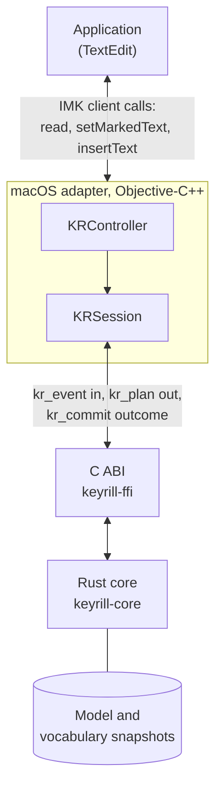
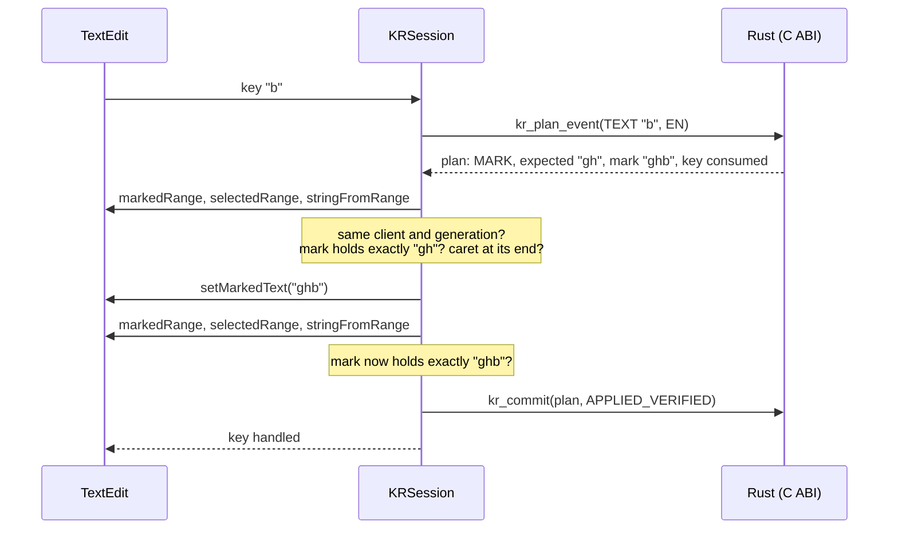
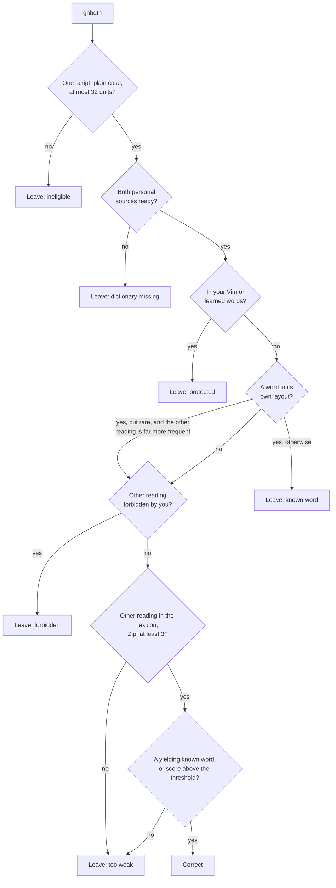
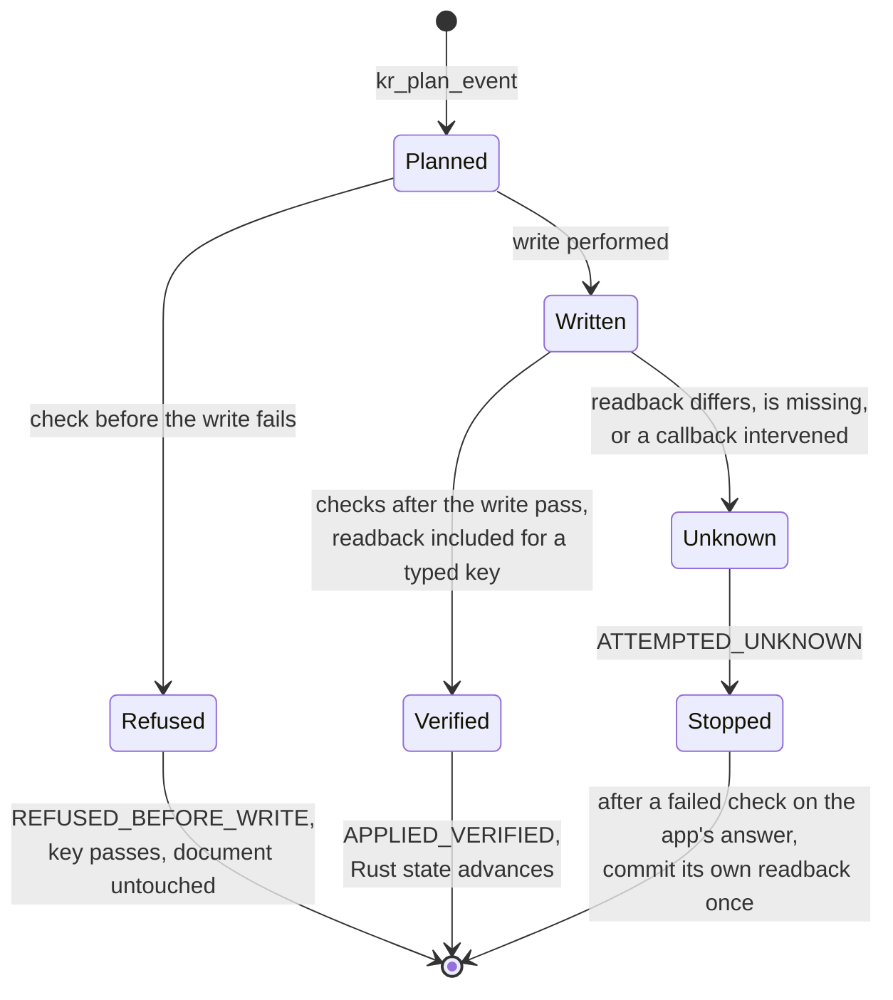
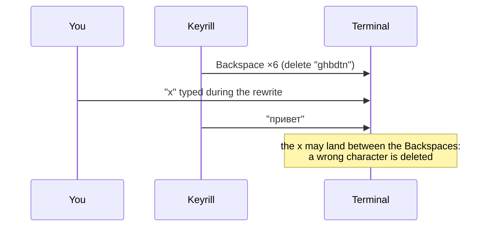

# How Keyrill works

This page follows one word, `ghbdtn` typed with Space in TextEdit, from the key press to the
verified edit, and stops at each check Keyrill makes before and after the edit. Read it before the
reference pages; they assume the terms defined here. The numbers come from the shipped model and the
real C ABI, not from an illustration.

## Two readings of the same keys

A layout mistake leaves no trace in the keys themselves. The user meant to type `привет` with the
Russian layout active, the US layout was active instead, and the same six physical keys produced
Latin letters:

| Key | `G` | `H` | `B` | `D` | `T` | `N` |
| -- | -- | -- | -- | -- | -- | -- |
| US layout | g | h | b | d | t | n |
| Russian ЙЦУКЕН | п | р | и | в | е | т |

So the conversion itself is a table lookup (`crates/keyrill-core/src/mapping.rs`), and the whole
difficulty is deciding *when* to apply it. `hello` and `руддщ` are also the same keys, and only the
first is a word anyone means. A wrong correction costs the user more than a missed one, so Keyrill
is built to abstain when in doubt ([ADR 003](adr/003-conservative-inference.md)); the release target
is fewer than one false correction per 10,000 correctly typed words.

## Why an input method

Keyrill doesn't watch the screen and fix text afterwards. It is the layout: you select **Keyrill
English** or **Keyrill Russian** in place of the stock US and Russian sources, so every key reaches
Keyrill before the application. Keyrill holds the word being typed as *marked text*, the underlined
composition an input method owns, and replaces only that mark. On the composition path, text the
application has already committed is never rewritten: each way of doing it (counted Backspaces, a
temporary selection, the clipboard) fails under some schedule, by deleting a key typed meanwhile,
overwriting a selection or leaving text in clipboard history; see
[architecture](../ARCHITECTURE.md#safety-invariants) and
[ADR 005](adr/005-no-committed-text-rewrite.md). The compatibility backend described below is the
one exception. The price is visible: an underline under the current word and an input source to
select.

## Who does what



The two halves have different powers. The Rust core decides: it knows the layouts, the model, your
protected words and the state of the current word, and it answers each key with a *plan*. It never
touches the document. The adapter acts: it talks to the application, checks that the document is
what the plan expects, performs the write, reads the result back and reports what happened. A plan
is a proposal, never editing authority.

> [!IMPORTANT]
> Rust state advances only on a *verified acknowledgement*: every check the write requires passed,
> and for a write a key causes that includes reading the document back and finding the expected
> text. A commit the platform requests on focus loss writes back the text last verified in the mark
> without reading it again. The [edit contract](../ARCHITECTURE.md#edit-contract) lists the checks
> for every write. A write that was attempted but can't be confirmed is reported as unknown, and
> correction stops. Nothing is guessed, repaired or replayed.

## Typing the word

Each key goes through the same loop. Here is the third key, `b`, with `gh` already marked:



Before the write the session checks the client, the exact marked range, the caret at its end and the
exact UTF-16 text in the mark. After the write it reads the mark back. Between these calls it
compares a *generation* counter: every client call can call back into the input method (a focus
change, a commit request), and a callback that invalidates the session bumps the generation, so work
that started under the old one is dropped instead of acting on a stale document.

The very first letter is planned differently, because nothing is owned yet: the session reads the
character before the caret, and a word starts only at the document start or after whitespace. A
caret inside `foo|bar` starts nothing, since there would be no complete word to judge.

Typing the whole word, the engine returns these plans (the adapter verifies and acknowledges each
one):

| Key | Action | Expected in the mark | New mark | Key |
| -- | -- | -- | -- | -- |
| `g` | MARK |  | `g` | consumed |
| `h` | MARK | `g` | `gh` | consumed |
| `b` | MARK | `gh` | `ghb` | consumed |
| `d` | MARK | `ghb` | `ghbd` | consumed |
| `t` | MARK | `ghbd` | `ghbdt` | consumed |
| `n` | MARK | `ghbdt` | `ghbdtn` | consumed |
| Space | MARK | `ghbdtn` | `привет ` | consumed |

## The decision at Space

Space ends the word, and only Space: a word followed by Return or Tab is committed as typed. The
engine then runs `inference::infer`, which looks for a reason to *not* correct before it looks for
evidence to correct:



`ghbdtn` is not an English word, so the decision falls to the score. It compares how likely the user
meant `привет` with how likely they meant the letters as typed, in log10 units:

```math
\text{score} = \log_{10} f_{RU}(\text{привет}) - \log_{10} P_{EN}(\text{ghbdtn}) + \log_{10}\frac{p}{1-p} + \log_{10} c
```

| Term | Meaning | Value |
| -- | -- | -: |
| log₁₀ *f* | Frequency of `привет` among Russian words (Zipf 5.13) | −3.87 |
| log₁₀ *P* | How English the letter sequence looks to an order-2 character chain | −16.75 |
| *p* | Prior that any given word was typed in the wrong layout, 0.001 | −3.00 |
| *c* | Context: 19 if the previous words were Russian, 1/19 if English, 1 if none | 0 |
| **score** |  | **9.88** |

A correction needs a score of at least log₁₀ 100 = 2, the cost of a false correction, plus a penalty
for short words (4, 2 and 1 for one, two and three letters). `ghbdtn` clears it by a wide margin.
`руддщ` read as `hello` scores 4.59, also a correction.

> [!NOTE]
> These are ranking scores with chosen parameters, not calibrated probabilities. The minimum Zipf
> and the known-word rule below were chosen on the dev split of the
> [evaluation](engine.md#evaluation), where the same sentences typed correctly get no false
> corrections; that is a synthetic measurement, not precision on real typing.

The harder case is a string that is a word in both layouts. `yf` is a rare English entry (Zipf 2.37)
and the keys for `на`, one of the most frequent Russian words (Zipf 7.25). A known word yields only
when it is rare (below Zipf 3) and the other reading is at least 2.5 Zipf more frequent, 3.5 for a
two-letter word without Russian context; here the difference is 4.88, so `yf` becomes `на`. `lf`
(Zipf 3.40) is above the rarity bar and stays `lf`, even though `да` is far more frequent. A
yielding word is corrected on that frequency difference alone, which becomes its score; the
character chain adds nothing for a string the lexicon already has.

## The write, and the mark that stays

The plan for Space replaces the mark `ghbdtn` with `привет ` and consumes the Space: the Space is
inside the new mark. The word and its Space stay marked until the next key. Two things depend on
that. The correction can still be undone exactly, because Keyrill still owns the text it would
restore over; and the engine keeps a *receipt*, the original `ghbdtn`, valid only while that mark is
owned. After the correction Keyrill also asks macOS to switch to **Keyrill Russian**, so the next
word is typed in the layout the user evidently wanted.

The next key first finishes the mark, then is planned as a new word:

| Key | Action | Expected | New text | Key |
| -- | -- | -- | -- | -- |
| `x` | FINISH | `привет ` | `привет ` committed | replan |
| `x` | MARK |  | `x` | consumed |

`KR_KEY_REPLAN` tells the adapter that the first write handled only the old mark and the same key
must be planned again. Each plan permits at most one write.

## Undo

Control+Option+Z right after the correction is planned against the same mark:

| Key | Action | Expected | New mark | Key |
| -- | -- | -- | -- | -- |
| Control+Option+Z | MARK | `привет ` | `ghbdtn ` | consumed |

The input mode switches back too, since the switch was a consequence of the correction. Once the
next key finishes the mark, the receipt expires; a late undo makes no write at all, because the text
is now the application's and Keyrill can no longer prove what it would be replacing.

## When the application disagrees

The checks around each write sort every outcome into one of three kinds, and only one of them lets
Rust move on:



*Unknown* is the case that needs care. The write happened, but what the document contains is not
what Keyrill expected, and nothing Keyrill could write next is known to be safe. If the failed check
was the readback after the write, with no reentrant call in between, Keyrill does the one thing that
keeps what the user sees: it reads the marked text as the application reports it and, if that text
still covers exactly the marked range, commits it unchanged. Otherwise it writes nothing. Either way
it stops correcting that word. The key that carried the write is consumed, not replayed, because it
may already be in the document. Correction resumes with the next word only if an earlier write in
this activation was verified; otherwise, or after a second unknown outcome, it stays off until you
switch away and back. The input menu's first line says so.

## Applications that can't do this

Composition needs an application that reflects marked text and reads it back faithfully. TextEdit,
Safari and Firefox have been tested for that; terminals, code editors and Microsoft Office are
handled differently. For those, Keyrill has a *compatibility backend*: it watches the keys it passes
through and, on Control+Option+K, rewrites the word by posting Backspaces and the replacement as
synthetic key events. It can't read the result, so it can't verify it:



> [!WARNING]
> The compatibility backend gives up the guarantees above: typing during a rewrite, autocompletion
> or a focus change can delete the wrong characters. That is why automatic correction is off there
> by default and the backend is documented as an exception
> ([ADR 006](adr/006-compatibility-backend.md)).

Each application gets one *tier* when it gains focus: composition, compatibility (manual only, or
also automatic) or off. Password managers, remote desktops and virtual machines are off: keys pass
through untouched.

## Terms

The [glossary](glossary.md) has the full list, with the abbreviations.

| Term | Meaning |
| -- | -- |
| Mark, owned composition | The underlined text Keyrill placed with `setMarkedText` and still owns; the only text the composition path may change |
| Boundary mark | The corrected word plus Space, kept marked until the next key so the correction can be undone |
| Plan | Rust's proposal for one key: an action, the text the mark must hold, the new mark and what to do with the key |
| Acknowledgement | The adapter's report of a plan's outcome: verified, refused before the write, or unknown |
| Generation | A counter the adapter bumps on every invalidating callback; work from an older generation is dropped |
| Receipt | The original word kept for undo; valid only while its boundary mark is owned |
| Tier | How an application is handled: composition, compatibility or off |
| Snapshot | An immutable, fully parsed copy of the model or a dictionary; published whole and never edited in place |
| Zipf | log10 of a word's frequency per billion words; 7 is very common, 3 is rare |

## Reading on

[Architecture](../ARCHITECTURE.md) has the full state table and the safety invariants these steps
implement. [Engine](engine.md) covers the mapping, inference rules, vocabulary formats and
evaluation; [macOS adapter](macos.md) the checks around IMK clients, tiers and dictionaries;
[porting](porting.md) what another platform must reproduce. In the code, start with
`crates/keyrill-ffi/tests/abi_smoke.c`: in under 200 lines of C it drives the same plan, check,
write and commit loop against an in-memory document.
