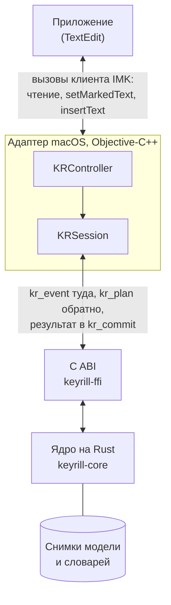
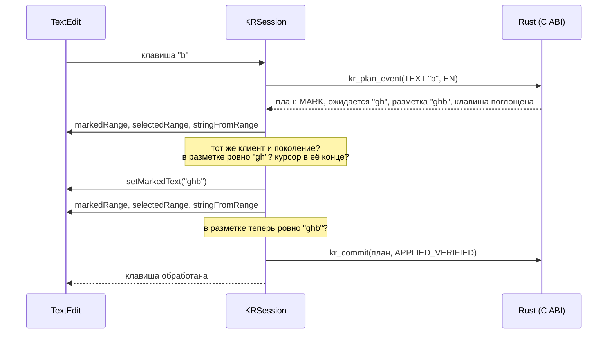
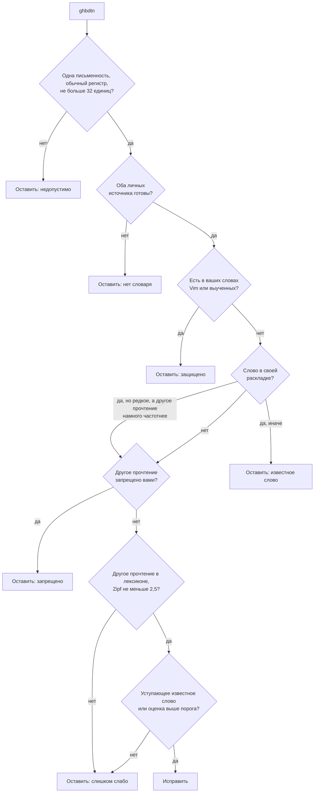
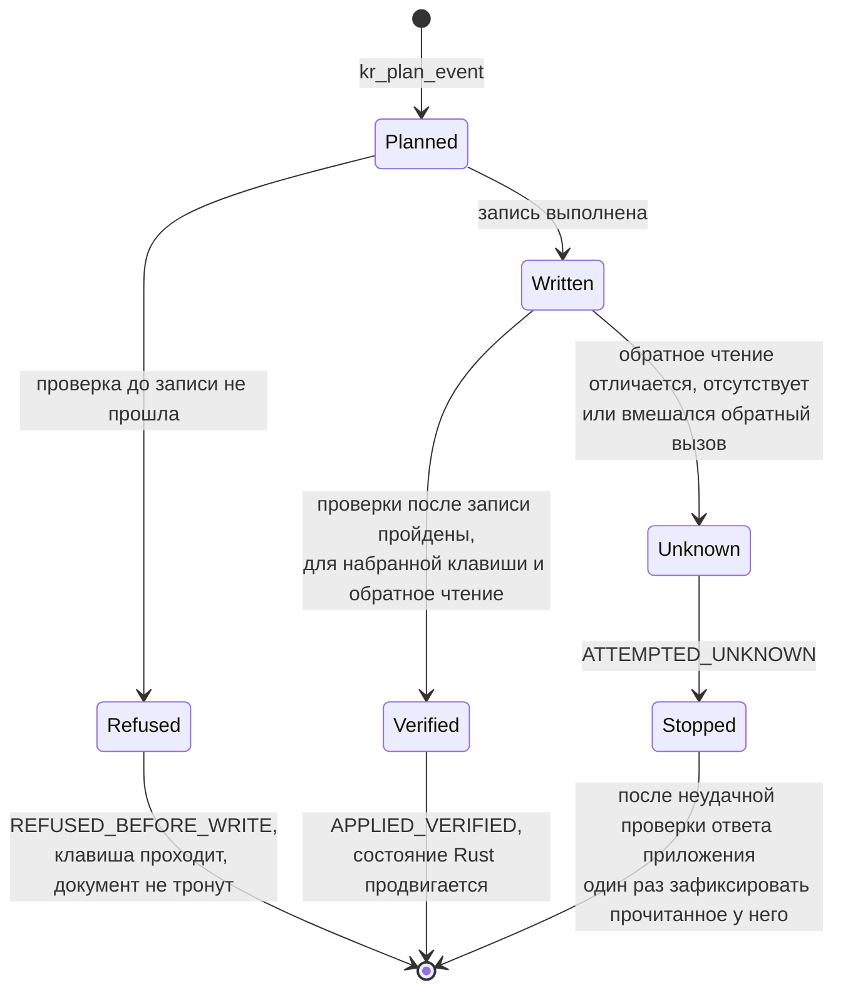
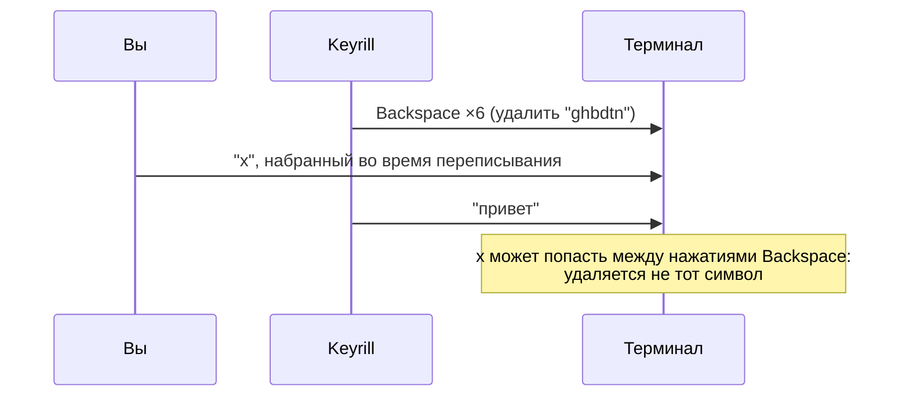

<!-- translation of docs/how-it-works.md at a4c1bc3aa7c0fdb00f4b8a1039cf468ada91c0ed -->

# Как работает Keyrill

В этом разделе мы проследим путь одного слова, `ghbdtn`, набранного с пробелом в TextEdit, от
нажатия клавиши до проверенной правки и на каждом этапе рассмотрим проверки, которые Keyrill
выполняет до правки и после неё. Раздел следует прочитать раньше справочных: в них используются
термины, которые вводятся здесь. Все приведённые числа взяты из поставляемой модели и настоящего
интерфейса C ABI, а не придуманы для примера.

## Два прочтения одних и тех же клавиш

Ошибка раскладки не оставляет следа в самих нажатиях. Пользователь хотел набрать `привет` в русской
раскладке, но была включена американская, и те же шесть физических клавиш дали латинские буквы:

| Клавиша | `G` | `H` | `B` | `D` | `T` | `N` |
| -- | -- | -- | -- | -- | -- | -- |
| Раскладка «США» | g | h | b | d | t | n |
| Русская ЙЦУКЕН | п | р | и | в | е | т |

Само преобразование, таким образом, сводится к поиску по таблице
(`crates/keyrill-core/src/mapping.rs`); вся трудность состоит в том, чтобы решить, *когда* его
применять. Ведь `hello` и `руддщ` тоже набираются одними и теми же клавишами, но слово, которое
пользователь мог иметь в виду, — только первое. Ошибочное исправление обходится пользователю дороже
пропущенного, поэтому Keyrill устроен так, чтобы в сомнительных случаях от исправления отказываться
([ADR 003](adr/003-conservative-inference.ru.md)). Целью выпуска является менее одного ложного
исправления на 10 000 правильно набранных слов.

## Почему метод ввода

Keyrill не наблюдает за экраном и не исправляет текст задним числом. Он сам является раскладкой:
пользователь выбирает **Keyrill English** или **Keyrill Russian** вместо стандартных источников
«США» и «Русская», поэтому каждая клавиша попадает в Keyrill раньше, чем в приложение. Набираемое
слово Keyrill держит в виде *размеченного текста* (англ. marked text) — подчёркнутой композиции,
которая принадлежит методу ввода, — и заменяет только эту разметку. В режиме композиции текст, уже
зафиксированный приложением, никогда не переписывается. Любой способ такого переписывания (заданное
число нажатий Backspace, временное выделение, буфер обмена) в некотором сценарии даёт сбой: удаляет
клавишу, набранную за это время, затирает выделение или оставляет текст в истории буфера обмена (см.
раздел
[«Архитектура»](../ARCHITECTURE.ru.md#%D0%B8%D0%BD%D0%B2%D0%B0%D1%80%D0%B8%D0%B0%D0%BD%D1%82%D1%8B-%D0%B1%D0%B5%D0%B7%D0%BE%D0%BF%D0%B0%D1%81%D0%BD%D0%BE%D1%81%D1%82%D0%B8)
и [ADR 005](adr/005-no-committed-text-rewrite.ru.md)). Единственное исключение составляет режим
совместимости, описанный ниже. Цена такого решения видна сразу: под текущим словом стоит
подчёркивание, а источник ввода приходится выбирать.

## Распределение обязанностей



Две части системы наделены разными полномочиями. Ядро на Rust принимает решения: ему известны
раскладки, модель, защищённые слова пользователя и состояние текущего слова, и на каждую клавишу оно
отвечает *планом*. К документу ядро не прикасается. Адаптер выполняет действия: он взаимодействует с
приложением, проверяет, что документ находится в том состоянии, которое ожидает план, выполняет
запись, читает результат обратно и сообщает, что произошло. План является предложением и права на
правку не даёт.

> [!IMPORTANT]
> Состояние Rust продвигается только при *проверенном подтверждении*, то есть когда пройдены все
> проверки, которых требует данная запись; для записи, вызванной клавишей, в их число входит
> обратное чтение документа с ожидаемым результатом. Фиксация, которую платформа запрашивает при
> потере фокуса, записывает последний проверенный в разметке текст без повторного чтения Проверки
> для каждого вида записи перечислены в
> [контракте правки](../ARCHITECTURE.ru.md#%D0%BA%D0%BE%D0%BD%D1%82%D1%80%D0%B0%D0%BA%D1%82-%D0%BF%D1%80%D0%B0%D0%B2%D0%BA%D0%B8).
> Запись, которая была предпринята, но не может быть подтверждена, объявляется неизвестной, и
> исправление прекращается. Ничего не угадывается, не исправляется и не повторяется.

## Набор слова

Каждая клавиша проходит один и тот же цикл. Рассмотрим третью клавишу, `b`, когда `gh` уже
размечено:



Перед записью сеанс проверяет клиента, точный размеченный диапазон, положение курсора в конце этого
диапазона и точный текст разметки в UTF-16. После записи он читает разметку обратно. Между этими
вызовами сеанс сверяет счётчик *поколения*. Дело в том, что любое обращение к клиенту может повлечь
обратный вызов метода ввода (смену фокуса, запрос фиксации), а обратный вызов, делающий сеанс
недействительным, увеличивает поколение; поэтому работа, начатая при старом поколении, отбрасывается
и не действует по устаревшему документу.

Самая первая буква планируется иначе, поскольку Keyrill пока ничего не принадлежит: сеанс читает
символ перед курсором, и слово начинается только в начале документа или после пробельного символа.
Курсор внутри `foo|bar` слова не начинает, так как целого слова для оценки там не оказалось бы.

При наборе всего слова движок выдаёт следующие планы (каждый из них адаптер проверяет и
подтверждает):

| Клавиша | Действие | Ожидается в разметке | Новая разметка | Клавиша |
| -- | -- | -- | -- | -- |
| `g` | MARK |  | `g` | поглощена |
| `h` | MARK | `g` | `gh` | поглощена |
| `b` | MARK | `gh` | `ghb` | поглощена |
| `d` | MARK | `ghb` | `ghbd` | поглощена |
| `t` | MARK | `ghbd` | `ghbdt` | поглощена |
| `n` | MARK | `ghbdt` | `ghbdtn` | поглощена |
| Пробел | MARK | `ghbdtn` | `привет ` | поглощена |

## Решение при нажатии пробела

Слово завершается пробелом, и только им: слово, за которым следует Return или Tab, фиксируется в
набранном виде. Затем движок вызывает `inference::infer`, который сначала ищет причину *не*
исправлять и лишь потом рассматривает доводы в пользу исправления:



Строка `ghbdtn` не является английским словом, поэтому решение принимается по оценке. Оценка
сравнивает вероятность того, что пользователь имел в виду `привет`, с вероятностью того, что он имел
в виду буквы в набранном виде; вычисление ведётся в десятичных логарифмах:

```math
\text{score} = \log_{10} f_{RU}(\text{привет}) - \log_{10} P_{EN}(\text{ghbdtn}) + \log_{10}\frac{p}{1-p} + \log_{10} c
```

| Слагаемое | Значение | Величина |
| -- | -- | -: |
| log₁₀ *f* | Частота слова `привет` среди русских слов (Zipf 5,13) | −3,87 |
| log₁₀ *P* | Насколько английской выглядит последовательность букв с точки зрения символьной модели второго порядка | −16,75 |
| *p* | Априорная вероятность того, что произвольное слово набрано в неверной раскладке, 0,001 | −3,00 |
| *c* | Контекст: 19, если предыдущие слова были русскими, 1/19, если английскими, 1, если их нет | 0 |
| **оценка** |  | **9,88** |

Для исправления оценка должна быть не меньше log₁₀ 100 = 2 (цена ложного исправления) с добавкой
штрафа для коротких слов: 4, 2 и 1 для слов из одной, двух и трёх букв. Слово `ghbdtn` проходит этот
порог с большим запасом. Строка `руддщ`, прочитанная как `hello`, получает оценку 4,59 и также
исправляется.

> [!NOTE]
> Эти оценки служат для ранжирования, их параметры подобраны, и откалиброванными вероятностями они
> не являются. Минимальный Zipf и описанное ниже правило для известных слов проверяются при
> [оценке](engine.ru.md#%D0%BE%D1%86%D0%B5%D0%BD%D0%BA%D0%B0), где те же предложения, набранные
> правильно, не получают ложных исправлений. Это синтетическое измерение, а не точность при реальном
> наборе.

Для слов из трёх единиц с условными знаками препинания в начале оценка повышается, если Zipf
русского кандидата не ниже 4 и контекст не поддерживает английский язык. Поэтому `[eq` исправляется
в `хуй`, а `,kz` в `бля` после пробела, в том числе в первом слове; правило оценки и его ограничения
приведены в разделе [«Вывод»](engine.ru.md#%D0%B2%D1%8B%D0%B2%D0%BE%D0%B4).

Труднее случай, когда строка является словом в обеих раскладках. Строка `yf` — редкая английская
запись (Zipf 2,37), и в то же время ею набирается слово `на`, одно из самых частых в русском языке
(Zipf 7,25). Защита известного слова снимается в пользу другого прочтения, только если оно само
редкое (Zipf ниже 3), а другое прочтение частотнее не менее чем на 2,5 по шкале Zipf, или на 3,5 для
слова из двух букв без русского контекста. Здесь разница составляет 4,88, поэтому `yf` преобразуется
в `на`. Строка `lf` (Zipf 3,40) лежит выше порога редкости и остаётся без изменений, хотя слово `да`
гораздо частотнее. После снятия защиты слово исправляется только на основании этой разности значений
Zipf, которая и становится его оценкой: для строки, уже имеющейся в лексиконе, символьная модель
ничего не добавляет.

## Запись и сохраняющаяся разметка

План для пробела заменяет разметку `ghbdtn` на `привет ` и поглощает пробел, так что пробел
оказывается внутри новой разметки. Слово вместе с пробелом остаётся размеченным до следующей
клавиши. От этого зависят две вещи. Во-первых, исправление по-прежнему можно точно отменить,
поскольку текст, поверх которого восстанавливался бы оригинал, всё ещё принадлежит Keyrill.
Во-вторых, движок хранит *квитанцию* — исходное слово `ghbdtn`, — которая действительна лишь до тех
пор, пока эта разметка принадлежит Keyrill. Кроме того, после исправления Keyrill просит macOS
переключиться на **Keyrill Russian**, чтобы следующее слово набиралось в той раскладке, которую
пользователь, по всей видимости, и имел в виду.

Следующая клавиша сначала завершает разметку и лишь затем планируется как начало нового слова:

| Клавиша | Действие | Ожидается | Новый текст | Клавиша |
| -- | -- | -- | -- | -- |
| `x` | FINISH | `привет ` | `привет ` зафиксировано | повторное планирование |
| `x` | MARK |  | `x` | поглощена |

Значение `KR_KEY_REPLAN` сообщает адаптеру, что первая запись затронула только старую разметку и ту
же клавишу нужно спланировать заново. Каждый план допускает не более одной записи.

## Отмена

Сочетание Control+Option+Z, нажатое сразу после исправления, планируется относительно той же
разметки:

| Клавиша | Действие | Ожидается | Новая разметка | Клавиша |
| -- | -- | -- | -- | -- |
| Control+Option+Z | MARK | `привет ` | `ghbdtn ` | поглощена |

Режим ввода при этом также переключается обратно, поскольку переключение было следствием
исправления. Как только следующая клавиша завершит разметку, срок действия квитанции истекает;
запоздалая отмена не выполняет никакой записи, потому что текст теперь принадлежит приложению и
Keyrill уже не может доказать, что именно он стал бы заменять.

## Если приложение ведёт себя иначе

Проверки, окружающие каждую запись, относят любой исход к одному из трёх видов, и лишь один из них
позволяет Rust продвинуться дальше:



Особой осторожности требует неизвестный исход. Запись произошла, но документ содержит не то, чего
ожидал Keyrill, и ни про одну из возможных дальнейших записей нельзя сказать, что она безопасна.
Если не прошла проверка обратного чтения после записи и повторного входа за это время не было,
Keyrill делает единственное, что сохраняет видимое пользователю: читает размеченный текст в том
виде, в каком его сообщает приложение, и, если этот текст по-прежнему точно занимает диапазон
разметки, фиксирует его без изменений. В остальных случаях он ничего не записывает. В обоих случаях
исправление данного слова прекращается. Клавиша, вызвавшая запись, поглощается и не повторяется, так
как она уже может находиться в документе. Со следующего слова исправление возобновляется, только
если за эту активацию уже была проверена хотя бы одна запись; в противном случае, а также после
второго неизвестного исхода оно остаётся выключенным до тех пор, пока пользователь не переключится в
другое место и обратно. Об этом сообщает первая строка меню ввода.

## Приложения, не поддерживающие композицию

Для композиции необходимо приложение, которое отображает размеченный текст и добросовестно позволяет
прочитать его обратно. Для TextEdit, Safari и Firefox это проверено; терминалы, редакторы кода и
Microsoft Office обслуживаются по-другому. Для них в Keyrill предусмотрен *режим совместимости*: он
отслеживает клавиши, которые пропускает, и по сочетанию Control+Option+K переписывает слово, посылая
нажатия Backspace и замену в виде синтетических событий клавиш. Прочитать результат этот режим не
может, а значит, не может его и проверить:



> [!WARNING]
> Режим совместимости отказывается от описанных выше гарантий: набор во время переписывания,
> автодополнение или смена фокуса могут привести к удалению не тех символов. Поэтому автоматическое
> исправление в этом режиме по умолчанию выключено, а сам режим оформлен как исключение
> ([ADR 006](adr/006-compatibility-backend.ru.md)).

При получении фокуса каждому приложению назначается один *уровень*: композиция, совместимость
(только ручная или также автоматическая) или «выключено». Менеджеры паролей, удалённые рабочие столы
и виртуальные машины отнесены к уровню «выключено»: клавиши в них проходят без изменений.

## Термины

Полный перечень терминов вместе с сокращениями приведён в [глоссарии](glossary.ru.md).

| Термин | Значение |
| -- | -- |
| Разметка, собственная композиция | Подчёркнутый текст, помещённый Keyrill вызовом `setMarkedText` и всё ещё ему принадлежащий; единственный текст, который Keyrill может изменять в режиме композиции |
| Разметка на границе | Исправленное слово с пробелом, которое остаётся размеченным до следующей клавиши, чтобы исправление можно было отменить |
| План | Предложение Rust для одной клавиши: действие, текст, который должна содержать разметка, новая разметка и решение о клавише |
| Подтверждение | Сообщение адаптера об исходе плана: проверено, отказ до записи или исход неизвестен |
| Поколение | Счётчик, который адаптер увеличивает при каждом обратном вызове, делающем состояние недействительным; работа более старого поколения отбрасывается |
| Квитанция | Исходное слово, сохранённое для отмены; действительна, пока её разметка на границе принадлежит Keyrill |
| Уровень | Способ обслуживания приложения: композиция, совместимость или «выключено» |
| Снимок | Неизменяемая, полностью разобранная копия модели или словаря; публикуется целиком и на месте никогда не изменяется |
| Zipf | Десятичный логарифм частоты слова на миллиард слов; 7 соответствует очень частому слову, 3 — редкому |

## Что читать дальше

Полная таблица состояний и инварианты безопасности, которые реализуются описанными шагами, приведены
в разделе [«Архитектура»](../ARCHITECTURE.ru.md). В разделе [«Движок»](engine.ru.md) описаны
отображение раскладок, правила вывода, форматы словарей и оценка; в разделе
[«Адаптер для macOS»](macos.ru.md) — проверки при работе с клиентами IMK, уровни и словари; в
разделе о [переносе на другие платформы](porting.ru.md) — то, что должна воспроизвести другая
платформа. Изучение кода рекомендуется начать с файла `crates/keyrill-ffi/tests/abi_smoke.c`: менее
чем в 200 строках на языке C он проходит тот же цикл планирования, проверки, записи и подтверждения
на документе в памяти.
