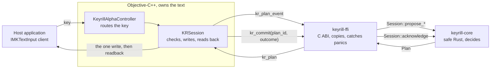

# Learning Rust and Objective-C++ through Keyrill

This is a guided reading of a real program, written for a programmer who knows C++, Python or
JavaScript and wants to learn [Rust](https://www.rust-lang.org/) and
[Objective-C++](https://en.wikipedia.org/wiki/Objective-C#Objective-C++) on code that does
something. Keyrill is an **input method**, the kind of program that sits between the keyboard and
every application and decides what text a key produces; this one fixes words typed in the wrong
keyboard layout, such as `ghbdtn` typed on the US layout when `привет` was meant.

The walkthrough asks for work. Read every excerpt, not only the text around it; run the commands; do
the exercises at the end before you look at the answers. A chapter read without the code teaches the
words and not the language.

## How to read this walkthrough

*Goal: know what the formatting means before you start.*

Every section opens with a line like the one above: what you will be able to do once you have read
it. A new term is set in **bold** where it first appears and is defined in the same sentence or the
next; later chapters link back to it, and the [glossary](../glossary.md) lists them all. Where an
idea has a counterpart in C++, Python or JavaScript, the text names it and says where the comparison
stops being true. Each section ends with a box of one or two facts to keep.

Every code **excerpt** is copied from this repository and captioned with its path and line numbers;
the caption links to the same lines on GitHub. `tools/check-excerpts.py` compares each excerpt with
its source on every build and fails when they differ, so what you read here is what the code
contains today.

> [!TIP]
> **Remember.** Bold marks a new term. An excerpt is the real code, checked on every build.

## Objective-C++? I've only heard of Objective-C

*Goal: know what Objective-C++ is and why this project needs it.*

**Objective-C** is the language Apple's frameworks were written in before Swift: C plus a small
object system borrowed from Smalltalk, in which you call a method by sending a **message**,
`[object doSomething]`. Everything C allows is still allowed. Most macOS programs written before
2014 are Objective-C, and the input-method framework this project uses, InputMethodKit, is an
Objective-C framework.

**Objective-C++** is not a separate language with its own rules. It is what Apple's compiler, clang,
produces when a file ends in `.mm` instead of `.m`: Objective-C and C++ mixed in one source file, so
a C++ object may hold an Objective-C object and an Objective-C method may take a C++ argument.
Keyrill's macOS code is in `.mm` files, compiled by `native/macos/build.sh` with
`clang++ -std=c++20 -fobjc-arc`.

The reason is concrete. A host application can raise an exception inside a call Keyrill makes, and
Keyrill must clean up and keep running. In Objective-C++, a C++ destructor, the function that cleans
up when an object is destroyed, runs while an Objective-C exception passes through, and the
automatic memory management releases objects on that path; in plain Objective-C, neither is true by
default. The [Objective-C chapter](objective-c.md) teaches the Objective-C half, and the
[Objective-C++ chapter](objective-cpp.md) shows what C++ adds and where this code depends on it.

> [!TIP]
> **Remember.** Objective-C++ is Objective-C and C++ in one `.mm` file. Keyrill uses it so that
> cleanup still happens when a host application raises an exception.

## One rule before any syntax

*Goal: know which half of the program does what, and why each half got its language.*

Keyrill is split between two languages, and the split follows one rule: **the Rust side may only
propose, and the native side may only act on a proposal after checking it**. Here *native* means the
platform's own code, the part written against Apple's frameworks.

Rust holds the decision and the state, because its compiler can prove things about them: that a
function can't change what it only reads, that every case of a choice is handled, that no reference
outlives its data. Objective-C++ holds the conversation with macOS and with the application being
typed into. Nothing can be proven there, because the other side is someone else's program, so every
answer it gives is checked.



One key goes round this loop once, sometimes twice. Rust answers the key with a **plan**: the text
the application must show now, the one change Keyrill may make, and what to do with the key
afterwards. The native side, the **adapter**, checks the application's text against the plan, makes
the change, reads the text back, and reports the **outcome**. Only a verified outcome moves Rust's
state forward.

> [!NOTE]
> A comparison for a reader from hardware design: the loop is speculative execution with a reorder
> buffer of depth one. A proposal issues into `pending`, a verified acknowledgement retires it into
> architectural state, and any other outcome is a flush. The native side's `_generation` counter
> plays the epoch tag that squashes work still in flight. The comparison is this walkthrough's, not
> a term the project uses.

The code is divided into four parts. A **crate** is Rust's unit of compilation: one library or one
program, compiled as a whole, much like a Python package or an npm package; Keyrill has two that
matter here.

| Part | Language | Owns | Never does |
| -- | -- | -- | -- |
| `crates/keyrill-core` | Safe Rust, standard library only | Layout maps, word model, inference, dictionaries, the word session | See a document, a native object or a pointer |
| `crates/keyrill-ffi` | Rust with `unsafe` code, which the compiler can't fully check | The C interface: handles, struct copies, panic containment, dictionary files | Call back into native code |
| `include/keyrill.h` | C | The contract both sides compile against | Change incompatibly without a version bump |
| `native/macos/src` | Objective-C++ | InputMethodKit, the application's text, Secure Input (the macOS mode for password fields), each change and its readback | Decide what a word should become |

The C header in the middle is how the two languages meet, through C's **ABI**, the agreement on
function names and the byte layout of structs (records of named fields) that compiled code from
different languages shares; the [C boundary](boundary.md) chapter explains it in full. A **panic**,
in the table and the diagram, is Rust's way of stopping on a bug, and it must never cross into C.

> [!TIP]
> **Remember.** Rust proposes, the adapter checks and acts, and only a verified outcome advances
> Rust's state.

## Chapters

*Goal: choose where to start, and set up the tools.*

| Chapter | What it teaches |
| -- | -- |
| [Rust in the core](rust.md) | Editions and crates, enums and `match`, ownership and borrowing, lifetimes, `Arc`, errors, iterators and closures |
| [The C boundary](boundary.md) | ABIs, `unsafe`, struct layouts pinned from both sides, handles, panics at the boundary, threads and locks |
| [Objective-C](objective-c.md) | Messages, classes, properties, protocols, reference counting, blocks, dispatch queues and exceptions |
| [Objective-C++](objective-cpp.md) | C linkage, destructors that run during Objective-C exceptions, C++ types inside Objective-C objects and back |
| [Reentrancy and tests](reentrancy-and-tests.md) | Why every call to the application is followed by a check, one word end to end, property tests and a hostile fake client |
| [Exercises](exercises.md) | Nine predict-then-run changes, each reproduced on this code |

Read the chapters in order; each one uses what the previous one taught. You need a Rust toolchain
(its version is pinned in `rust-toolchain.toml`, and [rustup](https://rustup.rs/) installs it on
first use) and, for the native parts, macOS with Command Line Tools. Run both commands once before
you start; each should finish with its tests passing:

```sh
cargo test -p keyrill-core     # the Rust core and the examples in its documentation
native/macos/build.sh check    # the adapter, built and tested against a fake application
```

None of the chapters installs the input method or selects an **input source**, the macOS name for a
keyboard layout or input method chosen from the menu bar.

> [!TIP]
> **Remember.** Read in order, run the code, and predict before you check an answer.
