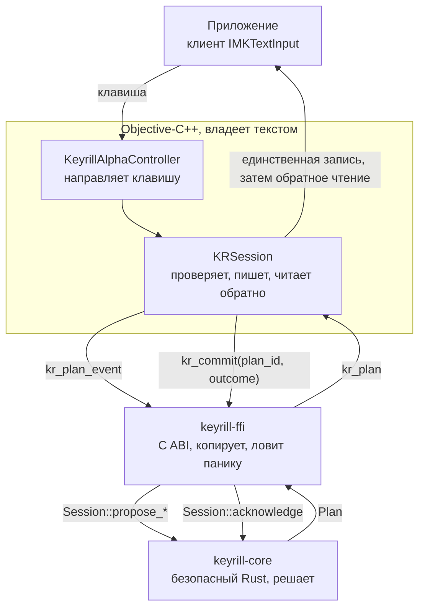

<!-- translation of docs/learn/README.md at a55dddaf14d7e52f7fe6218cad39f322f955fcad -->

# Изучаем Rust и Objective-C++ на примере Keyrill

Настоящий учебник представляет собой последовательное чтение работающей программы. Он предназначен
для программиста, знакомого с C++, Python или JavaScript, который хочет изучить
[Rust](https://www.rust-lang.org/) и
[Objective-C++](https://en.wikipedia.org/wiki/Objective-C#Objective-C++) на коде, решающем
практическую задачу. Keyrill является **методом ввода** (англ. input method), то есть программой,
которая находится между клавиатурой и всеми приложениями и определяет, какой текст даёт нажатая
клавиша. Этот метод ввода исправляет слова, набранные в неверной раскладке, например `ghbdtn`,
набранное в раскладке «США» вместо `привет`.

Учебник требует от читателя работы. Каждый фрагмент кода необходимо прочитать, а не ограничиваться
окружающим текстом; приведённые команды следует выполнить; упражнения в конце нужно решить до того,
как смотреть ответы. Глава, прочитанная без кода, научит словам, но не языку.

## Как читать этот учебник

*Цель: понять принятые в учебнике обозначения, прежде чем приступить к чтению.*

Каждый раздел верхнего уровня на этой странице и в пяти главах начинается строкой, подобной
приведённой выше: в ней сказано, чему читатель научится, изучив раздел. Подраздел может иметь
собственную строку цели, а у главы упражнений одна цель на весь практикум. Новый термин выделяется
**полужирным шрифтом** там, где он встречается впервые, и определяется в том же или в следующем
предложении; последующие главы ссылаются на это место, а [глоссарий](../glossary.ru.md) содержит
перечень всех терминов. При первом упоминании рядом с русским термином приводится английский,
поскольку именно его читатель встретит в коде, документации и сообщениях компилятора. Если у понятия
есть аналог в C++, Python или JavaScript, он указывается, причём оговаривается, где сравнение
перестаёт быть верным. В конце каждого такого раздела помещена рамка с одним-двумя фактами, которые
следует запомнить.

Каждый **фрагмент** кода взят из этого репозитория и снабжён подписью с путём к файлу и номерами
строк; подпись является ссылкой на те же строки в GitHub. При каждой сборке скрипт
`tools/check-excerpts.py` сравнивает все фрагменты с исходными файлами и сообщает об ошибке при
расхождении, так что читатель всегда видит код в его нынешнем виде. Комментарии в коде оставлены на
английском языке.

> [!TIP]
> **Запомните.** Полужирным шрифтом выделяются новые термины. Фрагмент — это настоящий код, который
> проверяется при каждой сборке.

## Objective-C++? Я слышал только об Objective-C

*Цель: понять, что такое Objective-C++ и зачем он нужен в этом проекте.*

**Objective-C** — язык, на котором до появления Swift писались фреймворки Apple. Он представляет
собой язык C, дополненный небольшой объектной системой, заимствованной из Smalltalk; метод в ней
вызывается посылкой **сообщения** (англ. message): `[object doSomething]`. Всё, что разрешено в C,
разрешено и здесь. На Objective-C написано большинство программ для macOS, созданных до 2014 года;
на нём же написан и фреймворк методов ввода InputMethodKit, которым пользуется этот проект.

**Objective-C++** не является отдельным языком со своими правилами. Так называют то, что компилирует
компилятор Apple, clang, когда имя файла оканчивается на `.mm`, а не на `.m`: смесь Objective-C и
C++ в одном исходном файле, при которой объект C++ может хранить объект Objective-C, а метод
Objective-C может принимать аргумент C++. Код Keyrill для macOS находится в файлах `.mm` и
компилируется скриптом `native/macos/build.sh` командой `clang++ -std=c++20 -fobjc-arc`.

Причина выбора вполне конкретна. Внутри вызова, который делает Keyrill, приложение может выбросить
исключение, и Keyrill обязан после этого навести порядок и продолжить работу. В Objective-C++
деструктор C++ — функция, выполняющая завершающие действия при уничтожении объекта, — срабатывает,
когда через него проходит исключение Objective-C, а автоматическое управление памятью освобождает
объекты на этом пути. В чистом Objective-C по умолчанию не выполняется ни то, ни другое.
[Глава об Objective-C](objective-c.ru.md) излагает ту часть языка, которая относится к Objective-C,
а [глава об Objective-C++](objective-cpp.ru.md) показывает, что добавляет C++ и в каких местах этот
код от него зависит.

> [!TIP]
> **Запомните.** Objective-C++ — это Objective-C и C++ в одном файле `.mm`. Keyrill использует его
> для того, чтобы завершающие действия выполнялись и тогда, когда приложение выбрасывает исключение.

## Одно правило прежде всякого синтаксиса

*Цель: понять, какую работу выполняет каждая половина программы и почему для каждой выбран свой
язык.*

Keyrill написан на двух языках, и разделение между ними подчиняется одному правилу: **сторона Rust
может только предлагать, а нативная сторона может действовать по предложению только после его
проверки**. Нативной здесь называется собственная часть платформы, написанная с использованием
фреймворков Apple.

Решения и состояние хранятся на стороне Rust, поскольку компилятор Rust способен кое-что о них
доказать: что функция не может изменить данные, которые она только читает; что обработан каждый
вариант выбора; что ни одна ссылка не переживает данных, на которые указывает. Objective-C++ ведёт
взаимодействие с macOS и с приложением, в котором набирается текст. О поведении приложения
компилятор Rust ничего доказать не может, потому что это чужая программа; поэтому адаптер проверяет
каждый её ответ.



Каждая клавиша проходит этот цикл один раз, иногда дважды. На каждую клавишу Rust отвечает
**планом** (англ. plan): каким должен быть текст приложения в данный момент, какое единственное
изменение разрешено сделать Keyrill и что делать с клавишей после этого. Нативная сторона,
**адаптер** (англ. adapter), сверяет текст приложения с планом, вносит изменение, читает текст
обратно и сообщает **исход** (англ. outcome). Продвигает состояние Rust только проверенный исход.

> [!NOTE]
> Для читателя, знакомого с проектированием аппаратуры, приведём сравнение: этот цикл подобен
> спекулятивному исполнению с буфером переупорядочивания глубиной в одну запись. Предложение
> заносится в `pending`, проверенное подтверждение фиксирует его в архитектурном состоянии, а любой
> другой исход вызывает сброс. Счётчик `_generation` на нативной стороне играет роль метки эпохи,
> которая аннулирует незавершённую работу. Это сравнение принято только в учебнике и термином
> проекта не является.

Код разделён на четыре части. **Крейтом** (англ. crate) называется единица компиляции Rust: одна
библиотека или одна программа, компилируемая целиком; крейт примерно соответствует пакету Python или
пакету npm. В Keyrill для нас важны два крейта.

| Часть | Язык | Чем ведает | Чего никогда не делает |
| -- | -- | -- | -- |
| `crates/keyrill-core` | Безопасный Rust, только стандартная библиотека | Карты раскладок, модель слов, вывод, словари, сеанс слова | Не видит ни документа, ни нативного объекта, ни указателя |
| `crates/keyrill-ffi` | Rust с кодом `unsafe`, который компилятор не может полностью проверить | Интерфейс C: дескрипторы, копии структур, перехват паники, файлы словарей | Не вызывает нативный код в обратную сторону |
| `include/keyrill.h` | C | Контракт, по которому компилируются обе стороны | Не изменяется несовместимо без увеличения номера версии |
| `native/macos/src` | Objective-C++ | InputMethodKit, текст приложения, Secure Input (режим macOS для полей паролей), каждое изменение и его обратное чтение | Не решает, каким должно стать слово |

Заголовочный файл C в середине является местом встречи двух языков. Они встречаются через **ABI**
языка C — соглашение об именах функций и о побайтовом расположении структур (записей с именованными
полями), общее для скомпилированного кода на разных языках; подробно ABI разобран в главе о
[границе C](boundary.ru.md). **Паника** (англ. panic), упомянутая в таблице и на схеме, — это
способ, которым Rust останавливает работу при ошибке в программе; переходить в код на C паника не
должна ни в коем случае.

> [!TIP]
> **Запомните.** Rust предлагает, адаптер проверяет и действует, и только проверенный исход
> продвигает состояние Rust.

## Главы

*Цель: выбрать, с чего начать, и подготовить инструменты.*

| Глава | Содержание |
| -- | -- |
| [Rust в ядре](rust.ru.md) | Редакции и крейты, перечисления и `match`, владение и заимствование, времена жизни, `Arc`, ошибки, итераторы и замыкания |
| [Граница C](boundary.ru.md) | ABI, `unsafe`, расположение структур, закреплённое с обеих сторон, дескрипторы, паника на границе, потоки и блокировки |
| [Objective-C](objective-c.ru.md) | Сообщения, классы, свойства, протоколы, подсчёт ссылок, блоки, очереди диспетчеризации и исключения |
| [Objective-C++](objective-cpp.ru.md) | Связывание C, деструкторы, работающие во время исключений Objective-C, типы C++ внутри объектов Objective-C и наоборот |
| [Реентерабельность и тесты](reentrancy-and-tests.ru.md) | Почему за каждым обращением к приложению следует проверка, одно слово от начала до конца, тесты свойств и враждебный фальшивый клиент |
| [Упражнения](exercises.ru.md) | Девять изменений по схеме «предскажи, затем запусти», каждое проверено на этом коде |

Главы следует читать по порядку: каждая опирается на материал предыдущей. Потребуются инструменты
Rust (их версия закреплена в `rust-toolchain.toml`, и [rustup](https://rustup.rs/) установит её при
первом запуске), а для нативной части — macOS с Command Line Tools. Перед началом работы выполните
обе команды; каждая должна завершиться успешным прохождением тестов:

```sh
cargo test -p keyrill-core     # the Rust core and the examples in its documentation
native/macos/build.sh check    # the adapter, built and tested against a fake application
```

Ни одна глава не устанавливает метод ввода и не выбирает **источник ввода** (англ. input source) —
так macOS называет раскладку клавиатуры или метод ввода, выбираемые в строке меню.

> [!TIP]
> **Запомните.** Читайте по порядку, запускайте код и делайте предсказание, прежде чем проверять
> ответ.
