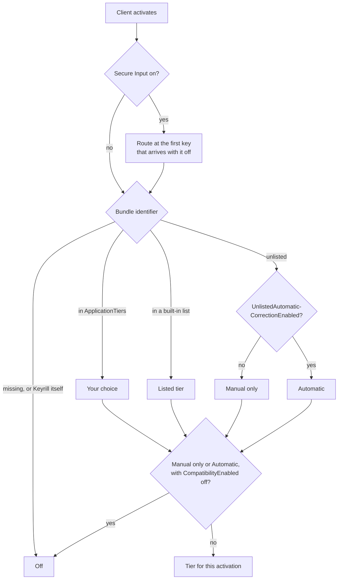
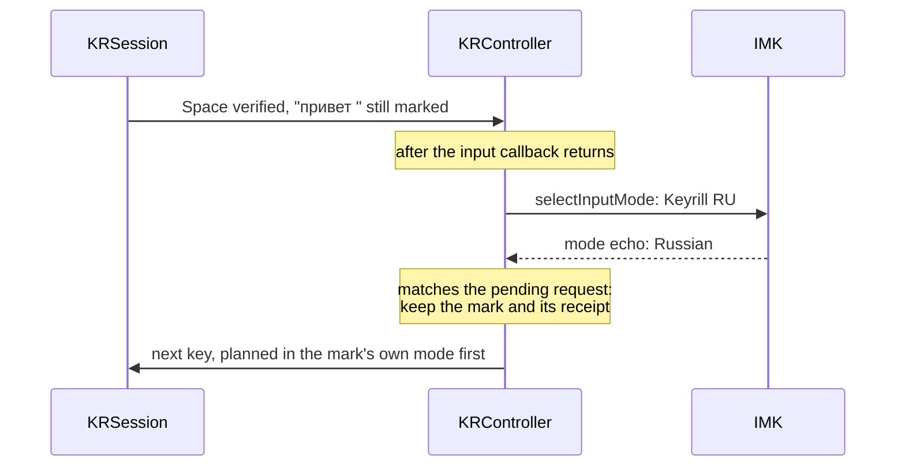
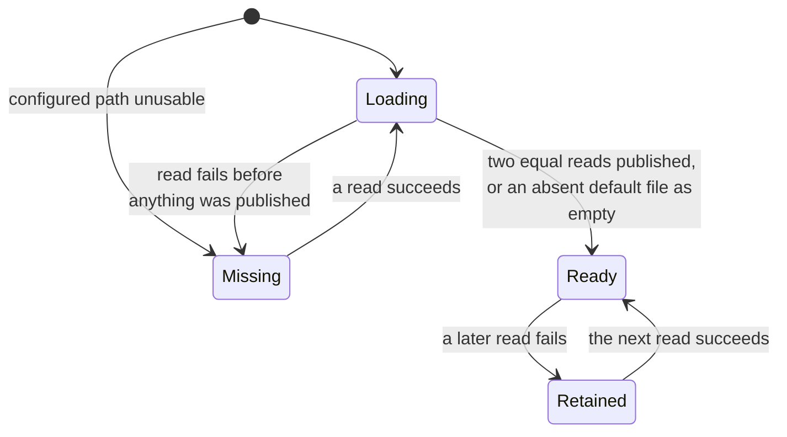

# macOS adapter

`native/macos` is an InputMethodKit input method written in Objective-C++ with ARC. It links the
`keyrill-ffi` static library and calls Rust only through `include/keyrill.h`. Building, signing and
installing it are covered in the [README](../README.md#install-from-source); the
[walkthrough](how-it-works.md) shows one correction through these files.

| File | Role |
| -- | -- |
| `src/main.mm` | Reads configuration, prewarms the model, starts `IMKServer` |
| `src/KRController.mm` | `IMKInputController`: lifecycle, input menu, tier routing, source switching |
| `src/KRSession.mm` | Owned-composition session: client checks, plan/acknowledge loop with Rust |
| `src/KRCompatibility.mm` | Compatibility backend: observed input, event posting, metadata guard |
| `src/KRRuntime.mm` | Policy and tier snapshot, dictionary acquisition worker, deferred adoption |
| `src/KRPreferences.mm` | Settings window and preference merging |
| `src/KRKeys.mm` | `NSEvent` to `kr_event` translation, including the two command chords |
| `tools/` | `input_icons` (icon checks and generation), `source_status`, `source_enable --plan` |
| `tests/` | Controlled session, runtime and preferences tests; browser fixture |

## Bundle identity

The bundle is `KeyrillAlpha.app`, identifier `org.keyrill.inputmethod.alpha`, connection
`org.keyrill.inputmethod.alpha_Connection`, with modes `.English` and `.Russian` shown as **Keyrill
EN** and **Keyrill RU**. `Info.plist` declares the controller class, the connection name,
`ComponentInputModeDict` with both modes and `TISIntendedLanguage`, and the Latin and Cyrillic
repertoire. Keep the plist and the server initialization in agreement. `build.sh` reads
`CFBundleIdentifier` from the plist and compiles it in as `KR_BUNDLE_IDENTIFIER`; the mode
identifiers and Keyrill's own Off tier derive from it, and the server refuses to start from a bundle
with a different identifier.

Registration, enablement, appearance in Settings, selection, server launch, controller activation,
key delivery and correct document output are eight separate checks. `native/macos/build.sh status`
reads the TIS identities and flags without changing anything. A mode needs both its own and its
parent's enabled state to be selectable. Don't edit `AppleEnabledInputSources`, reset input-source
databases or mint new identifiers to work around a registration failure; start with read-only
diagnostics.

The deployment target is macOS 13.0, which is a compile setting, not a tested OS range. Ad-hoc or
self-signed code signing checks integrity only. There is no Developer ID signing, notarization or
stapling yet.

## Application tiers

Every application falls in one tier, chosen by bundle identifier when a client activates and before
any edit:

| Tier | Behavior | Built-in applications |
| -- | -- | -- |
| Composition (direct editing) | Owned composition: automatic and manual correction, reversal, exact checks | TextEdit, Safari, Firefox |
| Manual only | Compatibility backend on Control+Option+K and Control+Option+Z only | Terminals, editors and IDEs with completion, Microsoft Office |
| Automatic | Compatibility backend, also correcting on Space | None |
| Off | Pass-through, no client inspection | Password managers, remote desktops and virtual machines, Keyrill itself |

An unlisted application gets Manual only, or Automatic when `UnlistedAutomaticCorrectionEnabled` is
on. A missing, empty or non-string bundle identifier is Off. With `CompatibilityEnabled` off, Manual
only and Automatic become Off; an unlisted application never gets composition. Secure Input passes
every key whatever the tier.

The built-in lists live in `KRRuntime.mm`. Composition entries match the bundle identifier exactly.
The others ignore case, and an entry ending in a dot matches a prefix:

| Tier | Bundle identifiers |
| -- | -- |
| Composition | `com.apple.TextEdit`, `com.apple.Safari`, `org.mozilla.firefox` |
| Manual only | `com.apple.Terminal`, `com.googlecode.iterm2`, `com.mitchellh.ghostty`, `com.github.wez.wezterm`, `org.alacritty`, `net.kovidgoyal.kitty`, `dev.warp.Warp-Stable`, `dev.warp.Warp-Preview`, `co.zeit.hyper`, `com.umputun.agterm`, `com.umputun.agterm.debug`, `com.apple.dt.Xcode`, `com.microsoft.VSCode`, `com.microsoft.VSCodeInsiders`, `com.jetbrains.` (prefix), `com.sublimetext.3`, `com.sublimetext.4`, `dev.zed.Zed`, `dev.zed.Zed-Preview`, `org.vim.MacVim`, `org.gnu.Emacs`, `com.microsoft.Word`, `com.microsoft.Excel`, `com.microsoft.Powerpoint`, `com.microsoft.Outlook` |
| Off | `com.1password.1password`, `com.agilebits.onepassword7`, `com.apple.Passwords`, `com.apple.keychainaccess`, `com.apple.ScreenSharing`, `com.microsoft.rdc.macos` (Microsoft Remote Desktop and Windows App), `com.parallels.desktop.console`, `com.utmapp.UTM`, `com.vmware.fusion` |

**Correction in This App** in the input menu overrides the active application's tier, or returns it
to the default. The choice is stored in `ApplicationTiers` and applied at once: the controller
installs a runtime built from the new preferences, finishes an owned mark through the verified path
and routes the application again. Any tier can be chosen for any application except Keyrill itself.
Choosing Composition for an application outside the built-in list admits a client that hasn't been
tested; one that can't reflect and read back marked text stops correction at its first word.

Admission is per application, not per field: every surface of an admitted application is eligible,
including address bars and inspectors. Routing reads only the client's bundle identifier.
`IsSecureEventInputEnabled` is checked before routing and before a key's characters are read; when
it is on at activation, routing waits for the first key that arrives with it off. It is a global
guard, not per-field password detection. agterm is Manual only because its client gives
preedit-relative ranges without substring readback, so even the first marked update can't be
verified.

### Composition

Before starting, the session requires an admitted client, a known mode, a collapsed valid caret, no
foreign mark and a complete token context. After that, every write is bracketed by checks of the
same client and generation, and the generation is rechecked after every client call. The
[edit contract](../ARCHITECTURE.md#edit-contract) lists every check, key disposition and outcome;
`KRSession apply:client:generation:` implements it with these IMK calls:

| Write | IMK call |
| -- | -- |
| Start, update or empty the word | `setMarkedText:selectionRange:replacementRange:` over the current selection |
| Finish with new text | `insertText:replacementRange:` over the current selection |
| Finish unchanged | `insertText:replacementRange:` over the exact marked range |

The mark and caret checks read `markedRange` and `selectedRange`. "Exact text" is a readback through
`stringFromRange:actualRange:` that must return the expected UTF-16 units over the expected range,
and the range IMK actually returned must be that range.

The two unchanged finishes relax checks for a reason Firefox supplies. It moves the caret on focus
loss before IMK asks for the commit, so an unchanged commit, which replaces the exact marked range
with the same text, skips the caret. When IMK or the controller requests the commit (commit request,
deactivation, a mode change or a click) rather than a typed key, Firefox's readback over the exact
range matches nothing typed at that moment, and after committing on its own it keeps reporting the
old marked range, which would block every later word in the field. So the session writes back the
text it last verified in the mark without reading it again. Only Keyrill changes its own mark, and
the exact marked range is still required.

Secure Input is checked at entry and again after each client query that precedes a text read or a
write. Range units, `NSNotFound` sentinels and mark-relative selection are kept distinct; arithmetic
is checked against overflow and surrogate splits.

`setMarkedText` gets the attributed value with a selection relative to that value. The tested
clients update their active composition under the `NSNotFound` replacement range; this is used only
for the owned composition, never to replace a selection or a remembered committed range. Clients
that lack document access can ignore explicit ranges, so selector availability is no reason to admit
a client.

After Space, the word and Space stay marked until the next event. That keeps reversal possible and
avoids Firefox returning empty ranges for immediately committed text, at the cost of a longer
underline and per-host Undo grouping. An empty composition uses an empty owned `setMarkedText`;
empty `insertText` left a stray character in TextEdit.

The controller handles activation, mode changes, commit requests, cancellation, deactivation and
shutdown, invalidating generations before stale work can run. It recognizes left mouse-down so it
can finish a valid mark and return unhandled: a keyboard-only event mask swallowed clicks in
Firefox. Ordinary keys arrive already translated by the host and the selected layout; only supported
letters are composed, and dead keys, Option input and shortcuts pass through after a finish. An
uncertain update stops correction for that word and shows a pause in the input menu; the next text
key starts a new word from the same fresh client checks as a first one. The session stays stopped
until reactivation after a second uncertain update in the activation, or when no write has verified
since activation, as in a client that ignores writes.

When the client's readback after a write doesn't match, the effect is unknown. An NSTextView
replaces marked text with the next key the input method passes, so a stopped session would lose the
word on the following key. Keyrill therefore reads the marked range and its exact text once and
commits that readback with `insertText(readback, markedRange)`, then stops.

> [!IMPORTANT]
> This is the only write after an unknown effect, and it repairs nothing: it keeps what the client
> shows. Nothing is written when the mark, its exact readback or the range IMK returns is
> unavailable, after a reentrant callback or client exception, or once Secure Input is on. The key
> keeps its disposition: a mark that carried it consumed it, a finish passes it.

### Compatibility

The compatibility session watches passed-through input in bounded memory and rewrites the observed
run by posting Backspace and Unicode key events to the captured foreground process. Automatic
correction also requires that run to start after a Space observed since reset. The original Space
passes and is counted in the deletion; the replacement carries its own Space. A listen-only event
tap, the *guard*, observes mouse, navigation, shortcut and source changes without reading characters
and expires tracking on them; each such event, and the tap being switched off by a timeout, advances
the process-wide *guard generation*. Secure Input, foreground identity, the guard generation and the
session generation are rechecked before each post. Synthetic events are tagged, and a bounded
expected-key sequence suppresses replanning when a tag is stripped.

It needs Accessibility (event posting) and Input Monitoring (the guard tap) already granted, and
only for applications in the Manual only or Automatic tier. Keyrill preflights both without
prompting when such an application activates and shows each missing permission in the input menu;
missing access disables compatibility and leaves typing alone. The guard tap starts on main after an
activation, outside the callback, so permissions granted later take effect at the next activation. A
tap the system disables by timeout or user input is re-enabled and tracking restarts. Permissions
are preflighted once per handled key, not before each posted event: a revocation between two posts
of one synchronous batch is a race that a check before each post can't close either.

> [!WARNING]
> None of this verifies the host's result. The guarantees the compatibility backend gives up are
> listed in [ADR 006](adr/006-compatibility-backend.md).

## Configuration

`main.mm` reads the defaults domain `org.keyrill.inputmethod.alpha` at startup. External `defaults`
edits need a restart; the Settings window applies changes in-process.

| Key | Meaning |
| -- | -- |
| `AutomaticCorrectionEnabled` | `true` selects the model policy. Default off |
| `AutomaticInputSourceSwitchingEnabled` | Switch modes after an automatic correction. Default on |
| `EnglishDictionaryPath` | Absolute path, at most 1,024 bytes. Default `~/.vim/spell/en.utf-8.add` |
| `RussianDictionaryPath` | Same, default `~/.vim/spell/ru.utf-8.add` |
| `CompatibilityEnabled` | Allow the Manual only and Automatic tiers. Default on; off makes them Off |
| `UnlistedAutomaticCorrectionEnabled` | Unlisted applications get Automatic instead of Manual only. Default off |
| `ApplicationTiers` | Dictionary of bundle identifier to `composition`, `automatic`, `manual` or `off`. Written by the input menu |

Boolean keys take an `NSNumber`; any other type disables the feature. `ApplicationTiers` entries
with another key or value type, an unknown tier name or Keyrill's own identifier are ignored. A file
that doesn't exist at a default path is an empty dictionary until one is created there; a file that
doesn't exist at a configured path, or a present but unusable path, leaves that language missing and
never falls back to another file. The home directory comes from `getpwuid_r`, not `$HOME`. With the
model selected, the asset is validated on the main thread before `IMKServer` starts; a failure
leaves automatic correction off.

**Settings…** in the input menu opens a non-modal window with the automatic-correction switch,
source switching, compatibility options and both dictionary paths. Save merges these keys into the
domain, keeping unrelated ones such as `ApplicationTiers`, and installs a replacement runtime. Each
controller finishes its old owned mark through the verified path and picks up the new configuration
on its next activation. Dictionary contents are never displayed or logged.

## Input-source switching

After an automatic correction Keyrill asks IMK for the Keyrill mode of the corrected language;
manual conversion doesn't switch. Composition requests the switch with the verified word and Space
still marked. The request runs on main after the input callback, rechecks controller, runtime,
generation, mode, guard generation and Secure Input, and is cancelled by newer real input or any
lifecycle callback. It doesn't consult TIS: in the input method's process
`TISCopyCurrentKeyboardInputSource` reports the overridden keyboard layout, such as
`com.apple.keylayout.US`, not the Keyrill mode. `selectInputMode:` reports nothing, so a mode that
isn't enabled in Input Sources silently stays unselected. `_mode` changes only on IMK's mode echo,
and keys typed before the echo arrives still use the old mode.

When the echo matches Keyrill's own pending request, with no guard event other than source changes
since, the controller keeps the session, the owned mark and its reversal. The mark is still planned
in its own mode: reversal or Escape restores the typed word there, and any other key finishes the
mark before it is planned in the new mode. Any other mode change finishes the mark first. Reversing
a correction in the mode Keyrill switched to also requests the original mode again, because the
switch was a consequence of the correction: keeping the new mode would type the next word in the
layout the user just rejected.

Compatibility requests the switch after full dispatch and keeps its tracked word at the echo in the
same way: a reversal in the new mode rewrites in the word's mode and switches back, and any other
input first restarts tracking in the new mode with the already-observed Space as the boundary.

Whether IMK calls `commitComposition:` or the client commits its mark during `selectInputMode:`
hasn't been observed on a physical host. Either way the result is safe: a `commitComposition:`
finishes the mark through the verified path, and a mark the client dropped makes the next update's
readback check fail before any write, so reversal is refused rather than written over committed
text.

## Dictionaries

`keyrill-ffi`'s `vocabulary_source` (exported as `kr_vocabulary_*`) reads the two files on one
serial utility queue, right after configuration and then every 2 seconds. It follows symlinks,
requires a regular file before and after opening, opens read-only with `O_NONBLOCK | O_NOCTTY`,
reads at most 1 MiB plus one byte, and compares descriptor and path identity, size, mtime and ctime
around the read. Two equal observations of identity and bytes publish an immutable snapshot;
failures keep the last good one. For a default path the adapter passes the account's home directory
to `kr_vocabulary_configure_default`, which names `~/.vim/spell/{en,ru}.utf-8.add`: while no file
there has been published, a path that doesn't exist publishes an empty source. Once a file has been
published, its absence keeps the last good snapshot, since an editor that saves by rename can leave
the path briefly absent.

The same queue reads the list Learn Spelling writes,
`~/Library/Group Containers/group.com.apple.AppleSpell/Library/Spelling/LocalDictionary`, into
learned slot `KR_LEARNED`, with a missing file counted as empty. It is one list for all languages,
and the path is undocumented; the older `~/Library/Spelling/LocalDictionary` isn't read. Because
this file lives under the home, the home is resolved even when both language paths are set
explicitly. The group container belongs to Apple's spell service, and macOS protects group
containers from other apps; whether the input method's read raises an "access data from other apps"
prompt hasn't been checked on a physical host. A denied read leaves the list missing, which the menu
shows and correction ignores.

Each source is in one of these states; the input menu shows a source only when it is missing or
retained:

`Retained` shows as "update rejected, previous kept": correction goes on with the last good
snapshot. Only `Missing` on an English or Russian source keeps automatic correction off.

> [!CAUTION]
> Two equal observations are a settling heuristic, not proof that a save finished: a writer paused
> after truncation across both reads can publish an empty file and drop protection.

Snapshots are adopted on main, outside any input callback, outside client dispatch and with no
pending Rust plan; a refused adoption retries on the next observation. Adoption keeps history and
the reversal receipt and makes no client calls. Shutdown never waits for a read in progress.

The input menu leads with one line saying whether automatic correction runs on the next Space in the
active application, or the first reason it doesn't: Keyrill off there, correction paused after a
failed check, manual only, missing permissions, policy off, a missing dictionary, or dictionaries
still loading. Below it the menu lists only what explains a failure: a tier that couldn't be saved,
a failed layout switch, each missing permission, a compatibility status other than ready, why the
last word was left alone (excluded field, Secure Input, no word boundary, the app changing the mark,
caret or text, no readback, engine refusal, client exception), and each missing or retained source.
The **Correction in This App** submenu opens with the application's tier and where it comes from
(built-in, unlisted or the user's setting). None of it contains text, offsets, bundle identifiers or
paths, and none of it queries the client; the tier comes from the bundle identifier read at routing.

## Bundle

`native/macos/build.sh bundle` builds the one bundle; tiers and preferences decide admission. The
[browser fixture](testing.md#browser-fixture) is a test file and isn't bundled. Use a fresh
`.noindex` output directory so Spotlight and LaunchServices don't pick up build products as a second
input method.

## Icons

Each mode declares a `TISIconLabels` text label, EN or RU, requesting a badge rendered by macOS. The
key is undocumented; whether a release honors it needs physical confirmation. `resources/icons`
holds the fallback: Template and Selected masters for the menu bar, drawn as a rounded badge with
the letters cut out, and black-on-white palette badges for the switcher, at 16 and 32 pixels each.
Builds check references, representations, transparency and monochrome ink but never render them. To
regenerate, run `input_icons --write` (masters) or `input_icons --write-palette` (badges) from the
native output directory against `native/macos/resources/icons`, then review the new files.
