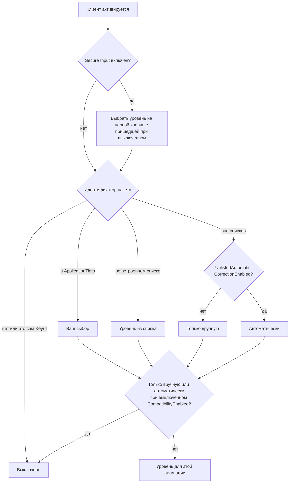
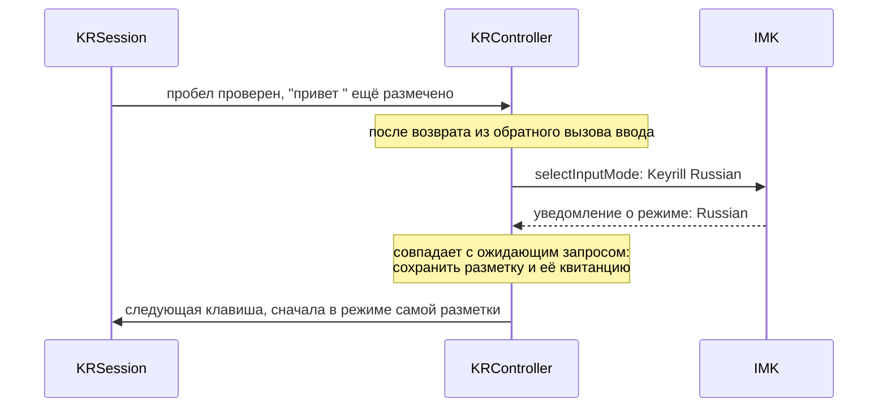
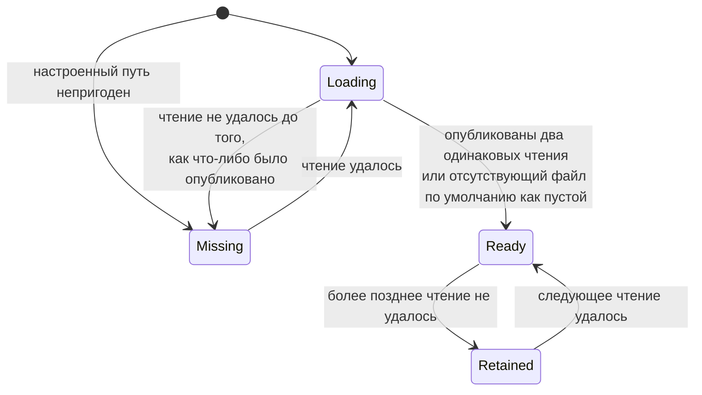

<!-- translation of docs/macos.md at 1b0ad5868c86e147e7ed1dad272a1cdb543af16d -->

# Адаптер для macOS

Каталог `native/macos` содержит метод ввода, построенный на InputMethodKit и написанный на
Objective-C++ с автоматическим подсчётом ссылок (ARC). Он компонуется со статической библиотекой
`keyrill-ffi` и обращается к Rust только через `include/keyrill.h`. Сборка, подпись и установка
описаны в
[README](../README.ru.md#%D1%83%D1%81%D1%82%D0%B0%D0%BD%D0%BE%D0%B2%D0%BA%D0%B0-%D0%B8%D0%B7-%D0%B8%D1%81%D1%85%D0%BE%D0%B4%D0%BD%D0%BE%D0%B3%D0%BE-%D0%BA%D0%BE%D0%B4%D0%B0),
а прохождение одного исправления через перечисленные ниже файлы прослежено в
[пошаговом разборе](how-it-works.ru.md).

| Файл | Назначение |
| -- | -- |
| `src/main.mm` | Чтение конфигурации, предварительная загрузка модели, запуск `IMKServer` |
| `src/KRController.mm` | `IMKInputController`: жизненный цикл, меню ввода, выбор уровня, переключение источников |
| `src/KRSession.mm` | Сеанс собственной композиции: проверки клиента, цикл «план — подтверждение» с Rust |
| `src/KRCompatibility.mm` | Режим совместимости: наблюдаемый ввод, отправка событий, страж по метаданным |
| `src/KRRuntime.mm` | Снимок политики и уровней, чтение словарей в фоновой очереди, отложенное подключение снимков |
| `src/KRPreferences.mm` | Окно настроек и объединение настроек |
| `src/KRKeys.mm` | Преобразование `NSEvent` в `kr_event`, включая два сочетания клавиш для команд |
| `tools/` | `input_icons` (проверка и создание значков), `source_status`, `source_enable --plan` |
| `tests/` | Контролируемые тесты сеанса, среды выполнения и настроек; браузерный стенд |

## Пакет и его идентификаторы

Пакет называется `KeyrillAlpha.app` и имеет идентификатор `org.keyrill.inputmethod.alpha`; имя
соединения — `org.keyrill.inputmethod.alpha_Connection`. Режимы ввода `.English` и `.Russian`
отображаются в системе как **Keyrill English** и **Keyrill Russian**. В файле `Info.plist` объявлены
класс контроллера, имя соединения, словарь `ComponentInputModeDict` с обоими режимами и их
`TISIntendedLanguage`, а также латинский и кириллический наборы символов. Содержимое plist и
инициализация сервера должны соответствовать друг другу. Скрипт `build.sh` читает
`CFBundleIdentifier` из plist и передаёт его компилятору как `KR_BUNDLE_IDENTIFIER`; из этого
значения выводятся идентификаторы режимов и собственный уровень «выключено» для самого Keyrill, а из
пакета с другим идентификатором сервер запускаться отказывается.

Регистрация, включение, появление в настройках, выбор, запуск сервера, активация контроллера,
доставка клавиш и правильный результат в документе представляют собой восемь отдельных проверок.
Команда `native/macos/build.sh status` читает идентификаторы и флаги TIS, ничего не изменяя. Для
того чтобы режим можно было выбрать, должны быть включены и сам режим, и его родительский источник.
При сбое регистрации не следует править `AppleEnabledInputSources`, сбрасывать базы источников ввода
или придумывать новые идентификаторы; начинать нужно с диагностики, которая только читает состояние.

Минимальная целевая версия — macOS 13.0; это параметр компиляции, а не проверенный диапазон версий
системы. Подпись кода ad hoc или самоподписанным сертификатом подтверждает только целостность.
Подписи Developer ID, нотариального заверения и вшитого билета (stapling) пока нет.

## Уровни приложений

Каждое приложение относится к одному уровню, который выбирается по идентификатору пакета при
активации клиента, до начала любой правки:

| Уровень | Поведение | Встроенные приложения |
| -- | -- | -- |
| Композиция (прямое редактирование) | Собственная композиция: автоматическое и ручное исправление, отмена, точные проверки | TextEdit, Safari, Firefox |
| Только вручную | Режим совместимости только по Control+Option+K и Control+Option+Z | Терминалы, редакторы и среды разработки с автодополнением, Microsoft Office |
| Автоматически | Режим совместимости, который исправляет также по пробелу | Нет |
| Выключено | Клавиши пропускаются без изменений, обращений к клиенту нет | Менеджеры паролей, удалённые рабочие столы и виртуальные машины, сам Keyrill |

Приложение, не входящее в списки, получает уровень «только вручную», а если включён параметр
`UnlistedAutomaticCorrectionEnabled`, — уровень «автоматически». Если идентификатор пакета
отсутствует, пуст или не является строкой, назначается уровень «выключено». При выключенном
`CompatibilityEnabled` уровни «только вручную» и «автоматически» заменяются уровнем «выключено»;
приложение вне списков никогда не получает композицию. При включённом режиме Secure Input все
клавиши пропускаются без изменений независимо от уровня.

Встроенные списки находятся в файле `KRRuntime.mm`. Записи уровня композиции сравниваются с
идентификатором пакета точно. Остальные записи сравниваются без учёта регистра, причём запись,
оканчивающаяся точкой, задаёт префикс:

| Уровень | Идентификаторы пакетов |
| -- | -- |
| Композиция | `com.apple.TextEdit`, `com.apple.Safari`, `org.mozilla.firefox` |
| Только вручную | `com.apple.Terminal`, `com.googlecode.iterm2`, `com.mitchellh.ghostty`, `com.github.wez.wezterm`, `org.alacritty`, `net.kovidgoyal.kitty`, `dev.warp.Warp-Stable`, `dev.warp.Warp-Preview`, `co.zeit.hyper`, `com.umputun.agterm`, `com.umputun.agterm.debug`, `com.apple.dt.Xcode`, `com.microsoft.VSCode`, `com.microsoft.VSCodeInsiders`, `com.jetbrains.` (префикс), `com.sublimetext.3`, `com.sublimetext.4`, `dev.zed.Zed`, `dev.zed.Zed-Preview`, `org.vim.MacVim`, `org.gnu.Emacs`, `com.microsoft.Word`, `com.microsoft.Excel`, `com.microsoft.Powerpoint`, `com.microsoft.Outlook` |
| Выключено | `com.1password.1password`, `com.agilebits.onepassword7`, `com.apple.Passwords`, `com.apple.keychainaccess`, `com.apple.ScreenSharing`, `com.microsoft.rdc.macos` (Microsoft Remote Desktop и Windows App), `com.parallels.desktop.console`, `com.utmapp.UTM`, `com.vmware.fusion` |

Пункт **Correction in This App** меню ввода позволяет переопределить уровень активного приложения
или вернуть уровень по умолчанию. Выбор сохраняется в `ApplicationTiers` и вступает в силу
немедленно: контроллер устанавливает среду выполнения, построенную по новым настройкам, завершает
собственную разметку проверенным путём и заново выбирает уровень приложения. Любой уровень можно
назначить любому приложению, кроме самого Keyrill. Следует иметь в виду, что назначение уровня
композиции приложению вне встроенного списка означает допуск непроверенного клиента; если клиент не
умеет отображать размеченный текст и возвращать его при обратном чтении, исправление остановится на
первом же слове.

Допуск выдаётся приложению, а не отдельному полю: в допущенном приложении допущены все элементы,
включая адресные строки и инспекторы. При выборе уровня читается только идентификатор пакета
клиента. Функция `IsSecureEventInputEnabled` вызывается до выбора уровня и до чтения символов
клавиши; если в момент активации режим Secure Input включён, выбор уровня откладывается до первой
клавиши, поступившей при выключенном режиме. Этот страж действует глобально и не распознаёт поля
паролей по отдельности. Приложение agterm отнесено к уровню «только вручную», поскольку его клиент
сообщает диапазоны относительно предварительного ввода и не позволяет прочитать подстроку обратно;
следовательно, проверить невозможно даже первое обновление разметки.

### Композиция

Для начала композиции сеансу необходимы допущенный клиент, известный режим, допустимое положение
курсора без выделения, отсутствие чужой разметки и контекст, содержащий токен целиком. Далее перед
каждой записью и после неё проверяется, что клиент и поколение остались прежними, а поколение, кроме
того, сверяется после каждого обращения к клиенту. Все проверки, судьба клавиши и исходы перечислены
в
[контракте правки](../ARCHITECTURE.ru.md#%D0%BA%D0%BE%D0%BD%D1%82%D1%80%D0%B0%D0%BA%D1%82-%D0%BF%D1%80%D0%B0%D0%B2%D0%BA%D0%B8);
`KRSession apply:client:generation:` реализует его следующими вызовами IMK:

| Запись | Вызов IMK |
| -- | -- |
| Начало, обновление или опустошение слова | `setMarkedText:selectionRange:replacementRange:` по текущему выделению |
| Завершение с новым текстом | `insertText:replacementRange:` по текущему выделению |
| Неизменное завершение | `insertText:replacementRange:` по точному диапазону разметки |

Разметка и курсор проверяются вызовами `markedRange` и `selectedRange`. Под «точным текстом»
понимается обратное чтение с помощью `stringFromRange:actualRange:`, которое должно вернуть
ожидаемые единицы UTF-16 в ожидаемом диапазоне; при этом диапазон, фактически возвращённый IMK,
должен совпадать именно с ним.

Два вида завершения без изменений проверяются слабее, и причиной тому является поведение Firefox.
При потере фокуса Firefox перемещает курсор раньше, чем IMK запрашивает фиксацию; поэтому при
фиксации без изменений, которая заменяет точный размеченный диапазон тем же текстом, курсор не
проверяется. Если фиксацию запрашивает IMK или контроллер (запрос фиксации, деактивация, смена
режима или щелчок мышью), а не набранная клавиша, обратное чтение Firefox по точному диапазону не
возвращает текста, набранного к этому моменту; после же самостоятельной фиксации Firefox продолжает
сообщать прежний размеченный диапазон, что заблокировало бы все последующие слова в поле. Поэтому
сеанс записывает обратно текст, проверенный в разметке последним, не читая его повторно. Свою
разметку изменяет только Keyrill, а точный размеченный диапазон по-прежнему требуется.

Режим Secure Input проверяется при входе и повторно после каждого запроса к клиенту, предшествующего
чтению текста или записи. Единицы измерения диапазонов, особое значение `NSNotFound` и выделение
относительно разметки строго разграничиваются; арифметические операции проверяются на переполнение и
на разрыв суррогатных пар.

Метод `setMarkedText` получает строку с атрибутами и выделение, заданное относительно этой строки.
Проверенные клиенты при диапазоне замены `NSNotFound` обновляют свою активную композицию; этой
возможностью Keyrill пользуется только для собственной композиции и никогда — для замены выделения
или запомненного диапазона зафиксированного текста. Клиенты, не имеющие доступа к документу, могут
игнорировать явные диапазоны, поэтому сам факт, что клиент отвечает на селектор, ещё не является
основанием для его допуска.

После пробела слово вместе с пробелом остаётся размеченным до следующего события. Благодаря этому
сохраняется возможность отмены и не возникают пустые диапазоны, которые Firefox возвращает для
только что зафиксированного текста; платой за это являются более длинное подчёркивание и то, что
каждое приложение по-своему группирует шаги отмены. Для опустошения композиции используется
собственный вызов `setMarkedText` с пустой строкой: пустой вызов `insertText` оставлял в TextEdit
лишний символ.

Контроллер обрабатывает активацию, смену режима, запросы фиксации, отмену, деактивацию и завершение
работы и гасит поколения прежде, чем устаревшая работа успеет выполниться. При нажатии левой кнопки
мыши он завершает действительную разметку и возвращает событие необработанным: маска, пропускавшая
только клавиатурные события, поглощала щелчки в Firefox. Обычные клавиши поступают уже
преобразованными приложением и выбранной раскладкой; в композицию включаются только поддерживаемые
буквы, а мёртвые клавиши, ввод с Option и сочетания клавиш пропускаются после завершения слова.
Неопределённое обновление прекращает исправление данного слова, и меню ввода показывает паузу;
следующая текстовая клавиша начинает новое слово с теми же полными проверками клиента, что и в
первый раз. Сеанс остаётся остановленным до следующей активации, если за одну активацию произошло
второе неопределённое обновление или если с момента активации ни одна запись не прошла проверку (так
ведёт себя клиент, игнорирующий записи).

Если после записи обратное чтение клиента не совпало с ожидаемым, результат считается неизвестным.
NSTextView заменяет размеченный текст следующей клавишей, которую пропускает метод ввода;
следовательно, остановленный сеанс потерял бы слово при первом же нажатии. Поэтому Keyrill один раз
читает размеченный диапазон и его точный текст, фиксирует прочитанное вызовом
`insertText(readback, markedRange)` и после этого останавливается.

> [!IMPORTANT]
> Это единственная запись после неизвестного исхода, и она ничего не исправляет: она лишь сохраняет
> то, что показывает клиент. Запись не выполняется, если недоступны разметка, её точное обратное
> чтение или диапазон, возвращённый IMK, если произошёл обратный вызов с повторным входом или
> исключение клиента, а также если включён режим Secure Input. Решение о клавише при этом не
> меняется: если клавиша вошла в разметку, она поглощена, если она вызвала завершение — пропущена.

### Совместимость

Сеанс совместимости запоминает пропущенный ввод в буфере ограниченного размера и переписывает
замеченную последовательность, отправляя события клавиши Backspace и события Unicode тому процессу,
который был запомнен как процесс переднего плана. Для автоматического исправления
последовательность, кроме того, должна начинаться после пробела, замеченного после сброса. Исходный
пробел пропускается приложению и учитывается при удалении; замена содержит собственный пробел. За
мышью, клавишами навигации, сочетаниями клавиш и сменой источника следит *страж* (англ. guard) —
перехватчик событий, работающий только на наблюдение. Символов он не читает и по любому из этих
событий сбрасывает отслеживание; каждое такое событие, а также отключение самого перехватчика по
тайм-ауту увеличивает общий для процесса счётчик — *поколение стража*. Перед каждой отправкой
повторно проверяются режим Secure Input, приложение переднего плана, поколение стража и поколение
сеанса. Синтетические события помечаются; если метка утрачена, повторное планирование подавляется
очередью ожидаемых клавиш ограниченной длины.

Режиму совместимости необходимы заранее выданные разрешения Accessibility (для отправки событий) и
Input Monitoring (для перехватчика стража), причём только для приложений уровней «только вручную» и
«автоматически». При активации такого приложения Keyrill заранее, без запроса пользователю,
проверяет оба разрешения и показывает в меню ввода каждое недостающее; при отсутствии доступа режим
совместимости отключается, а набор текста не затрагивается. Перехватчик стража запускается на
главном потоке после активации, вне обратного вызова, поэтому разрешения, выданные позднее, вступают
в силу при следующей активации. Если система отключила перехватчик по тайм-ауту или из-за действий
пользователя, он включается снова, а отслеживание начинается заново. Разрешения проверяются один раз
на каждую обработанную клавишу, а не перед каждым отправленным событием: отзыв разрешения между
двумя отправками одного синхронного пакета представляет собой гонку, которую не устранила бы и
проверка перед каждой отправкой.

> [!WARNING]
> Ни одно из перечисленных действий не проверяет результат в приложении. Гарантии, от которых
> отказывается режим совместимости, перечислены в [ADR 006](adr/006-compatibility-backend.ru.md).

## Конфигурация

При запуске `main.mm` читает домен настроек `org.keyrill.inputmethod.alpha`. Изменения, сделанные
командой `defaults`, вступают в силу после перезапуска; окно настроек применяет изменения сразу,
внутри процесса.

| Ключ | Значение |
| -- | -- |
| `AutomaticCorrectionEnabled` | `true` выбирает политику модели. По умолчанию выключено |
| `AutomaticInputSourceSwitchingEnabled` | Переключать режим после автоматического исправления. По умолчанию включено |
| `EnglishDictionaryPath` | Абсолютный путь длиной не более 1024 байт. По умолчанию `~/.vim/spell/en.utf-8.add` |
| `RussianDictionaryPath` | То же; по умолчанию `~/.vim/spell/ru.utf-8.add` |
| `CompatibilityEnabled` | Разрешить уровни «только вручную» и «автоматически». По умолчанию включено; при выключении эти уровни заменяются уровнем «выключено» |
| `UnlistedAutomaticCorrectionEnabled` | Приложения вне списков получают уровень «автоматически» вместо «только вручную». По умолчанию выключено |
| `ApplicationTiers` | Словарь, сопоставляющий идентификатору пакета значение `composition`, `automatic`, `manual` или `off`. Заполняется через меню ввода |

Логические ключи должны иметь тип `NSNumber`; значение любого другого типа выключает соответствующую
функцию. Записи `ApplicationTiers`, у которых ключ или значение имеют другой тип, указано
неизвестное имя уровня или идентификатор самого Keyrill, игнорируются. Если файл по пути по
умолчанию отсутствует, словарь считается пустым до появления файла. Если же файл отсутствует по
настроенному пути или путь существует, но непригоден, словарь этого языка считается отсутствующим, и
никакой другой файл вместо него не используется. Домашний каталог определяется функцией
`getpwuid_r`, а не переменной `$HOME`. Если выбрана политика модели, файл модели проверяется на
главном потоке до запуска `IMKServer`; при неудачной проверке автоматическое исправление остаётся
выключенным.

Пункт **Settings…** меню ввода открывает немодальное окно, в котором находятся переключатель
автоматического исправления, переключение источников, параметры совместимости и пути к обоим
словарям. При сохранении эти ключи записываются в домен, а остальные ключи (например,
`ApplicationTiers`) сохраняются без изменений; затем устанавливается новая среда выполнения. Каждый
контроллер завершает свою прежнюю собственную разметку проверенным путём и применяет новую
конфигурацию при следующей активации. Содержимое словарей нигде не показывается и в журнал не
записывается.

Настройки используют неактивирующую панель `NSPanel`, способную принимать клавиатурный фокус, и
остаются видимыми при переходе в другое приложение. Показ панели не активирует сервер метода ввода
явно, а Save, Cancel и закрытие не запрашивают выбор источника ввода. Таким образом, запомненный
источник не выбирается после того, как пользователь продолжил работу в другом приложении. Поля ввода
панели и отдельный модальный диалог выбора файла ещё требуют физических проверок источника ввода:
сам по себе неактивирующий стиль не доказывает поведение TSM.

## Переключение источников ввода

После автоматического исправления Keyrill просит IMK включить режим Keyrill, соответствующий языку
исправленного слова; ручное преобразование режим не переключает. Композиция запрашивает
переключение, пока проверенное слово и пробел ещё размечены. Запрос выполняется на главном потоке
после возврата из обратного вызова ввода; при этом повторно проверяются контроллер, среда
выполнения, поколение, режим, поколение стража и режим Secure Input, а более новый настоящий ввод
или любой обратный вызов жизненного цикла запрос отменяют. К TIS запрос не обращается: в процессе
метода ввода функция `TISCopyCurrentKeyboardInputSource` сообщает переопределённую раскладку
клавиатуры, например `com.apple.keylayout.US`, а не режим Keyrill. Метод `selectInputMode:` ничего
не возвращает, поэтому режим, не включённый в источниках ввода, без всякого сообщения остаётся
невыбранным. Переменная `_mode` изменяется только по ответному уведомлению IMK о смене режима, а
клавиши, набранные до прихода этого уведомления, по-прежнему используют старый режим.

Если уведомление совпадает с ожидающим запросом самого Keyrill и с тех пор не было событий стража,
кроме смены источника, контроллер сохраняет сеанс, собственную разметку и возможность её отмены.
Разметка по-прежнему планируется в своём режиме: отмена или Escape восстанавливают набранное слово в
этом режиме, а любая другая клавиша сначала завершает разметку и лишь затем планируется в новом
режиме. Любая другая смена режима прежде всего завершает разметку. Отмена исправления в режиме, на
который переключился Keyrill, кроме того, вновь запрашивает исходный режим, так как переключение
было следствием исправления: если бы новый режим сохранился, следующее слово набиралось бы в
раскладке, которую пользователь только что отверг.

Режим совместимости запрашивает переключение после отправки всего пакета и так же сохраняет
отслеживаемое слово при получении уведомления: отмена в новом режиме переписывает слово в его
собственном режиме и переключает режим обратно, а любой другой ввод сначала заново начинает
отслеживание в новом режиме, принимая уже замеченный пробел за границу слова.

Вызывает ли IMK метод `commitComposition:` и фиксирует ли клиент свою разметку во время
`selectInputMode:`, на физическом компьютере установить пока не удалось. В обоих случаях результат
безопасен: `commitComposition:` завершает разметку проверенным путём, а если клиент сбросил
разметку, при следующем обновлении проверка обратного чтения не проходит ещё до записи, так что
отмена отклоняется и не записывается поверх зафиксированного текста.

## Словари

Модуль `vocabulary_source` крейта `keyrill-ffi` (экспортируемый как `kr_vocabulary_*`) читает два
файла в одной последовательной служебной очереди: сразу после настройки и затем каждые 2 секунды. Он
следует по символическим ссылкам, требует, чтобы до и после открытия это был обычный файл, открывает
его только для чтения с флагами `O_NONBLOCK | O_NOCTTY`, читает не более 1 МиБ плюс один байт и до и
после чтения сравнивает, тот ли это файл по дескриптору и по пути, а также размер, mtime и ctime.
Если два наблюдения подряд показали тот же файл и те же байты, публикуется неизменяемый снимок; при
сбоях сохраняется последний удачный. Для пути по умолчанию адаптер передаёт домашний каталог учётной
записи функции `kr_vocabulary_configure_default`, которая строит пути
`~/.vim/spell/{en,ru}.utf-8.add`: пока ни один файл по этому пути не опубликован, отсутствующий файл
публикуется как пустой источник. Если же файл уже был опубликован, а затем исчез, сохраняется
последний удачный снимок, поскольку редактор, сохраняющий файл через переименование, может ненадолго
оставить путь пустым.

В той же очереди читается список, который ведёт функция Learn Spelling, —
`~/Library/Group Containers/group.com.apple.AppleSpell/Library/Spelling/LocalDictionary`; он
помещается в ячейку выученных слов `KR_LEARNED`, а отсутствующий файл считается пустым. Это единый
список для всех языков, и его путь не документирован; прежний файл
`~/Library/Spelling/LocalDictionary` не читается. Поскольку файл находится в домашнем каталоге,
домашний каталог определяется даже тогда, когда пути для обоих языков заданы явно. Групповой
контейнер принадлежит службе проверки орфографии Apple, а macOS защищает групповые контейнеры от
других приложений; вызывает ли чтение этого файла методом ввода запрос «доступ к данным других
приложений», на физическом компьютере не проверялось. Если в чтении отказано, список считается
отсутствующим: меню ввода это показывает, а исправление продолжает работать без него.

Для каждого источника меню ввода показывает одно из следующих состояний:

Состояние `Retained` отображается как «update rejected, previous kept»: исправление продолжается с
последним удачным снимком. Автоматическое исправление остаётся выключенным только в состоянии
`Missing` английского или русского источника.

> [!CAUTION]
> Совпадение двух наблюдений — всего лишь эвристический признак того, что файл перестал изменяться,
> а не доказательство окончания сохранения: программа, которая после усечения файла приостановилась
> на время обоих чтений, может привести к публикации пустого файла и снятию защиты.

Снимки принимаются на главном потоке, вне любого обратного вызова ввода и обращения к клиенту, при
отсутствии ожидающего плана Rust; отклонённое принятие повторяется при следующем наблюдении.
Принятие сохраняет историю и квитанцию отмены и не требует обращений к клиенту. При завершении
работы окончания начатого чтения Keyrill не ждёт.

Первая строка меню ввода сообщает, сработает ли автоматическое исправление на следующем пробеле в
активном приложении, а если нет — называет первую причину: Keyrill в этом приложении выключен,
исправление приостановлено после неудачной проверки, разрешён только ручной режим, нет разрешений,
политика выключена, нет словаря или словари ещё загружаются. Затем следуют два сочетания клавиш.
Ниже указаны уровень приложения и его происхождение (встроенный список, приложение вне списков или
настройка пользователя), подменю **Correction in This App**, режим набора, состояние разрешений,
причина, по которой последнее слово оставлено без изменений (исключённое поле, Secure Input, нет
границы слова, приложение изменило разметку, курсор или текст, нет обратного чтения, отказ движка,
исключение клиента), а также состояние источников для каждого языка и списка выученных слов
(загружается, готов, отсутствует или не прошёл проверку, обновление отклонено с сохранением прежних
данных). Ни один из этих пунктов не содержит текста, смещений, идентификаторов пакетов или путей и
не обращается к клиенту; уровень берётся из идентификатора пакета, прочитанного при выборе уровня.

## Пакет

Команда `native/macos/build.sh bundle` собирает единственный пакет; допуск приложений определяется
уровнями и настройками.
[Браузерный стенд](testing.ru.md#%D0%B1%D1%80%D0%B0%D1%83%D0%B7%D0%B5%D1%80%D0%BD%D1%8B%D0%B9-%D1%81%D1%82%D0%B5%D0%BD%D0%B4)
является тестовым файлом и в пакет не входит. Для сборки следует использовать новый выходной каталог
с суффиксом `.noindex`, чтобы Spotlight и LaunchServices не приняли продукты сборки за второй метод
ввода.

## Значки

Каталог `resources/icons` содержит шаблонные (Template) и выделенные (Selected) образцы для строки
меню и чёрно-белые значки палитры для переключателя Control+Space, каждый размером 16 и 32 пикселя.
Сборка проверяет ссылки, представления, прозрачность и монохромность значков, но сама их не рисует.
Чтобы создать значки заново, следует запустить `input_icons --write` (образцы) или
`input_icons --write-palette` (значки палитры) из выходного каталога нативной сборки, указав каталог
`native/macos/resources/icons`, а затем просмотреть полученные файлы.
