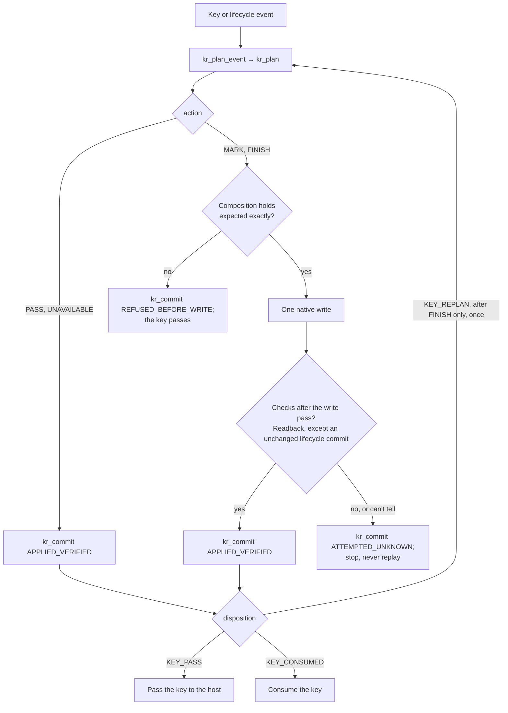
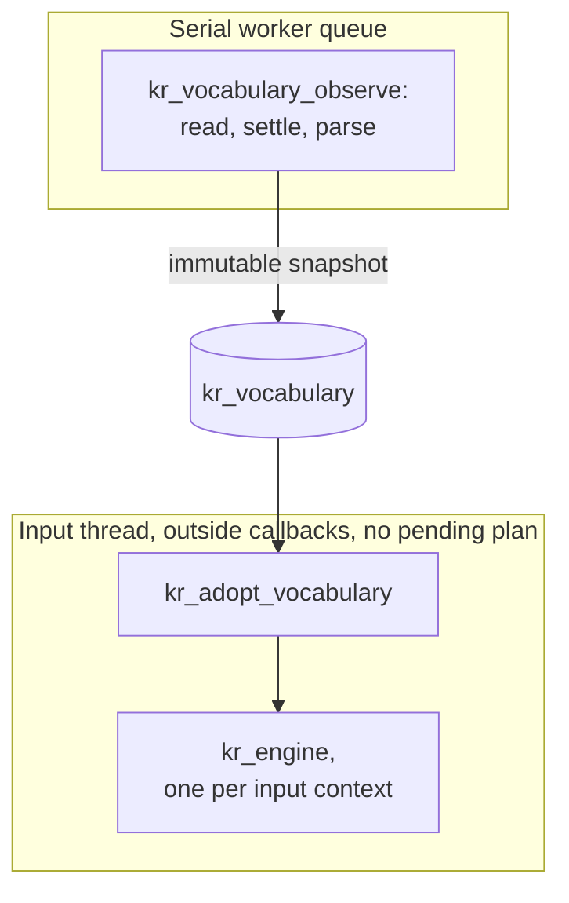

# Porting to Windows and Linux

A new platform needs a native input-method adapter and nothing else: the engine, model, vocabulary
parser, word session and C ABI are shared. Read [architecture](../ARCHITECTURE.md) first; its state
table, safety invariants and rejected mechanisms apply to every adapter. Don't write a second
inference engine, and don't build a cross-platform editing abstraction before two adapters have
shown the same real contract ([ADR 001](adr/001-rust-core-native-adapters.md)).

No Windows or Linux adapter exists yet. Each platform starts with the same first slice: one real
editor, physical keys, an owned composition, a Rust decision, a verified update, commit, then rapid
continuation and a focus change, all checked against the whole document. Use the fixture policy
(`kr_set_automatic_policy` with `KR_POLICY_FIXTURE`, which corrects only `ghbdtn` and `руддщ`)
before the model and real dictionaries. Tray icons, settings UI and packaging come after that works.

## Building the library

The Rust side builds with the pinned toolchain on any host. On Windows use an MSVC developer shell;
on Linux any C toolchain.

```console
$ cargo test --locked --workspace
$ cargo build --locked --release -p keyrill-ffi
$ cargo rustc --locked --release -p keyrill-ffi -- --print native-static-libs
```

Link `keyrill_ffi.lib` or `libkeyrill_ffi.a` together with the system libraries the last command
prints. Include `include/keyrill.h` rather than copying its declarations; its `static_assert`s pin
the struct layouts. CI runs the portable checks on `windows-2025` and `ubuntu-24.04` as well as
`macos-15`.

## Starting an adapter

Put the code in `native/windows/` or `native/linux/`, next to `native/macos/`, with its own build
script, tests and packaging. The Rust crates change only when the ABI does.

[`crates/keyrill-ffi/tests/abi_smoke.c`](../crates/keyrill-ffi/tests/abi_smoke.c) is the smallest
working caller and the place to start. It runs the whole loop against an in-memory document: plan a
key, check the composition against `expected`, write `mark`, commit the outcome, and honor the key
disposition, including `KR_FINISH` with `KR_KEY_REPLAN`. Its scenarios type `ghbdtn` and `руддщ`
with Space under the fixture policy, restore with Escape, leave an unlisted word alone, and convert
`ёлка` and `[jhjij` manually, including under the PC keyboard. `./tools/verify` links and runs it on
every platform, with the system libraries `--print native-static-libs` reports; on Windows it links
against the DLL C runtime (`-fms-runtime-lib=dll`), as Rust's MSVC staticlib expects.

Wire the adapter into `tools/verify` the way macOS is: a `uname -s` branch in the default mode runs
its format check, build and controlled tests, and a separate mode covers anything that needs
sanitizers or a desktop session. Platform setup goes in the Toolchain step of
`.github/workflows/verify.yml`. Clippy and rustdoc run on every lane, so shared docs can't link to
an item that exists on one OS only ([development](development.md#style)).

## The C ABI

`include/keyrill.h` is the authoritative contract; this is the map. Every key an adapter handles
goes through one loop, the one `abi_smoke.c` implements and
[how Keyrill works](how-it-works.md#typing-the-word) traces on a real word:



- **Versioning.** Pass `KR_ABI_VERSION` from the header to `kr_engine_new(abi, &engine)`. Before 1.0
  there is no compatibility promise: any other version is refused with `KR_VERSION`, and a change
  that breaks callers bumps the minor version.
- **Threading.** One engine per input context, called serially from the thread that owns that
  context. Buffers are copied in both directions and borrowed only for the call; no pointer into
  Rust storage crosses the boundary. Lengths are UTF-16 units.
- **Composition path.** Send each key as a `kr_event` (`KR_TEXT`, `KR_BACKSPACE`, `KR_ESCAPE`,
  `KR_MANUAL`, `KR_REVERSE`, or `KR_FINISH_REQUEST` for any other key or lifecycle request) with the
  mode and a context tag to `kr_plan_event`: `KR_CTX_BOUNDARY` when the caret is at the document
  start or follows whitespace, `KR_CTX_INELIGIBLE` otherwise, including when you didn't read the
  prefix. The `kr_plan` says what to do (`KR_PASS`, `KR_MARK`, `KR_FINISH`, `KR_UNAVAILABLE`), what
  the composition must contain beforehand, the new mark and what to do with the key (`KR_KEY_PASS`,
  `KR_KEY_CONSUMED`, `KR_KEY_REPLAN`). The caret goes at the end of the mark, `mark_len`; `KR_MARK`
  with `mark_len` 0 empties the composition. Perform at most that one write, verify it, then
  `kr_commit` with `KR_APPLIED_VERIFIED`, `KR_REFUSED_BEFORE_WRITE` or `KR_ATTEMPTED_UNKNOWN`.
- **Policy and dictionaries.** `kr_set_automatic_policy` selects off, fixture or model while idle.
  `kr_set_dictionary_utf8` publishes a whole dictionary (at most 1 MiB, NULL+0 is a valid empty
  source); `kr_clear_dictionary` makes a language missing. The `kr_vocabulary_*` handle reads and
  settles the files for you, as [macOS](macos.md#dictionaries) describes; the adapter owns the
  serial queue it observes on and adopts snapshots outside input callbacks. Paths are UTF-8 on
  Windows. `kr_vocabulary_configure_default` takes the home directory and names Vim's own files
  under it, `~/vimfiles/spell/{en,ru}.utf-8.add` on Windows and `~/.vim/spell` elsewhere. std has no
  stable file identity on Windows, so a read there is checked against size and the modified and
  creation times; the byte comparison between two observations still catches a same-size
  replacement. Learned slots `KR_LEARNED` through `KR_LEARNED + 3` take the OS spell checker's own
  lists as plain word lists. On Windows these are `%AppData%\Microsoft\Spelling\<tag>\default.dic`
  for added words and `default.exc`, configured with `KR_SOURCE_EXCLUDED`, for excluded ones; the
  adapter picks the language tags.
- **Failures.** Status codes are content-free. A Rust panic is caught at the boundary and
  permanently poisons the handle (`KR_POISONED`).
- **Compatibility path.** `kr_plan_compatibility_event` and `kr_commit_compatibility` are the macOS
  synthetic-rewrite backend. An adapter doesn't need them, and must not fall back to them when a
  native edit fails.

Dictionaries cross threads the one way that keeps file I/O out of key handling:



The session uses the Apple Russian map unless `kr_set_keyboard` selects `KR_KEYBOARD_PC`; they
differ only on the ё key (`\` on Apple, `` ` `` on PC).

## Adapter obligations

These follow from the architecture and apply on every platform:

- Track a generation for each input context; invalidate it on focus, context, composition and source
  changes, and recheck it after every native call that can reenter.
- Before a write, check that the composition you own still contains exactly the plan's expected
  text, at the expected position, with the caret where you left it. A commit that leaves the text
  unchanged can replace the exact composition range without the caret check. After the write, read
  the result back. If you can't read it back, the client can't be admitted.
- Report `KR_ATTEMPTED_UNKNOWN` when you can't tell what happened, and never replay the key or try
  to repair the document.
- Set key disposition from what actually happened, not from whether a request was accepted.
- Exclude password, secure and read-only fields before reading anything or starting a composition.
- Never hold a Rust borrow, a dictionary lock or the engine across a callback into the host. Contain
  native exceptions on the native side.
- Keep raw input, personal vocabulary and paths out of logs and status.

## Windows: Text Services Framework

TSF is the leading proposal ([ADR 007](adr/007-windows-tsf.md)): granted edit sessions, explicit
contexts and owned compositions fit the contract better than UI Automation reads plus synthetic
replacement. Use [`windows-rs`](https://github.com/microsoft/windows-rs) where practical, or a thin
native COM shim if it narrows lifetime risk.

| Interface | Documented behavior | Obligation |
| -- | -- | -- |
| [`ITfContext::RequestEditSession`](https://learn.microsoft.com/en-us/windows/win32/api/msctf/nf-msctf-itfcontext-requesteditsession) | Separate request HRESULT and session result; sync and async grants differ | Check both; handle denial or deferral without a speculative edit or a wrongly eaten key |
| [`ITfEditSession::DoEditSession`](https://learn.microsoft.com/en-us/windows/win32/tsf/edit-sessions) | Supplies an edit cookie for that session | Use it for that session only; never cache a cookie |
| [`StartComposition`](https://learn.microsoft.com/en-us/windows/win32/api/msctf/nf-msctf-itfcontextcomposition-startcomposition) | Needs a write cookie; an owner can reject with success and a null composition | Require a non-null composition and the exact context before updating |
| [`ITfRange::SetText`](https://learn.microsoft.com/en-us/windows/win32/api/msctf/nf-msctf-itfrange-settext) | Mutates under edit access | Use the owned range; the HRESULT is not a document check |
| [`OnKeyDown` / `pfEaten`](https://learn.microsoft.com/en-us/windows/win32/api/msctf/nf-msctf-itfkeyeventsink-onkeydown) | Key consumption is explicit | Set it from actual handling, not from an accepted lock request |
| [`OnCompositionTerminated`](https://learn.microsoft.com/en-us/windows/win32/api/msctf/nf-msctf-itfcompositionsink-oncompositionterminated) | Identifies the terminated composition | Compare with the captured composition; don't end a newer one |

Start with synchronous read/write edit sessions on the key path. If a path needs asynchronous
grants, capture the exact context, composition and generation, revalidate on grant and prove key
order; don't queue and replay input to make async easier. Edit-session locks regulate access, not
rollback, Undo grouping or focus after a later callback. An in-process TSF DLL shares the editor's
process: a crash takes down the editor, and process-global Rust state such as a panic hook affects
the host, so don't install one.

> [!WARNING]
> A text service runs inside every application that uses it. A crash, a leak or a blocked callback
> in the adapter is the editor's crash, leak or hang.

Determine COM registration, profile registration, enablement and activation separately, and look for
a per-user installation before anything that needs elevation. The Microsoft
[`textservice-step06-3`](https://github.com/microsoft/Windows-classic-samples/tree/main/Samples/Win7Samples/winui/input/tsf/textservice/textservice-step06-3)
sample is a reference for structure, not error handling: it reports keys eaten too early, uses a
composition without checking it started, ends the current rather than the captured composition and
translates keys inadequately. A sample that turns virtual keys into uppercase letters is not an
EN/RU input method; verify Shift, Caps Lock, dead keys and the EN/RU layouts against real input.
List x64 and ARM64 results separately.

Acceptance for the first slice includes edit-session denial, a rejected composition, focus A→B→A,
rapid continuation, read-only and password fields, a source change and service teardown, each with
the whole document, caret, composition identity and key disposition recorded.

## Linux

There is no Linux design yet; this is the starting point, not a decision. The likely target is an
[IBus](https://ibus.github.io/docs/ibus-1.5/IBusEngine.html) engine or a
[Fcitx 5](https://fcitx-im.org/wiki/Develop_an_simple_input_method) addon, both of which have
preedit text (the counterpart of a marked composition), commit, focus and reset callbacks, and a
surrounding-text API. Questions to answer with real clients before choosing:

- Does the preedit stay owned and readable across the GTK, Qt, Electron, Firefox and Chromium
  frontends, under X11 and under Wayland's `text-input-v3`? Surrounding text is optional for
  clients, so readback may be unavailable exactly where it's needed.
- Can the word plus Space stay in preedit until the next key, as on macOS, without breaking
  completion or Undo?
- Do content-type hints (IBus input purpose, Fcitx capability flags such as password and sensitive
  data) give a per-field secure-input signal? macOS only has a global one.
- Is IBus or Fcitx 5 the right first target for the desktops that matter?

The acknowledgement contract is the open decision: a Linux adapter has to give every row of the
[edit contract](../ARCHITECTURE.md#edit-contract) a check that proves its outcome. On macOS Keyrill
reads the client's marked text back after every write a key causes; only an unchanged commit that
IMK requests is written without that read. On Linux the client draws the preedit the engine sends,
and GTK's surrounding text explicitly leaves the preedit out
([`set_surrounding_with_selection`](https://docs.gtk.org/gtk4/method.IMContext.set_surrounding_with_selection.html)),
so there's nothing to read back.

> [!IMPORTANT]
> Echoing the engine's own preedit as `KR_APPLIED_VERIFIED` would verify bookkeeping, not the
> document.

Before writing the adapter, decide whether engine-owned preedit gets its own, weaker acknowledgement
in the ABI, or whether those clients stay pass-through. Until then a client without readback of the
owned preedit gets pass-through, not correction.
