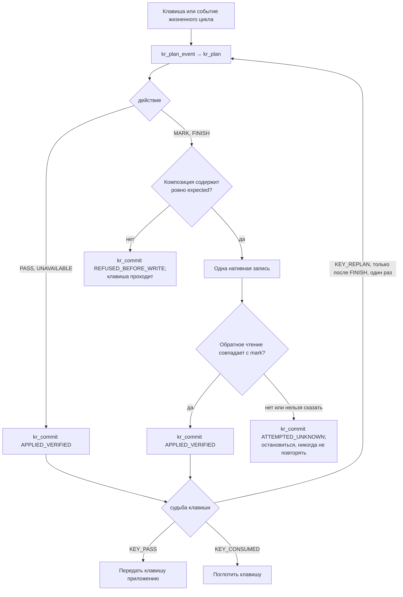
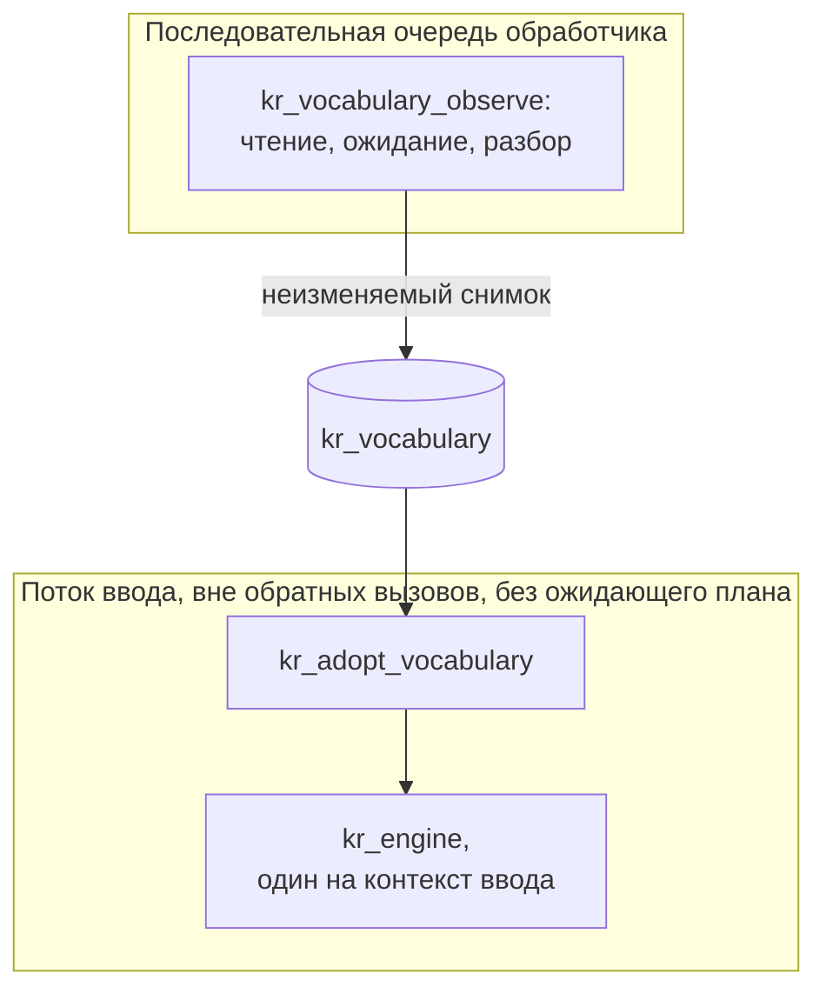

<!-- translation of docs/porting.md at 035bf26409b7eca5568d1f6495931d800f47464f -->

# Перенос на Windows и Linux

Для переноса Keyrill на новую платформу требуется только нативный адаптер метода ввода: движок,
модель, разборщик словарей, сеанс слова и интерфейс C ABI являются общими. Прежде всего следует
изучить раздел [«Архитектура»](../ARCHITECTURE.ru.md): приведённые там таблица состояний, инварианты
безопасности и перечень отвергнутых механизмов относятся к любому адаптеру. Не следует писать второй
движок вывода или строить общую для всех платформ абстракцию правки до тех пор, пока один и тот же
реальный контракт не будет подтверждён на двух адаптерах
([ADR 001](adr/001-rust-core-native-adapters.ru.md)).

Адаптеров для Windows и Linux пока нет. Первый шаг для любой платформы одинаков: один настоящий
редактор, физические нажатия клавиш, собственная композиция, решение Rust, проверенное обновление,
фиксация, затем быстрое продолжение набора и смена фокуса, причём на каждом этапе проверяется весь
документ. Начинать следует с тестовой политики (`kr_set_automatic_policy` с параметром
`KR_POLICY_FIXTURE`; она исправляет только `ghbdtn` и `руддщ`), а модель и настоящие словари
подключать позже. Значки в области уведомлений, окно настроек и упаковка откладываются до тех пор,
пока этот шаг не заработает.

## Сборка библиотеки

Часть на Rust собирается закреплённой версией инструментов на любой машине. В Windows следует
использовать командную оболочку разработчика MSVC, в Linux подойдёт любой набор инструментов для
языка C.

```console
$ cargo test --locked --workspace
$ cargo build --locked --release -p keyrill-ffi
$ cargo rustc --locked --release -p keyrill-ffi -- --print native-static-libs
```

Библиотеку `keyrill_ffi.lib` или `libkeyrill_ffi.a` нужно компоновать вместе с системными
библиотеками, которые выводит последняя команда. Заголовочный файл `include/keyrill.h` следует
подключать директивой `#include`, а не копировать из него объявления: содержащиеся в нём
`static_assert` фиксируют расположение структур в памяти. Система непрерывной интеграции (CI)
выполняет переносимые проверки на `windows-2025` и `ubuntu-24.04`, а также на `macos-15`.

## С чего начать адаптер

Код адаптера размещается в каталоге `native/windows/` или `native/linux/`, рядом с `native/macos/`,
вместе с собственным скриптом сборки, тестами и упаковкой. Крейты на Rust изменяются только
одновременно с ABI.

Начинать удобнее всего с файла
[`crates/keyrill-ffi/tests/abi_smoke.c`](../crates/keyrill-ffi/tests/abi_smoke.c) — наименьшего
работающего примера вызывающего кода. Он проходит весь цикл на документе в памяти: планирует
клавишу, сверяет композицию с `expected`, записывает `mark`, подтверждает результат и поступает с
клавишей так, как предписывает план, включая случай `KR_FINISH` с `KR_KEY_REPLAN`. Его сценарии при
тестовой политике набирают `ghbdtn` и `руддщ` с пробелом, восстанавливают слово по Escape, не
трогают слово вне списка и вручную преобразуют `ёлка` и `[jhjij`, в том числе на клавиатуре PC.
Команда `./tools/verify` компонует и запускает этот пример на каждой платформе с системными
библиотеками, которые сообщает `--print native-static-libs`; в Windows он компонуется с DLL-версией
среды выполнения C (`-fms-runtime-lib=dll`), как того требует статическая библиотека Rust для MSVC.

Адаптер подключается к `tools/verify` так же, как адаптер macOS: ветвь `uname -s` в режиме по
умолчанию запускает проверку форматирования, сборку и контролируемые тесты адаптера, а всё, что
требует санитайзеров или сеанса рабочего стола, выносится в отдельный режим. Настройка платформы
добавляется в шаг Toolchain файла `.github/workflows/verify.yml`. Clippy и rustdoc запускаются на
каждой платформе, поэтому общая документация не может ссылаться на элемент, существующий только в
одной операционной системе (см. раздел
[«Разработка»](development.ru.md#%D1%81%D1%82%D0%B8%D0%BB%D1%8C)).

## Интерфейс C ABI

Контракт определяется файлом `include/keyrill.h`; здесь приводится лишь его общая схема. Каждая
клавиша, которую обрабатывает адаптер, проходит один и тот же цикл. Этот цикл реализован в
`abi_smoke.c` и прослежен на настоящем слове в разделе
[«Как работает Keyrill»](how-it-works.ru.md#%D0%BD%D0%B0%D0%B1%D0%BE%D1%80-%D1%81%D0%BB%D0%BE%D0%B2%D0%B0):



- **Версии.** Значение `KR_ABI_VERSION` из заголовочного файла передаётся в
  `kr_engine_new(abi, &engine)`. До версии 1.0 совместимость не гарантируется: любая другая версия
  отклоняется с кодом `KR_VERSION`, а изменение, нарушающее работу вызывающего кода, увеличивает
  младший номер версии.
- **Потоки.** Каждому контексту ввода соответствует один движок; вызывать его необходимо
  последовательно и из того потока, которому принадлежит контекст. Буферы копируются в обоих
  направлениях и заимствуются только на время вызова; ни один указатель на память Rust границу не
  пересекает. Длины измеряются в единицах UTF-16.
- **Путь композиции.** Каждая клавиша передаётся в `kr_plan_event` в виде `kr_event` (`KR_TEXT`,
  `KR_BACKSPACE`, `KR_ESCAPE`, `KR_MANUAL`, `KR_REVERSE` или `KR_FINISH_REQUEST` для любой другой
  клавиши или запроса жизненного цикла) вместе с режимом и тегом контекста: `KR_CTX_BOUNDARY`, если
  курсор стоит в начале документа или после пробельного символа, и `KR_CTX_INELIGIBLE` в остальных
  случаях, в том числе если префикс не читался. Структура `kr_plan` сообщает, что делать (`KR_PASS`,
  `KR_MARK`, `KR_FINISH`, `KR_UNAVAILABLE`), что должна содержать композиция перед этим, какой будет
  новая разметка и как поступить с клавишей (`KR_KEY_PASS`, `KR_KEY_CONSUMED`, `KR_KEY_REPLAN`).
  Курсор ставится в конец разметки, на позицию `mark_len`; `KR_MARK` с `mark_len`, равным 0,
  опустошает композицию. Следует выполнить не более этой одной записи, проверить её и затем вызвать
  `kr_commit` с результатом `KR_APPLIED_VERIFIED`, `KR_REFUSED_BEFORE_WRITE` или
  `KR_ATTEMPTED_UNKNOWN`.
- **Политика и словари.** Функция `kr_set_automatic_policy` выбирает, пока движок простаивает, одну
  из политик: «выключено», тестовую или модель. Функция `kr_set_dictionary_utf8` публикует словарь
  целиком (не более 1 МиБ; пара NULL и 0 задаёт допустимый пустой источник); `kr_clear_dictionary`
  помечает словарь языка как отсутствующий. Дескриптор `kr_vocabulary_*` сам читает файлы и
  дожидается, пока они перестанут изменяться, как описано в разделе о
  [macOS](macos.ru.md#%D1%81%D0%BB%D0%BE%D0%B2%D0%B0%D1%80%D0%B8); последовательная очередь, в
  которой выполняется наблюдение, принадлежит адаптеру, и снимки он принимает вне обратных вызовов
  ввода. В Windows пути задаются в кодировке UTF-8. Функция `kr_vocabulary_configure_default`
  получает домашний каталог и строит в нём пути к файлам Vim: `~/vimfiles/spell/{en,ru}.utf-8.add` в
  Windows и `~/.vim/spell` в остальных системах. В Windows стандартная библиотека не предоставляет
  устойчивого идентификатора файла, поэтому там чтение проверяется по размеру и времени изменения и
  создания; побайтовое сравнение двух наблюдений всё равно обнаруживает замену файлом того же
  размера. Ячейки выученных слов с `KR_LEARNED` по `KR_LEARNED + 3` принимают списки, которые ведёт
  проверка орфографии операционной системы, в виде простых списков слов. В Windows это
  `%AppData%\Microsoft\Spelling\<tag>\default.dic` для добавленных слов и `default.exc`, настроенный
  с флагом `KR_SOURCE_EXCLUDED`, для исключённых; теги языков выбирает адаптер.
- **Сбои.** Коды состояния не содержат пользовательских данных. Паника Rust перехватывается на
  границе и навсегда отравляет дескриптор (`KR_POISONED`).
- **Путь совместимости.** Функции `kr_plan_compatibility_event` и `kr_commit_compatibility`
  реализуют режим синтетического переписывания для macOS. Новому адаптеру они не нужны, и прибегать
  к ним после неудачной нативной правки он не должен.

Словари передаются между потоками только одним путём; благодаря этому файловый ввод-вывод не
попадает в обработку клавиш:



Сеанс использует русскую раскладку Apple, если функцией `kr_set_keyboard` не выбрано значение
`KR_KEYBOARD_PC`; раскладки различаются только клавишей буквы ё (`\` у Apple, `` ` `` у PC).

## Обязанности адаптера

Следующие обязанности вытекают из архитектуры и действуют на любой платформе:

- Вести поколение для каждого контекста ввода, изменять его при смене фокуса, контекста, композиции
  и источника ввода и сверять после каждого нативного вызова, который может привести к повторному
  входу.
- Перед записью проверять, что собственная композиция по-прежнему содержит в точности ожидаемый
  планом текст, находится на ожидаемом месте, а курсор стоит там, где его оставили. Фиксация, не
  изменяющая текст, может заменить точный диапазон композиции без проверки курсора. После записи
  результат необходимо прочитать обратно; клиент, который не позволяет этого сделать, допускать
  нельзя.
- Сообщать `KR_ATTEMPTED_UNKNOWN`, если установить, что произошло, невозможно; клавишу при этом не
  повторять и документ не исправлять.
- Решать, пропустить или поглотить клавишу, по тому, что действительно произошло, а не по тому, был
  ли принят запрос.
- Исключать поля паролей, защищённые поля и поля только для чтения прежде, чем что-либо прочитано и
  начата композиция.
- Не удерживать заимствование Rust, блокировку словаря или движок во время обратного вызова в
  приложение. Нативные исключения перехватывать на нативной стороне.
- Не допускать попадания необработанного ввода, личного словаря и путей в журналы и строки
  состояния.

## Windows: Text Services Framework

Основным предложением для Windows является TSF ([ADR 007](adr/007-windows-tsf.ru.md)): сеансы
редактирования, которые выдаёт система, явные контексты и собственные композиции соответствуют
контракту лучше, чем чтение через UI Automation с синтетической заменой. Следует использовать
[`windows-rs`](https://github.com/microsoft/windows-rs) там, где это целесообразно, или тонкую
нативную прослойку COM, если она снижает риск ошибок во времени жизни объектов.

| Интерфейс | Документированное поведение | Обязанность адаптера |
| -- | -- | -- |
| [`ITfContext::RequestEditSession`](https://learn.microsoft.com/en-us/windows/win32/api/msctf/nf-msctf-itfcontext-requesteditsession) | HRESULT запроса и результат сеанса возвращаются раздельно; синхронная и асинхронная выдача различаются | Проверять оба значения; обрабатывать отказ или отсрочку без правки наугад и без ошибочно поглощённой клавиши |
| [`ITfEditSession::DoEditSession`](https://learn.microsoft.com/en-us/windows/win32/tsf/edit-sessions) | Предоставляет cookie правки для данного сеанса | Использовать cookie только в этом сеансе и никогда его не кешировать |
| [`StartComposition`](https://learn.microsoft.com/en-us/windows/win32/api/msctf/nf-msctf-itfcontextcomposition-startcomposition) | Требует cookie записи; владелец может отказать, вернув успех и пустую композицию | Перед обновлением требовать непустую композицию и точный контекст |
| [`ITfRange::SetText`](https://learn.microsoft.com/en-us/windows/win32/api/msctf/nf-msctf-itfrange-settext) | Изменяет текст при наличии доступа на правку | Использовать собственный диапазон; HRESULT не является проверкой документа |
| [`OnKeyDown` / `pfEaten`](https://learn.microsoft.com/en-us/windows/win32/api/msctf/nf-msctf-itfkeyeventsink-onkeydown) | Поглощение клавиши указывается явно | Устанавливать по фактической обработке, а не по принятому запросу блокировки |
| [`OnCompositionTerminated`](https://learn.microsoft.com/en-us/windows/win32/api/msctf/nf-msctf-itfcompositionsink-oncompositionterminated) | Сообщает, какая композиция завершена | Сравнивать с запомненной композицией; не завершать более новую |

Начинать следует с синхронных сеансов чтения и записи на пути обработки клавиши. Если для этого пути
потребуется асинхронная выдача, необходимо запомнить точный контекст, композицию и поколение,
сверить их в момент выдачи и доказать сохранение порядка клавиш; ставить ввод в очередь или
повторять его ради упрощения асинхронной обработки нельзя. Блокировка сеанса редактирования
управляет доступом, но не откатом, не группировкой отмены и не фокусом после более позднего
обратного вызова. Библиотека TSF загружается в процесс редактора: её аварийное завершение приводит к
аварийному завершению редактора, а глобальное для процесса состояние Rust, например обработчик
паники, действует на всё приложение, поэтому устанавливать его нельзя.

> [!WARNING]
> Текстовая служба работает внутри каждого приложения, которое ею пользуется. Сбой, утечка памяти
> или заблокированный обратный вызов в адаптере означают сбой, утечку или зависание редактора.

Регистрацию COM, регистрацию профиля, включение и активацию следует проверять по отдельности, причём
сначала искать вариант установки для одного пользователя и лишь затем рассматривать то, что требует
повышенных прав. Пример Microsoft
[`textservice-step06-3`](https://github.com/microsoft/Windows-classic-samples/tree/main/Samples/Win7Samples/winui/input/tsf/textservice/textservice-step06-3)
служит образцом структуры, но не обработки ошибок: он слишком рано сообщает о поглощении клавиш,
пользуется композицией, не убедившись, что она началась, завершает текущую композицию вместо
запомненной и неудовлетворительно преобразует клавиши. Пример, превращающий виртуальные клавиши в
заглавные буквы, методом ввода EN/RU не является; клавиши Shift и Caps Lock, мёртвые клавиши и
раскладки EN/RU необходимо проверять на настоящем вводе. Результаты для x64 и ARM64 указываются
раздельно.

При приёмке первого шага проверяются отказ в сеансе редактирования, отклонённая композиция, переход
фокуса A→B→A, быстрое продолжение набора, поля только для чтения и поля паролей, смена источника
ввода и завершение работы службы; для каждого случая записываются весь документ, положение курсора,
активная композиция и судьба клавиши.

## Linux

Проекта для Linux пока нет; сказанное ниже является отправной точкой, а не принятым решением.
Вероятной целью является движок [IBus](https://ibus.github.io/docs/ibus-1.5/IBusEngine.html) или
дополнение [Fcitx 5](https://fcitx-im.org/wiki/Develop_an_simple_input_method). Оба предоставляют
предварительный текст (англ. preedit, аналог размеченной композиции), фиксацию, обратные вызовы
фокуса и сброса, а также API окружающего текста. До выбора необходимо ответить на настоящих клиентах
на следующие вопросы:

- Остаётся ли preedit под управлением движка и можно ли прочитать его обратно во фронтендах GTK, Qt,
  Electron, Firefox и Chromium под X11 и под `text-input-v3` в Wayland? Поддержка окружающего текста
  для клиентов необязательна, поэтому обратного чтения может не оказаться именно там, где оно
  необходимо.
- Может ли слово с пробелом оставаться в preedit до следующей клавиши, как в macOS, не нарушая
  работу автодополнения и отмены?
- Дают ли подсказки о типе содержимого (назначение ввода в IBus, флаги возможностей в Fcitx, в том
  числе для паролей и конфиденциальных данных) признак защищённого ввода для отдельного поля? В
  macOS такой признак есть только глобальный.
- Что следует выбрать первой целью для основных рабочих столов: IBus или Fcitx 5?

Контракт подтверждения пока не определён. В macOS Keyrill после каждой записи читает размеченный
текст клиента обратно. В Linux клиент отображает preedit, переданный движком, а окружающий текст GTK
явно исключает preedit
([`set_surrounding_with_selection`](https://docs.gtk.org/gtk4/method.IMContext.set_surrounding_with_selection.html)),
так что читать обратно нечего.

> [!IMPORTANT]
> Если возвращать собственный preedit движка как `KR_APPLIED_VERIFIED`, проверялись бы собственные
> записи движка, а не документ.

Прежде чем писать адаптер, необходимо решить, будет ли в ABI отдельное, более слабое подтверждение
для preedit, которым управляет движок, или такие клиенты останутся в режиме пропуска. До принятия
этого решения клиент, не позволяющий прочитать собственный preedit обратно, получает пропуск, а не
исправление.
