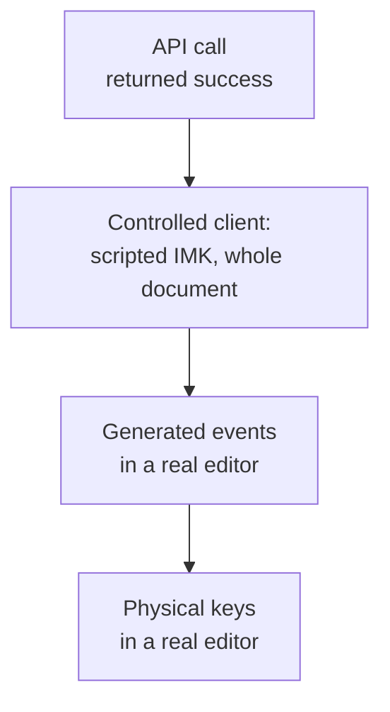

# Testing

A native API call that returns success is not a document result, a controlled `NSTextView` is not
system IMK, and a generated event in a real editor is not physical input. Record which of these a
result is. Results belong to the binary that produced them, not to later builds.

Each step to the right is stronger evidence, and only the last one shows that an application works.

## Layers

| Layer | Where | Covers |
| -- | -- | -- |
| Unit and property | `crates/*/src`, `crates/keyrill-core/tests` | Mapping, vocabulary flags, policy, session transitions, ABI bounds; fixed proptest seeds |
| Reference vectors | `tests/fixtures/engine-vectors.jsonl` | 1,217 mapping, vocabulary, context and inference outputs, see [engine](engine.md#reference-tests) |
| Negative set | `tests/fixtures/negative-words.jsonl`, `tests/negative_words.rs` | 766 words automatic correction must leave alone |
| Evaluation | `./tools/verify evaluate` | Session replays and a negative set over held-out corpora, with recall and false-correction gates |
| C ABI smoke | `crates/keyrill-ffi/tests/abi_smoke.c` | The plan, check, write, commit loop from C against an in-memory document |
| Fuzz and Miri | `fuzz/`, `./tools/verify miri` | Parsers, state, model asset, FFI pointer contract |
| Controlled native | `native/macos/tests` | Scripted IMK clients with whole-document oracles; ASan/UBSan |
| Browser fixture | `native/macos/tests/browser-fixture.html` | Field and caret oracle for physical browser runs |
| Physical | Real applications, real keys | The only evidence that an application works |

The controlled native tests drive `KRSession`, the compatibility session and the controller with
scripted clients that hold a whole document, and an offscreen `NSTextView` for the readback commit
after a failed check. They check correction, protection, forbidden targets, reversal, reentrant
callbacks that change generation or client, unknown effects, empty composition, dictionary reload
and adoption deferral, key disposition, and compatibility rewrites including missing echoes and a
terminal that forwards consumed keys. One test, `compatibility_known_interleaving_hazard`, keeps a
schedule where a typed character is deleted and the word corrupted; it documents the backend's limit
and is not integrity evidence.

## Regression schedules

[`regressions.json`](regressions.json) lists sixteen schedules (R01–R16) any adapter has to answer.
R01–R04 are negative controls for the rejected transports: a test passes by showing the damage in
the rejected mechanism or by refusing the schedule, never by reproducing the unsafe edit. The rest
cover reentrant invalidation, foreign marks on reused proxies, caret disagreement, empty
composition, manual boundaries, rapid continuation, focus reuse, source selection versus delivery,
dictionary reload, key disposition, TSF grants, and secure fields and shutdown. Use deterministic
barriers and callbacks, not shorter sleeps.

## Physical scenarios

Observe whole synthetic documents or fields, prefix and suffix, and the UTF-16 caret; for two-field
cases observe both. Native readback is the client's view: prefer an independent oracle such as a
saved file or the browser fixture. Classify each result as passed, failed, unsupported, untested or
setup-blocked. A permission or activation problem with no keys typed is not a correction failure,
and input that never reached Rust is not an abstention.

| ID | Scenario | Expected |
| -- | -- | -- |
| V01 | EN mode: `ghbdtn Space hello Space ghbdtn Space` | `привет hello привет `, caret after the last Space; repeat without restarting |
| V02 | RU mode: `руддщ Space цщкдв Space` | `hello world ` |
| V03 | `Ghbdtn`, all-caps, acronyms, identifiers, URLs | Title case converted; the rest unchanged |
| V04 | Manual before Space and right after the boundary | Deterministic conversion; inference never undoes it |
| V05 | Reversal before and after Space, then keep typing | Exact original restored; no re-correction at that boundary |
| V06 | Rapid typing straight through a boundary, repeated | No lost, duplicated or reordered characters |
| V07 | Backspace inside a word and to empty, then type | Only owned units removed |
| V08 | Half a word in field A, click B, correct in B, return to A | Both fields intact; nothing carried across |
| V09 | Foreign mark in a reused client; caret and mark disagree | Refusal, no new writes |
| V10 | Generation change inside a query, nested commands, source switch | No stale follow-on effect or revived receipt |
| V11 | Clamped or ignored range, partial write, delayed readback, exception | Unknown result; no rollback or replay |
| V12 | Navigation, selection, punctuation, Tab, Enter, shortcuts | Host action happens once; no trigger, no stale receipt |
| V13 | Escape, host cancel, app quit, server quit, source away and back | Documents stable; lifetimes drained |
| V14 | Read-only, password, custom, code, terminal, remote controls | No prohibited read or write; input not swallowed |
| V15 | Emoji, non-BMP, combining marks, multi-line text | Preserved exactly |
| V16 | Dictionary edit, Learn Spelling and Unlearn, atomic save, symlink, missing, invalid, oversized, restore | Last good data kept; manual conversion unaffected |
| V17 | Fresh install, enable, select, restart, log out and in | Actual typing works, not just registration |
| V18 | Windows: denied lock, async grant, null composition, terminated context | Correct key disposition; no stale edit |

For each application record the OS and app versions, control type, backend, automatic and manual
correction, reversal, native Undo, source switching, focus behavior and failures. Start with
TextEdit, Safari and Firefox text areas, then a contenteditable editor, a native text field, an
Electron app and an office editor. Treat IDEs, terminals and remote sessions as exclusion and
manual-availability checks first.

### Browser fixture

`browser-fixture.html` is a standalone page with one textarea holding fixed prefix and suffix text
(including a surrogate pair), with spellcheck, autocorrect and autocomplete off. Its four scenarios
(EN automatic, manual, reversal, RU automatic) record ordered full-field checkpoints, composition
events and the final UTF-16 caret, and give a pass or fail verdict. The report holds flags,
positions and counts, never text. It can't prove which input method produced the input.
`./tools/verify browser-fixture` checks the oracle itself, not a browser.

### Performance targets

Targets for a release build on Apple Silicon, to measure rather than assume: pure inference p99
under 1 ms for the longest eligible word; Space to verified visible update p95 under 20 ms and p99
under 50 ms over at least 1,000 boundaries per control; idle under 0.5% of one core over five
minutes with dictionary monitoring; RSS under 100 MiB; ready in under a second. None has been
measured end to end yet.

## Status

CI runs every gate on each change: the default check on macOS, Windows and Linux, the others on
macOS. The run page has the results and the line-level coverage report, so this page doesn't repeat
numbers that go stale.

Physical results, for the build that produced them: on the v0.1.0 source the maintainer typed by
hand with the model policy in TextEdit, in a Safari text field and address bar, and in a Firefox
text area. Automatic correction, Control+Option+K, Control+Option+Z and the mode switch after a
correction behaved as expected in all three. Nothing since has a physical result: the default paths
computed in Rust, the Learn Spelling list and the input menu's status line. Known open questions, to
check first:

- The Learn Spelling list lives in Apple's spell-service group container; whether the input method's
  read raises an "access data from other apps" prompt is unknown.
- VoiceOver uses Control+Option as its modifier, so Control+Option+K is also VoiceOver's Keyboard
  Help; which one receives the key with VoiceOver on is untested.
- Safari: in the browser fixture, manual conversion and reversal once left the field one UTF-16 unit
  short, consistent with a missing trailing Space. The hand run didn't show it, but the fixture
  hasn't been rerun.
- ChatGPT desktop gets no automatic correction; the cause is unknown.
- Compatibility: repeated corrections in Notes, terminal behavior, live source switching and
  permission retention across updates.

When reporting a problem from real use, include the application and version, the backend, the input
menu's first line, its "Last word left alone" row and dictionary state, and a synthetic reproduction
(what you typed and what you got). Don't paste private text.
