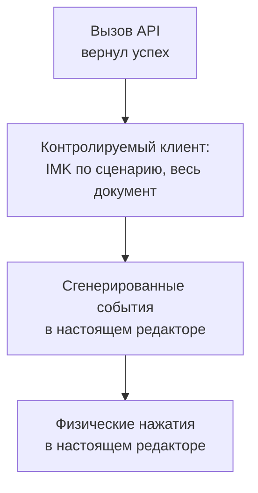

<!-- translation of docs/testing.md at 75f4d67b9759e54db5f35e1dafbd68086d06d5ef -->

# Тестирование

Следует строго различать виды результатов. Нативный вызов API, вернувший успех, ещё не означает
результата в документе; контролируемый `NSTextView` не является системным IMK; сгенерированное
событие в настоящем редакторе не равносильно физическому вводу. Для каждого результата необходимо
записывать, к какому виду он относится. Результат относится к тому двоичному файлу, на котором он
получен, и на более поздние сборки не распространяется.

Каждый следующий шаг на диаграмме даёт более сильное доказательство, и только последний показывает,
что приложение действительно работает.

## Уровни

| Уровень | Где находится | Что проверяет |
| -- | -- | -- |
| Модульные тесты и тесты свойств | `crates/*/src`, `crates/keyrill-core/tests` | Отображение раскладок, флаги словаря, политику, переходы сеанса, границы ABI; фиксированные начальные значения (seed) для proptest |
| Эталонные векторы | `tests/fixtures/engine-vectors.jsonl` | 1217 результатов отображения, словаря, контекста и вывода (см. раздел [«Движок»](engine.ru.md#%D1%8D%D1%82%D0%B0%D0%BB%D0%BE%D0%BD%D0%BD%D1%8B%D0%B5-%D1%82%D0%B5%D1%81%D1%82%D1%8B)) |
| Отрицательный набор | `tests/fixtures/negative-words.jsonl`, `tests/negative_words.rs` | 766 слов, которые автоматическое исправление обязано оставить без изменений |
| Оценка | `./tools/verify evaluate` | Повторы сеансов и отрицательный набор на отложенных корпусах с порогами полноты и ложных исправлений |
| Дымовой тест C ABI | `crates/keyrill-ffi/tests/abi_smoke.c` | Цикл «план — проверка — запись — подтверждение» на языке C на документе в памяти |
| Фаззинг и Miri | `fuzz/`, `./tools/verify miri` | Разборщики, состояние, файл модели, контракт указателей FFI |
| Контролируемые нативные тесты | `native/macos/tests` | Клиенты IMK по сценарию с проверкой всего документа; ASan/UBSan |
| Браузерный стенд | `native/macos/tests/browser-fixture.html` | Эталон поля и курсора для физических прогонов в браузере |
| Физические тесты | Настоящие приложения, настоящие клавиши | Единственное доказательство того, что приложение работает |

Контролируемые нативные тесты управляют `KRSession`, сеансом совместимости и контроллером с помощью
клиентов, действующих по сценарию и хранящих весь документ, а также внеэкранного `NSTextView`, на
котором проверяется фиксация прочитанного текста после неудачной проверки. Эти тесты охватывают
исправление, защиту, запрещённые цели, отмену, обратные вызовы с повторным входом, изменяющие
поколение или клиента, неизвестные исходы, опустошение композиции, перезагрузку словаря и отложенное
принятие, судьбу клавиши и переписывание в режиме совместимости, в том числе потерянные уведомления
и терминал, пересылающий поглощённые клавиши. Один из тестов,
`compatibility_known_interleaving_hazard`, сохраняет сценарий, в котором набранный символ удаляется,
а слово искажается; этот тест документирует предел возможностей режима и доказательством целостности
не служит.

## Регрессионные сценарии

В файле [`regressions.json`](regressions.json) перечислены шестнадцать сценариев (R01–R16), на
которые должен давать ответ любой адаптер. Сценарии R01–R04 являются отрицательными контрольными
сценариями для отвергнутых способов доставки: тест считается пройденным, если он показывает ущерб от
отвергнутого механизма или отказывается выполнять сценарий, и ни в коем случае не тогда, когда он
воспроизводит небезопасную правку. Остальные сценарии охватывают сброс при повторном входе, чужую
разметку в повторно используемых прокси, расхождение положения курсора, опустошение композиции,
ручные границы, быстрое продолжение набора, повторное использование фокуса, соотношение выбора
источника ввода и доставки, перезагрузку словаря, судьбу клавиши, выдачу сеансов TSF, защищённые
поля и завершение работы. Вместо сокращения пауз следует использовать детерминированные барьеры и
обратные вызовы.

## Инварианты и доказательства

Каждый
[инвариант безопасности](../ARCHITECTURE.ru.md#%D0%B8%D0%BD%D0%B2%D0%B0%D1%80%D0%B8%D0%B0%D0%BD%D1%82%D1%8B-%D0%B1%D0%B5%D0%B7%D0%BE%D0%BF%D0%B0%D1%81%D0%BD%D0%BE%D1%81%D1%82%D0%B8)
защищает от одной опасности. В таблице для каждого инварианта указаны регрессионные сценарии из
предыдущего раздела, тесты, которые сегодня обнаружили бы его нарушение, самое сильное из полученных
доказательств и то, чего ещё недостаёт. *Контролируемыми* называются нативные тесты с клиентами IMK,
действующими по сценарию, и проверкой всего документа; *физическими* — результаты, полученные
сопровождающим при наборе в настоящем приложении (они приведены ниже, в разделе «Текущее
состояние»). Режим совместимости по замыслу отказывается от S1, S4 и S6
([ADR 006](adr/006-compatibility-backend.ru.md)); это фиксируют его тесты `compatibility_*`, а
физических результатов для него пока нет.

| Обозначение | Опасность | Сценарии | Тесты | Самое сильное доказательство | Чего недостаёт |
| -- | -- | -- | -- | -- | -- |
| S1 | Исправление удаляет, удваивает или переставляет текст за пределами слова | R03, R08, R10, R13 | `model_whole_document_en`, `model_whole_document_ru`, `empty_composition`, `reenter_*`, `throw_*`; тесты свойств сеанса | Физическое, v0.1.0: TextEdit, Safari, Firefox | После v0.1.0 физических результатов нет; быстрый набор сквозь границу слова (V06) и работа с двумя полями (V08) не записаны; в Safari браузерный стенд однажды дал поле на одну единицу короче |
| S2 | Keyrill правит чужую разметку: разметку другого метода ввода, повторно используемого прокси или оставшуюся после смены фокуса | R06, R07, R11 | `foreign_mark`, `foreign_mark_after_context`, `moved_caret`, `caret_moved_after_context`, `client_change` | Контролируемое | Чужая разметка в повторно используемом клиенте (V09) физически не проверялась |
| S3 | Запись выполняется после того, как обратный вызов посреди обращения сменил фокус или поколение | R05, R15 | `reenter_*`, `throw_*`, `owner_release_during_callback`, `secure_input_during_client_calls`; [упражнение 9](learn/exercises.ru.md) | Контролируемое, в том числе под ASan и UBSan | Вложенные команды и смена источника во время запроса (V10) физически не проверялись; для Windows (R15) адаптера нет |
| S4 | Клавиша теряется, удваивается, уходит не туда или меняет порядок | R10, R14 | `unknown_finish_then_letter`, `unknown_finish_then_shortcut`, `unknown_escape_consumed`, `ignored_write`, `readback_commit_after_failed_check` | Контролируемое; обычный набор физически проверен на v0.1.0 | Клавиши навигации, сочетания клавиш, Tab и Enter (V12) физически не записаны |
| S5 | Успешный код возврата API принимается за правку документа | R07, R12 | `ignored_write`, `finish_altered_text`, `lifecycle_commit_unreadable_text`, `typed_finish_unreadable_text`; дымовой тест C ABI; [упражнение 8](learn/exercises.ru.md) | Контролируемое | Физический тест показывает только итог, поэтому это свойство остаётся предметом контролируемых тестов |
| S6 | В режиме композиции переписывается зафиксированный текст | R01–R04 | Соответствующего кода нет; R01–R04 служат отрицательными контрольными сценариями для отвергнутых способов доставки | Просмотр исходного кода | Нет, пока эти способы доставки отсутствуют |
| S7 | Запоздалая отмена правит слово, которое больше не принадлежит Keyrill | R09 | `manual_reversal_expiry`, `escape_restores_original`, `kept_mark_across_mode_change`, `model_reversal_dictionary_change`, `runtime_reload_whole_document_and_receipt` | Физическое, v0.1.0: Control+Option+Z во всех трёх приложениях | Отмена после продолжения набора (V05) физически не записана |
| S8 | Набранный текст попадает на диск, в журнал или в сеть | R16 | `input_status`, `controller_status_line`; сообщения об ошибках не содержат пользовательских данных; сетевого кода нет | Просмотр исходного кода и контролируемое | Текст может остаться в аварийном дампе; при выключенном Secure Input режим совместимости хранит набранное в памяти |
| S9 | Нативный объект или объект FFI используется после освобождения или после паники | Нет | Miri, фаззинг, дымовой тест C ABI, нативные тесты под ASan и UBSan, `owner_release_during_callback` | Санитайзеры и Miri | Выход из приложения и завершение сервера (V13) физически не записаны |
| S10 | Отказ изменяет документ или незаметно переключает способ доставки | R16 | `secure_input`, `unlisted_client`, `controller_secure_input_before_characters`, `lifecycle_interruption_status`, `compatibility_refusal_interruption_secure` | Контролируемое | Поля только для чтения, поля паролей и нестандартные элементы управления (V14) физически не проверялись |

## Физические сценарии

Наблюдению подлежат весь синтетический документ или поле, префикс, суффикс и положение курсора в
единицах UTF-16; в случаях с двумя полями наблюдаются оба. Нативное обратное чтение отражает точку
зрения клиента, поэтому предпочтение следует отдавать независимому эталону, например сохранённому
файлу или браузерному стенду. Каждый результат относится к одной из категорий: «прошёл», «не
прошёл», «не поддерживается», «не проверялся» или «заблокирован настройкой». Проблема с разрешениями
или активацией, при которой не было набрано ни одной клавиши, сбоем исправления не считается, а
ввод, не дошедший до Rust, не является отказом от исправления.

| Обозначение | Сценарий | Ожидаемый результат |
| -- | -- | -- |
| V01 | Режим EN: `ghbdtn Space hello Space ghbdtn Space` | `привет hello привет `, курсор после последнего пробела; повторить без перезапуска |
| V02 | Режим RU: `руддщ Space цщкдв Space` | `hello world ` |
| V03 | `Ghbdtn`, слова заглавными буквами, аббревиатуры, идентификаторы, URL | Слово с заглавной буквы преобразовано, остальное не изменено |
| V04 | Ручное преобразование до пробела и сразу после границы | Детерминированное преобразование; вывод его не отменяет |
| V05 | Отмена до и после пробела с последующим продолжением набора | Исходный текст восстановлен точно; повторного исправления на этой границе нет |
| V06 | Быстрый набор сквозь границу слова, несколько раз | Ни один символ не потерян, не удвоен и не переставлен |
| V07 | Backspace внутри слова и до опустошения, затем набор | Удалены только собственные единицы |
| V08 | Половина слова в поле A, щелчок в поле B, исправление в B, возврат в A | Оба поля не повреждены; ничего не перенесено |
| V09 | Чужая разметка в повторно используемом клиенте; расхождение курсора и разметки | Отказ, новых записей нет |
| V10 | Смена поколения во время запроса, вложенные команды, смена источника ввода | Устаревших последствий нет, квитанция не возобновляется |
| V11 | Усечённый или проигнорированный диапазон, частичная запись, задержанное обратное чтение, исключение | Исход неизвестен; ни отката, ни повтора |
| V12 | Клавиши навигации, выделение, знаки препинания, Tab, Enter, сочетания клавиш | Действие приложения выполняется один раз; ни срабатывания исправления, ни устаревшей квитанции |
| V13 | Escape, отмена в приложении, выход из приложения, завершение сервера, смена источника и возврат | Документы не изменяются; время жизни объектов исчерпано корректно |
| V14 | Поля только для чтения, поля паролей, нестандартные элементы управления, редакторы кода, терминал, удалённые сеансы | Запрещённых чтений и записей нет; ввод не поглощается |
| V15 | Эмодзи, символы вне BMP, комбинируемые знаки, многострочный текст | Сохранены в точности |
| V16 | Правка словаря, Learn Spelling и Unlearn, атомарное сохранение, символическая ссылка, отсутствующий, некорректный и слишком большой файл, восстановление | Последние удачные данные сохранены; ручное преобразование не затронуто |
| V17 | Чистая установка, включение, выбор, перезапуск, выход из системы и повторный вход | Набор действительно работает, а не только регистрация |
| V18 | Windows: отказ в блокировке, асинхронная выдача, нулевой указатель на композицию, завершённый контекст | Клавиша пропущена или поглощена правильно; устаревших правок нет |

Для каждого приложения записываются версии операционной системы и приложения, тип элемента
управления, режим, результаты автоматического и ручного исправления, отмены, встроенной отмены
приложения (Undo), переключения источника ввода, поведение фокуса и сбои. Начинать следует с
текстовых областей TextEdit, Safari и Firefox, затем переходить к редактору на основе
contenteditable, нативному текстовому полю, приложению на Electron и офисному редактору. Среды
разработки, терминалы и удалённые сеансы в первую очередь проверяются на правильное исключение и на
доступность ручного режима.

### Браузерный стенд

Файл `browser-fixture.html` представляет собой отдельную страницу с одной текстовой областью, в
которой заданы неизменные префикс и суффикс (включая суррогатную пару), а проверка орфографии,
автоисправление и автодополнение выключены. В четырёх сценариях стенда (автоматическое исправление
EN, ручное преобразование, отмена, автоматическое исправление RU) записываются упорядоченные
контрольные состояния всего поля, события композиции и итоговое положение курсора в единицах UTF-16,
после чего выносится заключение «прошёл» или «не прошёл». Отчёт содержит только флаги, позиции и
счётчики и никогда не содержит текста. Доказать, какой метод ввода произвёл ввод, стенд не может.
Команда `./tools/verify browser-fixture` проверяет сам эталон, а не браузер.

### Целевые показатели производительности

Для release-сборки на Apple Silicon установлены следующие целевые показатели, которые необходимо
измерять, а не предполагать: 99-й процентиль времени чистого вывода — менее 1 мс для самого длинного
допустимого слова; время от пробела до проверенного видимого обновления — 95-й процентиль менее
20 мс и 99-й процентиль менее 50 мс при не менее чем 1000 границах слов на каждый элемент
управления; загрузка в простое — менее 0,5 % одного ядра за пять минут при отслеживании словарей;
RSS — менее 100 МиБ; время готовности — менее одной секунды. Ни один из этих показателей пока не
измерен от начала до конца.

## Текущее состояние

Система непрерывной интеграции при каждом изменении выполняет проверку по умолчанию в macOS, Windows
и Linux, санитайзеры, аудит, покрытие, Miri, фаззинг и оценку в macOS, а проверку Markdown и сборку
сайта в Linux. Самопроверка браузерного стенда запускается только локально
(`./tools/verify browser-fixture`). Результаты и построчный отчёт о покрытии публикуются на странице
запуска, поэтому быстро устаревающие числа здесь не повторяются.

Физические результаты относятся к той сборке, на которой они получены. На исходных текстах версии
v0.1.0 сопровождающий вручную набирал текст с политикой модели в TextEdit, в текстовом поле и
адресной строке Safari и в текстовой области Firefox. Автоматическое исправление, Control+Option+K,
Control+Option+Z и переключение режима после исправления во всех трёх приложениях работали так, как
ожидалось. Для всего, что появилось позже, физических результатов нет: ни для путей по умолчанию,
вычисляемых в Rust, ни для списка Learn Spelling, ни для строки состояния в меню ввода. Известные
открытые вопросы, которые следует проверить в первую очередь:

- Список Learn Spelling находится в групповом контейнере службы проверки орфографии Apple;
  неизвестно, вызывает ли его чтение методом ввода запрос «доступ к данным других приложений».
- VoiceOver использует сочетание Control+Option в качестве модификатора, поэтому Control+Option+K
  одновременно вызывает справку по клавиатуре VoiceOver; какая из программ получает клавишу при
  включённом VoiceOver, не проверялось.
- Safari: в браузерном стенде ручное преобразование и отмена однажды оставили поле на одну единицу
  UTF-16 короче, что согласуется с потерей пробела в конце. Ручной прогон этого не подтвердил,
  однако стенд с тех пор повторно не запускался.
- Настольное приложение ChatGPT не получает автоматического исправления; причина неизвестна.
- Режим совместимости: повторные исправления в Notes, поведение терминалов, переключение источника
  ввода во время набора и сохранение разрешений после обновлений.

Сообщая о проблеме, возникшей при реальной работе, следует указать приложение и его версию, режим,
первую строку меню ввода, строку «Last word left alone» и состояние словарей, а также синтетический
пример воспроизведения (что было набрано и что получено). Личный текст в сообщение вставлять нельзя.
