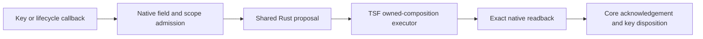

# Complete Windows support

Status is implementation and candidate integration. The implementation baseline is commit `4b3b611`.
This plan covers the missing Windows application integration, product configuration,
installation, and validation. The Rust migration and its recorded desktop results are in
[Windows TSF proof](windows.md).

## Implementation record

The following units are committed with focused checks, local full verification, and independent
review. Their controlled results establish native behavior under the tested provider contracts.
The required application and installation matrix still needs final-candidate evidence.

| Unit | Commit |
|---|---|
| Exact controlled-case runner and executed-test accounting | `4c3e9db` |
| Complete persisted preferences and revision conflicts | `7eba1fe` |
| Bounded public Terminal child | `d030e92` |
| Architecture-specific build and artifact validation | `1930594` |
| Candidate-bound acceptance ledger validation | `2421436` |
| Shared ordinary-field admission and revocation watches | `dd7b733` |
| Native Settings editor | `285bd43` |
| Actual x86 callback ABI and execution corrections | `db42fa1` |
| Generic host diagnostics and public fixtures | `08f80d0` |
| Complete runtime configuration adoption | `3079984` |
| Recoverable machine installation and dual-architecture packaging | `b1b6823` |
| Architecture, sanitizer, and reproducibility CI | `d46c738` |
| Deferred automatic source handoff | `936b1b9` |
| Owned-process native UIA verification | `1ad9eaa` |
| Packaged TSF Settings entry, local readiness, bounded native package I/O | `54381b5` |
| Writable native keyboard snapshots in proof fixtures | `4b06e8b` |
| Deferred-source acceptance and late-reversal assertions | `f79a3eb` |
| Native service-root metadata migration regression | `f7437ec` |
| Exact service metadata validation before migration and recovery | `b1bc606` |
| Canonical Settings shortcut target regression | `78696be` |
| Verified ordinary Shell path for the Settings shortcut | `84ee321` |
| Approved end-only termination of an unchanged owned composition | `f34861f` |
| Browser observers retain results in memory until explicit refresh | `7023336` |
| Complete target-thread enumeration and explicit diagnostic errors | `9d73928` |

The integrated implementation passed full local verification for x64 and x86, including
214 controlled tests and 53 proof-library tests per architecture. The x64 AddressSanitizer gate
passed with its required detected memory-error canary. Prebuilt std and Windows code remain
uninstrumented. Hosted CI and installed application acceptance are separate gates.

The current replacement source closure is committed at `4471d61`. Its string-buffer repair,
bounded recovery and disposable cleanup evidence are recorded in
[profile repair validation](windows-profile-repair-validation.md). The maintainer completed
thirteen native qualification cases on each architecture, approved profile recovery and installation.
Independent installed package verification and receipt readback passed. Application automation
and physical acceptance are in progress. Candidate identities, executable commands, current machine metadata,
verification reports, and remaining result cells belong in the prepared local worksheet.

The maintainer subsequently installed experimental candidate `940ee5df` from `975f45a`.
Independent package, registration, receipt and loaded Chrome DLL checks passed. This candidate
passed full x64 and x86 checks, sanitizer verification and byte-identical package rebuilds.
Its approved end-only termination experiment leaves Chrome Undo acceptance open. Correcting the
browser fixture's synchronous report updates restored text removal on first Undo, while the
restored selection still covers suffix characters. The remaining failure and isolated browser
comparisons are recorded in [Chrome Undo investigation](windows-chrome-undo.md).

The Windows branch includes the admission fix tested in candidate `f3831bbe` from `0582eb7`.
It requires bounded field authority
before editing. It puts generic controls into pass-through while the browser payment-field
admission gap remains open. Local x64 and x86 checks and the x64 AddressSanitizer run passed.
A clean rebuild in a separate checkout matched all 119 package paths and SHA-256 hashes.

The maintainer installed `f3831bbe`. Both machine COM registry views matched the package and
both operation receipts agreed on all 22 completed changes. Separate x64 and x86 processes
loaded the corresponding registered DLL and matched its file hash. The stored Preferences
value matched its pre-upgrade digest.

With that installed DLL, physical input in Notepad 11.2609.11.0 x64 produced `ghbdtn`, then
`привет` with left Ctrl+Alt+K, then `ghbdtn` with left Ctrl+Alt+Z. UI Automation matched the
whole document and end caret at each step. The TSF journal recorded both commands on the same
owned composition and zero unknown effects.

In the x86 RichEdit proof editor, physical input of `ghbdtn` followed by Space produced
`привет` followed by one space. The independent inspector matched the whole field, the
collapsed caret at UTF-16 offset seven, and the empty second field. TSF recorded seven
verified effects and zero unknown effects. The editor's activation manifest loaded an
adjacent copy with the installed x86 DLL's exact hash. Testing an x86 target application
through machine registration remains open.

On Edge 157.0.4341.60 x64, the maintainer confirmed that a physical `g` went into the
public `textarea`. The matching `f3831bbe` publication recorded one more key callback and
refused at `ProofWindow`, before character access. After six Tab presses and one `g` in
the reported synthetic payment field, the same TSF instance recorded seven more key
callbacks and six more `ProofWindow` refusals. One request stopped at `Session`. The last
refusal was at `ProofWindow`. The consumed-key, attempted-effect, verified-effect,
unknown-effect, and owned-composition counts stayed at zero across both tests. The maintainer
identified the payment field. Independent browser field and caret checks, ordinary browser
editing, and the final application and lifecycle matrix remain open.

The diagnostic thread-enumeration fix removes an artificial 64-thread rejection that prevented
observation of a live Edge process. The 65-worker regression passed on x64 and x86, and the
rebuilt inspector successfully enumerated that Edge process and armed its observer. Full
`cargo xtask windows check --arch all` and `cargo xtask windows sanitize` passed, including
217 controlled cases per run and the required sanitizer canary. Edge functional acceptance
still requires the installed source to be activated and its document behavior checked.

The first maintainer migration of the `f79a3eb` candidate refused an existing machine service-root
`Enable` value. The corrected boundary recognizes only absent metadata or exact `REG_SZ` `1`,
compares the raw observations across registry views, and retains the existing boolean service
receipt. Native registry fixtures and injected lifecycle schedules cover the refusal and recovery.
Actual machine migration remains a maintainer acceptance step.

The next attempt staged the complete package, then failed before registration changes because
ShellLink rejected the canonical verbatim Settings target with `0x80070057`. The corrected
shortcut boundary supplies an ordinary drive path only after verifying canonical target identity.
Native tests reload the saved shortcut and check its target and description. The corrected source
passed full verification on both architectures, x64 sanitizer checks, independent review, and
byte-identical clean package rebuilds. Actual migration remains pending maintainer acceptance.

An earlier final debug run timed out in worker-readiness and publication tests. Six fresh runs
of that same executable passed. Its historical cause remains inconclusive. An earlier sanitizer
run exposed a keyboard-fixture case mismatch. The fixture now binds output to a mutable native
buffer and restores its declared state before each synthetic callback. The complete matching
normal and sanitizer runs passed after that correction. These results establish the controlled
provider contract. The installed application, physical keyboard, and package-lifecycle matrix
remains open until the final candidate is installed and tested.

## Completion criteria

Windows support is complete when one frozen production package satisfies all of these conditions.

- The approved ordinary controls in Notepad, Chrome, Edge, Firefox, VS Code, Word, and
  Windows Terminal pass their required functional checks below.
- Intel/AMD Windows 11 runs the correct DLL in both x64 and 32-bit x86 client processes.
  Record the exact Windows builds and application versions tested.
- EN and RU profiles provide normal typing, manual conversion, retained reversal, and the
  configured automatic behavior. Input order, unrelated document content, and native shortcuts
  remain correct under the tested focus and composition lifecycle.
- Persistent settings, per-application policy, vocabulary updates, content-free status,
  and automatic input-source switching work across existing and newly opened applications.
- Install, repair, upgrade, rollback, and uninstall pass on clean accounts and the tested
  privilege levels. Profile identities and unrelated input methods remain consistent.
- The full automated, sanitizer, physical application, package, and cross-platform gates pass.
  Every required matrix entry has a recorded result tied to the final artifact identity.

An application required by this plan remains an open requirement until its functional controls
pass. Safe pass-through establishes exclusion behavior. A failing feasibility experiment leaves
that target blocked and records the specific missing native contract. Changing the target scope
or adopting a weaker backend requires an explicit decision.

## Product and application scope

The user selected these targets and Intel/AMD x64 plus x86 application support. Windows 11 is
the proposed operating-system baseline. Its exact supported build range must be fixed in phase 0.

The named applications define required acceptance targets and representative regression coverage.
The product goal is EN/RU source availability across TSF-enabled applications, with shared
native admission of the focused control. A control that satisfies a validated shared contract
should become eligible through that contract without a new application-name entry.
Phase 2 must establish that contract and its limits before broadening runtime admission.
Per-application settings remain optional behavior restrictions, and host-specific exceptions
remain narrowly tied to their independently verified facts.

| Application | Required ordinary controls | Proposed default when automatic correction is enabled | Additional acceptance |
|---|---|---|---|
| Notepad | Main plain-text document | Automatic | Retain the current version-bounded baseline and test the shipping version |
| Chrome | Local text input, textarea, and ordinary contenteditable | Automatic | Separate each control type, renderer, tab, and focus transition |
| Edge | The same local browser fixture controls | Automatic | Verify independently from Chrome |
| Firefox | The same local browser fixture controls | Automatic | Verify its composition termination and readback behavior independently |
| VS Code | Main text editor and separately admitted search input | Manual | Exercise completion, snippets, selection, workspace/window changes, and opt-in automatic mode |
| Word | Ordinary local document body and separately admitted table-cell text | Manual | Preserve formatting, selection, native Undo, and opt-in automatic mode |
| Windows Terminal | A positively identified ordinary input context with an owned composition | Manual | Verify bytes delivered to a public test child, command-key order, output interference, and secret/no-echo exclusion |

Manual defaults for editor, Office, and Terminal workflows follow the existing macOS product
behavior. Windows uses the TSF owned-composition contract for those modes. Application settings
restrict behavior within native admission. Functional qualification comes from the required
application scenarios. Terminal's first
functional requirement is owned manual conversion and retained reversal. Its automatic mode is
a separate capability to prove during the same feasibility work.

Browser address bars, developer tools, password and payment fields, unrelated application
dialogs, terminals embedded in editors, remote sessions, and virtual machines need distinct
admission evidence. Their initial policy is pass-through. VS Code's integrated terminal is a
separate future target from the Windows Terminal application selected here.

## Architecture to retain

The core proposes an edit. The Windows adapter establishes document authority and verifies its
effect. An owned composition carries its native context, generation, exact range, UTF-16 text,
and caret. Application preferences restrict behavior within that authority.

Each proposal permits one character write. Verified readback advances core state. An unknown
effect stops correction without replay or guessed repair. UI Automation supplies independent
diagnostic and test observations. The existing macOS compatibility exception remains governed
by [ADR 006](adr/006-compatibility-backend.md).

Use the existing core, C ABI, Windows executor, key translation, and vocabulary worker.
Keep configuration reads and model preparation outside keyboard callbacks. Preserve exclusion
checks before text inspection, callback generation checks, exact range verification, and
outcome-derived key disposition. A user policy cannot create native editing authority.

## Evidence and delivery discipline

Sequence Work into Verifiable Units sets the commit order. Each unit starts from a captured
baseline, makes one coherent change, runs its focused checks, and records its actual result.
Prove It Works requires independent document and caret observations on the real application.
Foundational Thinking puts the reusable observer and candidate identity checks before new hosts.

Each implementation unit records its hypothesis, changed paths, spot-check command, native
artifact identity, result, and remaining uncertainty. Use VERIFIED, FAILED, or INCONCLUSIVE.
Keep machine-specific logs and public desktop output under uncommitted `.audit/`.
Commit the code, reproducible tests, scenario metadata, and sanitized support documentation.

Plan approximately 20 to 30 reviewable implementation units across the phases below. This is
a decomposition estimate. The Terminal and first browser experiments determine the remaining
implementation effort. Update that estimate after phase 2 using observed failures and fixes.

## Phase 0. Fix the acceptance matrix and baseline

1. Record exact target application versions, package identities, process architectures, and
   supported Windows builds. Confirm Word's actual Office bitness and licensing readiness.
2. Add a versioned Windows acceptance manifest with application, control, required mode,
   architecture, scenario, expected result, and evidence status. Keep build observations in
   separate local result files.
3. Separate historical C++ evidence, current Rust controlled evidence, generated desktop keys,
   and physical keyboard evidence in the manifest and reports.
4. Capture a passing x64 baseline with `cargo xtask windows check` and
   `cargo xtask windows sanitize`. Record the existing Notepad and proof-editor oracles.
5. Preserve the existing behavior and fixtures while the remaining architecture experiments run.

Spot checks validate manifest uniqueness, required scenario coverage, and rejection of missing
evidence. Repeat one correction and one refusal baseline against the exact current DLL.

Exit requires a concrete matrix for every approved application and a baseline that can be rerun.

## Phase 1. Make spot checks repeatable

Primary paths are `native/windows/proof`, `native/windows/proof/scenarios.json`,
`native/windows/build-support`, and `tools/xtask`.

1. Extend the explicit-PID host inspector with content-free refusal stages for every proposed
   host and field family. Establish native identity and ordinary-field evidence before document reads.
2. Generalize named public-document UIA oracles to the approved local fixture controls.
   Add complete text, prefix, suffix, caret, selection, and focus assertions where providers support them.
3. Add a focused controlled-test runner to xtask that retains the existing DLL paths, feature
   variants, source fingerprints, and actually-executed scenario accounting.
4. Add a desktop run manifest and observer lifecycle that arm before input, bind the actual
   client and DLL, wait for fresh publication, and save bounded content-free evidence.
5. Reuse and extend `native/macos/tests/browser-fixture.html` for local browser cases.
   Add a Windows test driver that records native TSF evidence alongside the independent UIA oracle.
6. Provide a short maintainer-assisted script for physical keys and source selection.
   Put each sequence in one window without intermediate chat round trips.

Spot checks must reject a wrong PID, wrong DLL, stale publication, extra character, wrong caret,
foreign focus, unavailable UIA provider, and password field. Test observation tools with both
matching and deliberately mismatched public fixtures before trusting a success.

Exit requires a rerunnable spot check for a real ordinary control and a real excluded control.

Use these command boundaries during implementation. Phase-specific assertions remain beside
the code that implements the behavior.

| Change | Spot-check command or driver | Availability |
|---|---|---|
| Runtime configuration or key translation | `cargo test --locked -p keyrill-windows --lib` with the relevant test filter | Existing |
| Inspector or fixture | `cargo test --locked -p keyrill-windows-proof --lib` and its named public UIA oracle | Existing for current fixtures, extend for new controls |
| Native editing or lifecycle | `cargo xtask windows controlled` | Existing complete controlled suite |
| One native scenario | `cargo xtask windows controlled --case SCENARIO` | Proposed phase 1 extension with the same identity and DLL setup |
| Build or package inputs | `cargo xtask windows build` and `cargo xtask windows fingerprint production` | Existing, extend architecture selection in phase 3 |
| Model assets | `cargo xtask windows model-check` | Existing |
| Real application | Explicit-PID `KeyrillHostInspect` metadata/service observation and named public-document oracle | Existing for Notepad, extend in phase 1 |
| Installation lifecycle | Isolated registration providers, then clean-account package tests | Providers exist, package driver is phase 8 work |

Mandatory integration checks remain `cargo xtask windows check` and, for native or ABI changes,
`cargo xtask windows sanitize`. Focused checks provide the shorter feedback loop between changes.

## Phase 2. Prove the uncertain native contracts early

Run the Terminal experiment and a Chromium ordinary-field experiment before broad admission changes.
Probe registration scope and actual-host configuration access during the same phase.

### Windows Terminal

Trace its actual TSF text store, composition range, selection, input scope, termination, and
commit-to-child behavior. The upstream Terminal control has a TSF integration and forwards
completed output to its input path. That source observation establishes an investigation target.
The installed build still needs a live proof. [Terminal source](https://github.com/microsoft/terminal/blob/main/src/cascadia/TerminalControl/TermControl.cpp)

Implement an isolated public input-recording test child and a maintainer-launched Terminal test
profile. Assert the in-progress composition and exact committed bytes independently. Exercise
Space, Enter, Tab, navigation, Ctrl+C, paste, pane changes, close, and concurrent output.
Establish which operations finish the mark and which bytes reach the child, including ordering.
Terminal shortcuts use their recorded terminal baseline semantics. Editor Undo expectations
apply to document editors.

Probe echo-disabled and secret-input situations without real credentials. Ordinary-input
authority must remain distinguishable from uncertain or secret input before text inspection.
If that distinction or exact owned-range readback is unavailable, record the failed predicate
and keep Terminal functional acceptance open. Return the evidence for an explicit architectural
decision. A hook-and-SendInput backend still needs separate acceptance of weaker guarantees.

The current computer-use skill prohibits agent UI automation of terminal applications.
Terminal desktop input is maintainer-driven. Read-only native diagnostics and the dedicated
public test child supply the observations. This restriction comes from the computer-use skill.

### Browser and shared native admission

Capture ordinary, password, read-only, sensitive-scope, detached, and newly focused controls in
the local fixture. Determine how each browser binds its TSF context, view, focus, and renderer.
Compare a narrowly identified control-family contract with a broader capability-driven contract
in isolated experiments. Choose the smallest design that proves ordinary-field authority before
character access and remains valid around reentrant calls.

Prefer a shared positive native contract wherever the experiments establish it. Validate the
same predicate across independently implemented controls and representative applications.
Advertised TSF interfaces alone do not prove safe scope, ownership, or readback behavior.
Keep identity-dependent host exceptions explicit when their evidence cannot be generalized.

Preserve the proven Notepad unavailable-scope exception under its existing exact contract.
Every additional exception needs its own evidence and negative schedules. A successful TSF call
or a process name alone cannot widen admission.

### Registration and settings access

Reproduce standard-user and elevated registration on disposable accounts. Trace COM, TSF
profile, category, enablement, and selection independently. Inspect actual registry scope and
fresh-process readback after success and partial failure. Prefer a proven per-user path.
If installation requires elevation, document the exact operations and keep normal application
execution unprivileged. Microsoft's registration API documents `E_FAIL` as an unspecified failure.
[RegisterProfile](https://learn.microsoft.com/en-us/windows/win32/api/msctf/nf-msctf-itfinputprocessorprofilemgr-registerprofile)

Probe persisted configuration and configured vocabulary access under each real host token,
including packaged or restricted applications. Retain user-owned, read-only vocabulary and
explicit permission diagnostics. Resolve required access through documented supported mechanisms.
Keep personal vocabulary out of release files and diagnostic output.

Exit requires explicit experiment verdicts and a selected native admission shape. Required
targets with failed contracts remain visible blockers while independent work proceeds.

## Phase 3. Support x64 and x86 client processes

Primary paths are `tools/xtask/src/windows.rs`, `main.rs`, build-support, native structure
assertions, COM registration, and proof-provider layouts.

1. Parameterize target, artifact directories, manifests, and fingerprints for
   `x86_64-pc-windows-msvc` and `i686-pc-windows-msvc`.
2. Audit pointer-sized native fields, raw vtable signatures, C ABI layouts, alignment,
   handle encoding, diagnostic mappings, and cross-process reader assumptions.
3. Build and actually execute controlled providers, ABI callers, DLL loading, registration-free
   smoke tests, and a real proof editor in both client architectures.
4. Register parallel DLLs under the same logical service identity in the correct COM views.
   Validate duplicate-profile avoidance and simultaneous x86/x64 client use.
5. Run supported sanitizer configurations with the required memory-error canary.
   Record architecture-specific instrumentation limits and unavailable configurations explicitly.

Spot checks include target-distinct fingerprints, actual process bitness, exact ABI sizes,
correct adjacent DLL loading, wrong-bitness rejection, and independent reader behavior.
Microsoft recommends independently registered x86 and x64 TSF DLLs sharing the CLSID for
mixed-bitness application support. [TSF bitness](https://learn.microsoft.com/en-us/windows/win32/tsf/64-bit-platform-considerations)

Exit requires executed x86 and x64 tests and actual matching-bitness host loads.

## Phase 4. Expand application coverage in checked units

Keep a single owned-composition executor. Add field contracts and native capability acquisition
at the admission boundary selected in phase 2. Recheck context, focus, security, scope,
generation, and field identity after callback-capable queries and before every effect.

Implement each proven shared contract once, then verify it across these application/control
units in order. Reuse a passing contract across additional applications. Investigate a failure
at its native contract boundary before adding an application-specific exception.

1. Chrome text input and textarea, then contenteditable as a separate unit.
2. Edge using the same candidate family, with independent actual-app verification.
3. Firefox ordinary fixture controls and its distinct lifecycle behavior.
4. VS Code's main editor, followed by separately identified search input.
5. Word's ordinary document body, followed by table-cell text and formatting preservation.
6. Windows Terminal's ordinary context under the contract proved in phase 2.
7. Notepad regressions and version-update refusal behavior across the new admission paths.

For each unit, first capture its failing or pass-through baseline. Add the smallest native
change and corresponding denial, reentry, stale-focus, foreign-composition, and malformed-output
schedules. Then run correction, K/Z, Escape, continuation, native application behavior, and
focus-round-trip spot checks through the normal key entry point.

Before advancing, compare the complete fixture document, prefix, suffix, and caret. For Word,
also compare formatting surrounding the public test word. For Terminal, compare the owned
composition and committed byte sequence. Confirm excluded sibling controls make zero text reads,
composition starts, and writes. Keep settings preferences separate from native admission.

Exit requires every required ordinary control in the application matrix to pass its declared mode.

## Phase 5. Complete input and source-switching parity

Primary paths are `keys.rs`, `service.rs`, `edit.rs`, `engine.rs`, and controlled source fixtures.

1. Verify normal EN/RU PC typing, Shift, Caps Lock, punctuation, provisional characters, ё,
   Backspace, repeats, AltGr, dead keys, unsupported layouts, shortcuts, and IME coexistence.
2. Finish physical K/Z coverage for held keys, repeated commands, both modifier-release orders,
   right-side modifiers, bare Alt, focus changes, and receipt expiration.
3. Retain the original source and reversal mark after verified automatic correction. The next
   eligible letter must obtain a verified natural FINISH before source selection. Release the
   first edit session and its document authority before native TSF activation.
4. Carry scalar source and field facts, complete configuration identity, and callback-local
   cancellation through the source-only operation. Read back the target profile and layout.
   Continue the same input callback once through fresh translation and a new native admission.
   Source notifications invalidate old document authority. Matching observations establish facts.
5. Z, Escape, and manual conversion cancel pending source selection while the reversal mark is
   owned. FINISH expires that receipt. External changes and failed activation stop continuation.
   The unlocked source interval retains the FINISH scope observation and supported host metadata
   contract. Fresh second-session exclusion prevents character access under a changed private scope.
6. Renew live source-transition, rejection, lock-denial, cancellation, shutdown, and empty-close
   checks against the final Rust implementation.

Spot checks cover retained reversal before FINISH, late reversal after receipt expiration,
manual conversion preserving its source, callback reentry, delayed source observations, focus
loss, user source changes, actual target binding, failed native activation, and same-key order.
Physical source tests are maintainer-driven.
Verify zero replay, correct next-key order, unchanged prefix/suffix, and exact receipt lifetime.

Exit requires parity for the existing input semantics and verified requested-source transitions.

## Phase 6. Persist configuration and publish complete revisions

Add a Windows-owned configuration module and reuse the vocabulary worker and maintenance lifecycle.

1. Define a versioned complete configuration with automatic correction, automatic source
   switching, EN/RU dictionary paths, and per-application Automatic, Manual, or Off policy.
2. Make the shipping default automatic correction off, preserving owned manual commands in
   admitted applications. Automatic source switching can default on while correction remains off,
   matching the existing preference semantics. Keep Fixture explicit to verification tools.
3. Compare a versioned per-user file with a complete HKCU settings value for host access,
   concurrent Save, restart, malformed data, and atomic publication. Choose one storage owner
   before exposing a UI. Use the same typed snapshot boundary with either storage.
4. Validate the whole candidate, preserve unrelated values, and retain the last good snapshot
   on malformed or partial input. Use revision conflict detection for concurrent settings windows.
5. Read settings off the input callback. Stage a complete revision and adopt it at a safe
   lifecycle boundary, finishing or invalidating existing ownership through the verified path.
6. Apply revisions across already active x86 and x64 clients and newly opened applications.
   Keep dictionary reloads and retained reversal behavior consistent during adoption.
7. Preserve explicit versus absent dictionary semantics, bounded local acquisition, missing-file
   handling, last-good retention, and content-free errors.

Spot checks cover restart persistence, invalid configuration, interrupted Save, concurrent Save,
old schema migration, model readiness, per-app policy, existing marks, and both process bitnesses.
No file, registry, or model work runs synchronously on a keyboard callback.

Exit requires a complete user configuration to round-trip and take effect consistently in real apps.

## Phase 7. Add Windows settings and visible status

Add a small Rust Win32 `KeyrillSettings.exe` and a Windows input-method configuration entry.
Use existing windows-rs dependencies and native controls. The settings process launches on demand.

Expose automatic correction, automatic source switching, EN/RU path selection, application policy,
model/vocabulary readiness, current admission/refusal status, and the installed build identity.
Save uses phase 6 validation and publication. Cancel preserves the current revision.
Show explicit unavailable and retained states so a silent no-op is diagnosable.

Implement the appropriate TSF configure entry and a Start-menu entry, with branded EN/RU profile
resources. Evaluate the standard Input Indicator entry point on the target Windows build.
Microsoft documents `ITfFnConfigure` as a text-service configuration dialog interface.
[TSF configuration](https://learn.microsoft.com/en-us/windows/win32/api/ctffunc/nn-ctffunc-itffnconfigure)

Spot checks cover Save/Cancel, keyboard navigation, DPI, high contrast, accessible labels,
invalid and missing paths, per-app Off before text inspection, status across focus changes,
restricted hosts, and x86/x64 clients receiving the same revision.

Exit requires normal configuration without environment variables or a developer terminal.

## Phase 8. Productize profiles and installation

Keep service/profile GUIDs stable where possible. Migrate proof descriptions to product-facing
English/Russian names with explicit existing-install handling. Verify actual names, icon resources,
substitute layouts, enabled state, source visibility, and source activation separately.

Extend the registrar with an explicit installation scope and bounded install-state inspection.
Use the phase 2 scope result. Preserve before-state and post-state for exact owned registrations.
Handle interrupted registration with a documented repair/uninstall path. Never infer success
from an API return without fresh state readback. Exercise partial failures at each mutation.

Build an installer and uninstaller around those verified operations. Compare a signed native
bootstrapper with a conventional installer package before adding tooling. Prefer existing
dependencies and get approval before installing an additional packaging tool.

Use architecture-correct production DLL locations, required resources, an on-demand settings app,
licenses, notices, and uninstall metadata. Keep test DLLs, test API, public test dictionaries,
and proof utilities in the development bundle. Versioned installation directories must allow
already loaded DLLs to finish safely during upgrade. Delay removal of files still in use.

Implement clean install, repeated install, repair, upgrade from proof builds, downgrade/rollback
where supported, canceled elevation, partial failure, uninstall, and reinstall. Preserve user
settings and dictionaries according to an explicit uninstall choice. Source enablement and
selection remain distinct user-visible operations. Normal runtime stays unprivileged.

Spot checks use disposable provider state first, then maintainer-run installation on clean
standard and administrator accounts. Check both COM views, enabled profiles, fresh processes,
an additional user account, reboot/sign-in, and removal of exact owned registrations.

Exit requires a reproducible package and successful clean-machine installation lifecycle.

## Phase 9. Integrate continuous checks and package production

1. Retain existing macOS, Linux, and Windows core/ABI regression jobs.
2. Add actual x86 Windows controlled/ABI/smoke execution alongside x64.
3. Add the supported Windows sanitizer job, including the existing required canary.
4. Run scenario-manifest completeness and refusal tests on every relevant change.
5. Build a candidate package with source SHA, architecture, compiler, model provenance,
   production identities, file hashes, dependencies, and licenses.
6. Verify release contents reject test exports, developer paths, dictionaries, and diagnostics
   containing user content. Repeat the package build to check reproducibility or explain metadata
   that signing legitimately changes.
7. Provide a maintainer signing and publication procedure with independently verifiable
   signed-file hashes. Automated checks build and verify candidates without publishing releases.

Spot checks deliberately inject a stale file, wrong target, test DLL, missing resource, and
source change during staging. Packaging must refuse each invalid candidate.

Exit requires a CI-produced package traceable to the code exercised by desktop validation.

## Phase 10. Run full final validation

Start this phase after implementation is integrated. Freeze the candidate source, build outputs,
package contents, production identities, and final signed binaries where signing is available.
Install and test those exact artifacts. During debugging, a functional fix creates a new candidate
and reruns affected checks plus the mandatory full automated gates. Once fixes are complete,
rerun the entire required application, physical-input, and package matrix on the last frozen
candidate. Earlier-candidate results retain their historical identities. Final success refers
to the complete final-candidate matrix.

### Automated and native gates

- Run `./tools/verify` and `./tools/verify sanitize` through the implemented target matrix.
- Run macOS and Linux regression CI, portable coverage, model checks, dependency/license audit,
  FFI tests, Miri, fuzzing, and evaluation using the repository's configured commands.
- Run all Windows admission, range, selection, key-order, registration, worker, lifetime,
  malformed-output, reentry, refusal, deferred/late-callback, and unknown-effect schedules.
- Confirm the production export boundary and execute actual DLL/provider tests for both bitnesses.
- Review the actual diff and negative schedules independently before integration is called complete.

### Application matrix

For every required application/control and supported process architecture, run the applicable rows.

| Group | Required scenarios and observations |
|---|---|
| Correct output | EN/RU model correction, expected abstention, manual K, retained Z, Escape, mixed case, PC ё/provisional input, protected vocabulary |
| Input preservation | Rapid continuation, ordinary typing, Backspace/repeat, Tab, Enter, navigation, shortcuts, selection, prefix/suffix, paste, completion/formatting where applicable |
| Native history | Native Undo/Redo in document editors, exact text/caret, and the host's recorded shortcut behavior in Terminal |
| Authority | Focus A-to-B-to-A, window/tab/pane changes, caret movement, external edits, foreign marks, failed locks, denied sessions, delayed callbacks, unknown writes |
| Source and lifetime | EN/RU selection, configured source handoff after verified FINISH, retained reversal before FINISH and expiration afterward, close with owned mark, empty close, deactivation and unload |
| Exclusion | Password, read-only, sensitive/uncertain scopes, per-app Off, unsupported controls and layouts, Terminal secret/no-echo cases, integrity or container restrictions |
| Runtime configuration | Existing-client and new-client reload, model readiness/failure, vocabulary replace/disappear/malformed retention, settings migration and concurrent Save |
| Package lifecycle | Clean standard-account install, required explicit elevation, repair, partial failure, upgrade with active hosts, rollback, uninstall/reinstall, reboot and additional account |

Generated desktop input and physical input get separate evidence rows. Repeat correction,
rapid continuation, manual commands and held repeats, modifier releases, focus, source change,
and shutdown physically in each admitted control family. Use only public synthetic data.
The agent performs permitted application automation and independent assertions. The maintainer
performs installation, permissions, source UI, and the restricted Terminal input steps.

UIA must observe the actual public document and caret. If a provider cannot supply an independent
required assertion, implement a bounded test-specific oracle or record that check as unverified.
Terminal also requires exact child-byte and composition evidence. Password contents remain
unqueried. Exclusion checks use metadata and zero-inspection/zero-write service evidence.

### Final results and completion

Publish a sanitized matrix keyed by candidate identity, OS/app version, architecture, control,
scenario, keyboard origin, exact oracle, native outcome, and evidence status. Include supported
sanitizer coverage and its instrumentation limits. A setup blocker or unavailable required
assertion stays explicit. Resolve failing required rows, then repeat the complete final matrix
on the replacement frozen candidate before reporting completion.

The final review checks correctness, unsafe/COM lifetime, input authority, installation recovery,
privacy, accessibility, feature parity, and the recorded evidence. Update ADR 007 using the actual
completed proof and reviewed scope. Keep public application support claims aligned with the matrix.

## Execution order and parallel work

Run phases 0 and 1 first. Phase 2 investigates the highest-risk hosts, registration, and host
configuration access. Phase 3 supplies the mixed-bitness build foundation. Phase 4 lands one
application/control unit at a time. Phase 5 completes adapter behavior. Phases 6 and 7 deliver
settings, followed by profiles, installation, and packaging in phases 8 and 9. Phase 10 validates
the integrated candidate from end to end.

After the phase 2 decisions, configuration persistence, x86 build work, and fixture improvements
can run in separate worktrees. Keep admission/executor changes under one integration owner.
Use independent reviewers and exact-path Conventional Commits. Run focused checks after each
unit, then full required gates before integration. Maintain one support manifest and one
build-to-package identity chain throughout.

## Maintainer involvement

Use the [maintainer checklist](windows-maintainer-checklist.md) for the setup and physical-test
handoffs. The agent fills candidate-specific instructions and prepares a local worksheet for results.

Automate implementation, builds, controlled providers, artifact verification, permitted desktop
input, and independent UIA assertions. Batch installation and registration setup around validated
candidates. Keep source selection instructions together with the relevant application sequence.

Prepare one guided physical-validation session with complete per-control sequences and observers
already armed. The maintainer performs installation, elevation or permission prompts, source
selection, physical-key cases, and the restricted Terminal input. Inspect results independently
and request another sequence when an observed failure needs a new experiment.

The application list creates test coverage work. Compatible applications sharing a validated
runtime contract need no individual configuration step from the user. Hands-on duration remains
an estimate until the first host experiments establish source-selection and physical-test needs.

## Open decisions before the long implementation run

- Fix the supported Windows build range and exact first application versions in phase 0.
- Prove Terminal's ordinary/secret distinction, owned readback, and input ordering in phase 2.
- Select native admission shape from actual browser and Terminal evidence.
- Establish registration scope and required privilege using clean-account experiments.
- Choose persistent settings storage based on actual-host access and concurrent update tests.
- Choose the package format and signing workflow after verified installation operations exist.

These are scheduled implementation experiments and release inputs. This planning change has
source inspection and independent plan review as its verification. New application support,
installation behavior, and final product validation remain implementation work.
