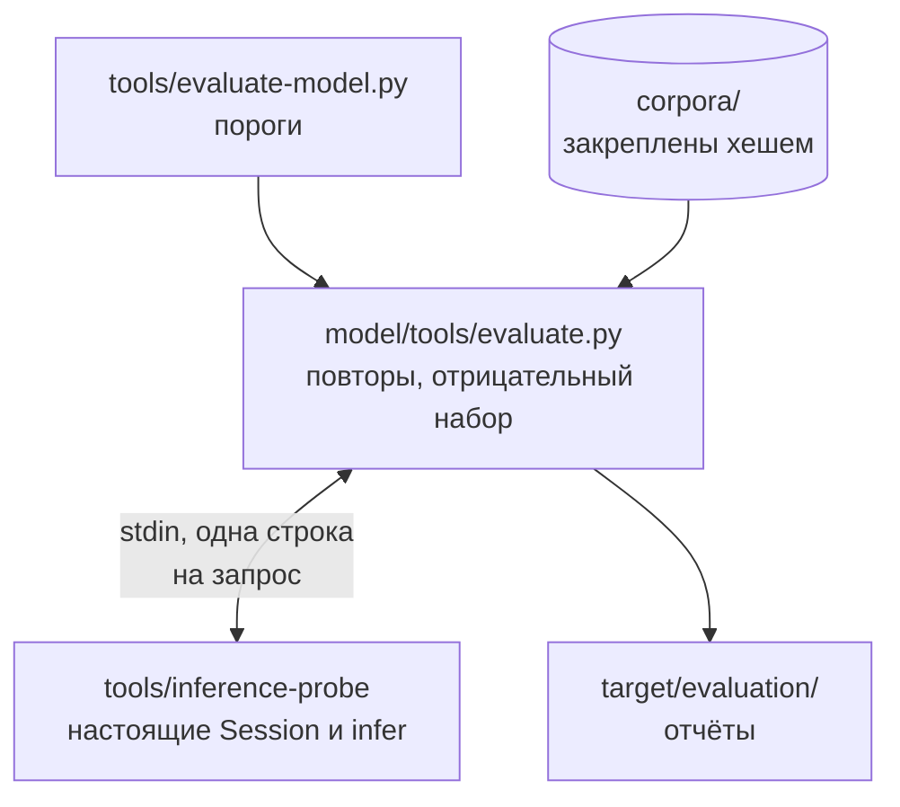

<!-- translation of model/README.md at ecd2022ec59fc84eebe5e882561dfc296c15c971 -->

# Исходные данные модели и оценка

В каталоге `model/` находятся данные и инструменты, используемые во время сборки для получения файла
`assets/model.bin`; во время работы программы ничто из этого каталога не читается. Каждый файл
закреплён побайтно: скрипт `tools/pack-model.py` в корне репозитория проверяет исходные данные
модели по хешу, `evaluate.py` сверяет корпуса с `data/evaluation-sources.json`, а в
`data/model-manifest.json` записаны хеши генератора и его закреплённых зависимостей.
Переформатировать, перекодировать или обрезать файлы в этом каталоге нельзя; файл `.gitattributes`
запрещает Git преобразовывать окончания строк и пробельные символы.

| Путь в `model/` | Содержимое |
| -- | -- |
| `data/model.inc.gz` | Частоты слов и символьные модели второго порядка для EN и RU, сжатые gzip |
| `data/model-manifest.json` | Хеши генератора, зависимостей, Python и исходных данных; версии пакетов; параметры модели |
| `data/model-notice.txt` | Указание авторства по лицензии CC BY-SA 4.0 для данных, полученных из wordfreq |
| `data/wordfreq-code-license.txt` | Уведомление о лицензии Apache-2.0 для кода wordfreq; на лицензию данных оно не влияет |
| `data/evaluation-sources.json` | Закреплённые URL источника, размер и SHA-256 каждого файла корпусов |
| `corpora/` | Выборки dev и test из UD English EWT и UD Russian Taiga вместе с их README и лицензиями |
| `tools/build_model.py` | Генератор `model.inc` на основе wordfreq 3.1.1 |
| `tools/model-requirements.{in,txt}` | Окружение Python для генератора, закреплённое хешами |
| `tools/evaluate.py` | Повтор сеансов и оценка на отрицательном наборе; запускается скриптом `tools/evaluate-model.py` в корне, который также проверяет пороги |

Словарь представляет собой нефильтрованные данные об употреблении слов из wordfreq и поэтому
содержит бранные и оскорбительные слова. Это сделано сознательно: движок никогда не предлагает слов,
а только решает, следует ли прочитать нажатия пользователя в другой раскладке, и отфильтрованное
слово, набранное в неверной раскладке, осталось бы неисправленным.

Для изучения исходных данных их следует распаковать и сравнить SHA-256 распакованного текста со
значением `model_sha256` в манифесте; хеш сжатого файла является другой величиной.

```console
$ python3 -c 'import gzip,pathlib; p=pathlib.Path("model/data/model.inc.gz"); p.with_suffix("").write_bytes(gzip.decompress(p.read_bytes()))'
$ shasum -a 256 model/data/model.inc
```

Для пересоздания модели необходимо создать отдельное виртуальное окружение, установить в него
зависимости из `tools/model-requirements.txt` с флагом `--require-hashes` и запустить
`tools/build_model.py`. Генератор записывает в каталог `data/` файлы `model.inc` и
`short-words.json`; первый из них нужно сжать gzip и сравнить хеши. Другая версия Python изменяет
манифест даже при совпадении байтов модели. После этого следует обновить закреплённые хеши в скрипте
`tools/pack-model.py` в корне и повторить оценку.



Программа оценки обменивается данными с `tools/inference-probe` через stdin: на каждую строку
запроса выдаётся одна строка ответа, каждая единица UTF-16 записывается четырьмя шестнадцатеричными
цифрами, а пустое значение — знаком `-`. Первый аргумент выбирает протокол; необязательные аргументы
вида `NAME=VALUE` переопределяют значения полей `Policy` по умолчанию (например, `minimum_zipf=3.5`)
и служат для перебора параметров на выборке dev.

| Протокол | Строка запроса | Строка ответа |
| -- | -- | -- |
| `word` | `en\|ru WORD_HEX CONTEXT_HEX` | `REASON<TAB>LOG10_SCORE<TAB>REPLACEMENT_HEX` |
| `session` | Сегменты `MODE:HEX`, разделённые пробелами | Документ после набора всех сегментов в шестнадцатеричной записи |

Протокол `session` набирает каждый сегмент по одной единице в его режиме (`en` или `ru`) через новый
`Session` и при этом ведёт себя как адаптер: проверяет каждый план, начинает слово только после
пробельного символа, при смене режима завершает слово и сбрасывает сеанс, а в конце завершает
последнее слово. Опечатки и транслитерации порождаются из закреплённых корпусов во время запуска
оценки, поэтому дополнительных файлов данных и доступа к сети не требуется.

## Лицензии

> [!NOTE]
> Юридическую силу имеют английский текст `model/README.md` и сами файлы уведомлений и лицензий;
> настоящий перевод приводится для удобства.

Производные данные о частотах и символах распространяются по лицензии CC BY-SA 4.0 и получены из
wordfreq 3.1.1 (автор Robyn Speer). Файл `model-notice.txt` и указанные в нём источники необходимо
хранить вместе с данными и с любым двоичным файлом, в который эти данные встроены. Корпуса EWT и
Taiga распространяются по лицензии CC BY-SA 4.0; их README и файлы лицензий находятся в каталоге
`corpora/`. README корпуса EWT ссылается на файлы исходного репозитория, которые сюда не скопированы
(см.
[закреплённый источник EWT](https://github.com/UniversalDependencies/UD_English-EWT/tree/4c89b5833a70aa5ed3a00bad2f23f57992cc7df8)).
